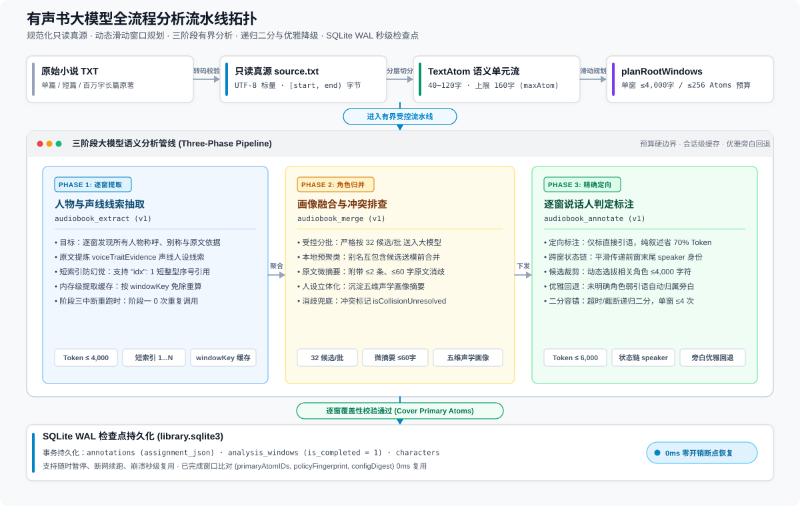
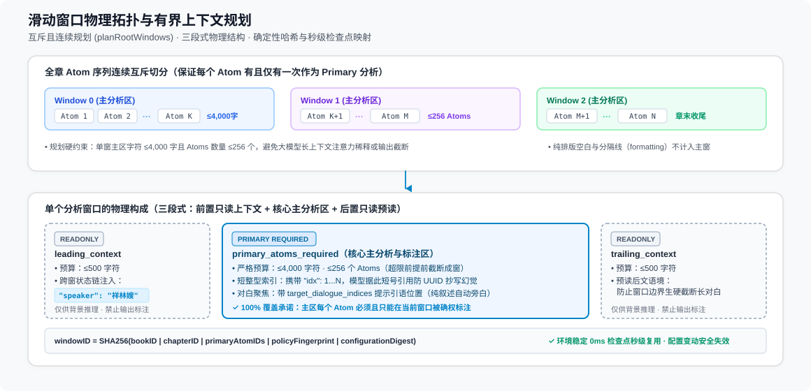
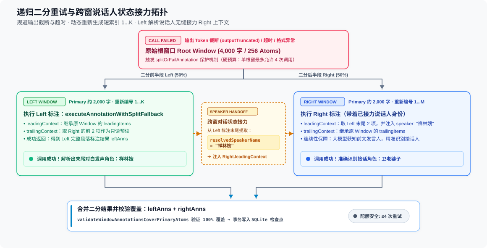

# 有声书工坊大模型全流程小说分析方案与架构规范

本文档全面规范 SpeechRail 有声书工坊（Audiobook Workshop）中，针对长篇小说（从数万字短篇到数百万字长篇）进行全书大模型语义理解、角色提炼、声学人设抽取、逐段说话人标注以及崩溃恢复的完整技术架构与实现流程。

---

## 1. 核心设计原则与架构边界



### 1.1 核心不变量
1. **只读真源保真（Lossless Source Text）**：
   正文导入后转化为规范化只读文件 `source.txt`（UTF-8 标量、LF 换行）。所有的切分单元（Atom）、章节（Chapter）、标注（Annotation）与语音切片（Fragment）**只记录正本上的半开字节区间 `[startByte, endByte)` 与 `sha256`**，禁止改写原文一个标点，禁止输出合成替代稿。
2. **预算硬边界与有界分析（Bounded Complexity）**：
   坚决禁止将整章或全书无截断地塞入单次 LLM 请求。任何模型交互必须受限于预设的字符与 Token 预算（单窗 Primary 4,000 字符 / 256 Atoms，Context 500 字符，单响应输出 4,000~6,000 Tokens）。
3. **全格式自适应（Universal Format Adaptability）**：
   切分与分析逻辑完全基于语言学规律与排版拓扑特征，严格禁止针对特定作品（如《西游记》、《彷徨》）编写特例补丁。
4. **优雅降级与确定性闭环（Graceful Degradation）**：
   大模型对于文学语境未明确指派角色的弱对白或内联引用，由系统自动安全回退为旁白（narrator），严禁因个别段落的语义分歧阻断全书处理流水线。

---

## 2. 文本导入与原子化建模（Atom Layer）

### 2.1 语义单元（`AudiobookTextAtom`）
文本在进入分析管线前，由 `AudiobookSourceIndex` 切分为细粒度的原子单元：
- **粒度目标**：单 Atom 长度约 40~120 字符，硬上限不超过 160 字符（`AudiobookLimits.maxAtomScalars`）。
- **结构类型**：
  - `heading`：章节标题；
  - `formatting`：纯排版空白或分隔线；
  - `body`：正文叙述或角色对白。

### 2.2 直接引语（Direct Dialogue）通用语言学判定
为了避免句中专有名词（如 `正在“祝福”了`）、古典字词引用（如 `稱個「老」字`）、篇名引用或借词强调（如 `所谓的“精英”`）被误判为独立对白，系统在 `AudiobookPromptAtomItem.isDirectDialogue(in:)`（位于 `AudiobookAnalysisPrompts.swift`）中实现了通用的直接引语特征识别：

命中以下条件之一，且仅当命中时，才判定为直接引语：
1. **行首对白（Dialogue Turn）**：去除首尾空白后，以开引号（`“`、`「`、`『`、`"`）起始；
2. **说话引导动词对白（Speech Verb Induced）**：开引号前紧邻冒号（`:` / `：`）或中文说话动词（`说`、`道`、`问`、`曰`、`喊`、`叫`、`答`、`云`、`喝`、`笑`、`叹`、`哭`、`骂`、`嗔`、`喃`、`嚷` 等）；
3. **独立长引语（Full Sentence Quote）**：引号内包含完整句终标点（`。！？`）且内部文本达到语义句长度（$\ge 4$ 字），或总引语长度 $\ge 10$ 字。

**句中内联短引用（$\le 4$ 字且无标点、前无说话动词）**：统一归为普通叙述，不强制要求大模型输出独立标注。

---

## 3. 滑动窗口规划（Sliding Window Planning）

单章长文本通过 `AudiobookAnalysisPipeline.planRootWindows` 分割为互斥且连续的根分析窗口（Root Windows）。



### 3.1 窗口规划参数（`AudiobookAnalysisPolicy`）
| 参数项 | 取值 | 作用与物理含义 |
|---|---|---|
| `maxPrimaryScalars` | 4,000 字符 | 单窗主分析区最大字符数上限，防止模型长文本注意力稀释 |
| `maxPrimaryAtoms` | 256 Atoms | 单窗 Atom 数量上限，防止单次 JSON 输出条目过多引发截断 |
| `maxContextScalarsPerSide` | 500 字符 | 单边前置/后置只读上下文预算，保证跨窗对白语义连续 |
| `minWindowScalars` | 64 字符 | 二分回退拆分的最小下限，防止过度碎片化 |
| `maxCallsPerRootWindow` | 4 次 | 单个根窗口最大允许的 LLM 调用次数（防止重试死循环） |
| `maxCharacterSummaryScalars` | 4,000 字符 | 单窗候选角色画像摘要总字符预算 |
| `maxFullRequestScalars` | 64,000 字符 | 包含指令、上下文与 Schema 的完整请求字符硬上限 |
| `extractionMaxOutputTokens` | 4,000 Tokens | 阶段一人物提取单次响应最大输出 Token 上限 |
| `mergeMaxOutputTokens` | 4,000 Tokens | 阶段二角色归并单次响应最大输出 Token 上限 |
| `annotationMaxOutputTokens` | 6,000 Tokens | 阶段三逐段标注单次响应最大输出 Token 上限 |
| `maxMergeCandidatesPerBatch` | 32 候选 | 阶段二每批受控送入归并的最大候选人物数 |
| `requestTimeoutSeconds` | 90 秒 | 单次大模型请求网络超时保护阈值 |

### 3.2 覆盖性与单调性原则
- 全章每个可读的非格式化 Atom，**有且仅有一次**作为某个窗口的 `primary_atoms_required`；
- 上下文区间仅作为模型推理的背景依据（带 `readonly` 标签），模型禁止对上下文输出标注条目；
- 窗口 ID 由 `(bookID, chapterID, primaryAtomIDs, policyFingerprint, configurationDigest)` 确定性哈希生成，保证环境变化时自动失效，环境稳定时确定性复用。

---

## 4. 三阶段流水线执行流程（Three-Phase Pipeline）

全书分析按照状态机严格执行三个阶段：

### 阶段一：逐窗实体与声线线索提取（Extraction）
- **职责**：通读各个窗口的正文，发现所有出场人物、对话发声者及其在原文中的声学特征描写。
- **输入**：`primary_atoms` + `leading_context` + `trailing_context`。
- **输出 Schema**：`audiobook_extract`
  ```json
  {
    "schema_version": "audiobook.extract.v1",
    "mentions": [
      {
        "surfaceName": "祥林嫂",
        "aliases": ["卫老婆子叫她嫂子"],
        "evidenceAtomIDs": ["2", "5"],
        "voiceTraitEvidence": "中年悲凉妇人，中低音区微带干哑，语速缓慢迟滞，神态木然"
      }
    ]
  }
  ```
- **关键设计**：
  - **证据短索引**：Prompt 支持模型以窗口内短整型序号（如 `"2"`）引用 Atom，避免模型输出 36 位长 UUID 导致 Token 膨胀及抄写幻觉；
  - **阶段一结果缓存**：提取结果按 `windowKey` 缓存于内存；若后续阶段三中断重跑，阶段一免除重复调用。

---

### 阶段二：全书角色归并与画像融合（Cast Consolidation & Merge）
- **职责**：将阶段一从全书各个窗口提取出的分散称谓（如“孙悟空”、“美猴王”、“老孙”、“齐天大圣”）归并为统一的规范角色，提炼五维声学人设画像，并排查重名冲突。
- **批次受控**：通过 `AudiobookCastRegistry.batchMentions` 严格按照 **32 个候选/批**（`maxMergeCandidatesPerBatch`）送入 LLM。
- **前置本地别名预聚类**：在请求 LLM 之前，若候选 A 的名称已直接包含在候选 B 的已知别名中，本地预先合并，大幅降低 LLM 调用负担。
- **原文微摘要注入（`evidenceExcerpts`）**：为每个候选角色附带最多 2 条、每条不超 60 字的原文字句摘录，使大模型具备足够上下文消歧。
- **输出 Schema**：`audiobook_merge`
  ```json
  {
    "schema_version": "audiobook.merge.v1",
    "groups": [
      {
        "canonicalName": "祥林嫂",
        "memberSurfaceNames": ["祥林嫂", "嫂子"],
        "aliases": ["嫂子"],
        "isCollisionUnresolved": false,
        "evidenceSummary": "中年女性，声线暗哑低沉，语速慢，情绪悲苦"
      }
    ]
  }
  ```
- **消歧兜底**：若存在同名不同人或关系无法确定，标记 `isCollisionUnresolved: true`，留给用户在工作台右侧角色栏人工复核。

---

### 阶段三：逐窗精确定向标注（Speaker Annotation）
- **职责**：带着阶段二提炼的角色库，重新遍历各个窗口，精确判定每个 Atom 的说话人（角色、旁白或未知）。
- **输入 Payload 结构**：
  - `primary_atoms_required`：主分析区 Atom 数组（包含字段：`atomID` 为 UUID 字符串，`kind` 为文本类型，`text` 为原文内容，`idx` 为 1-based 窗口内短整型序号 `1...N`，映射自 Swift 模型属性 `localIndex`）；
  - `leading_context_readonly`：前置只读上下文数组（结构同上，附带跨窗继承的 `speaker` 说话人名称字段，映射自 Swift 属性 `resolvedSpeakerName`）；
  - `trailing_context_readonly`：后置只读预读上下文数组（结构同上）；
  - `candidate_characters`：基于窗口文本动态选拔的候选角色数组（单次严格裁剪在 4,000 字符与 32 个候选以内，包含 `roleID`、`canonicalName`、`aliases`、`evidenceNote` 以及短代号 `roleKey: "R1", "R2"...`）；
  - `target_dialogue_indices`：当窗口内存在直接引语对白且少于全窗时，显式列出待标注对白的序号数组（如 `[2, 5, 8]`），为模型提供聚焦点。
- **Prompt 约定**：
  - 允许大模型**仅对含直接引语的对白段落输出标注**，纯叙述段落由客户端自动赋予旁白（节省 70% 输出 Token）；
  - 支持模型输出短序号（`atomID: "1"`）与短代号（`roleID: "R1"`），大幅压缩输出消耗并杜绝抄写幻觉。
- **跨窗口说话人状态链（Sliding Speaker Context）**：
  - 窗口 N 分析完成后，其末尾对白解析出的说话人身份会被塞入窗口 N+1 的 `leading_context_readonly` 对应 Atom 的 `speaker` 字段中；
  - 大模型借此获知前文最后是谁在说话，即使多轮对话被窗口切断，也能稳定识别接话人。
- **输出 Schema**：`audiobook_annotate`
  ```json
  {
    "schema_version": "audiobook.annotate.v1",
    "items": [
      {
        "atomID": "2",
        "speakerKind": "character",
        "roleID": "R1",
        "candidateRoleIDs": ["R1"],
        "confidence": 0.98,
        "evidence": "祥林嫂开口自语"
      }
    ]
  }
  ```

---

## 5. 解码校验、优雅降级与二分回退机制

### 5.1 本地覆盖性校验（`decodeAndValidateAnnotations`）
客户端收到模型 JSON 后，执行覆盖性校验：

```
对主窗口 primary_atoms 中的每一个 Atom 判决：
   ├─ 模型显式返回了标注项 ──────> 采用模型标注 (character / narrator / unknown)
   ├─ 模型未返回 ──┬─ 属于普通叙述或词级引用 ──> 确定性归属旁白 (narrator)
                   └─ 属于边缘或弱引语段落 ────> 优雅回退为旁白 (记录证据: 模型未显式指派角色，自动归属旁白)
```

- **消灭非黑即白的致命崩溃**：大模型经文学理解认为某句话不属于角色独立对白时，客户端由旁白承接，**绝不抛出致命 Coverage Violation 异常**。
- **整体性空响应拦截**：仅当窗口内存在明确对白、但大模型返回空数组（`items: []`）或完全无法解析时，才触发格式级异常。

### 5.2 递归二分回退机制（Binary Split Fallback）
当单窗由于情节过于复杂、输出 Token 耗尽截断（`outputTruncated`）或模型推理超时时，管线启动二分拆分重试：



1. **原子重排**：将 `primaryItems` 一分为二，重新计算短序号 `1...K` 和 `1...M`；
2. **上下文重建**：`Left` 的后部作为 `Right` 的 `leading_context`；
3. **状态接力**：`Left` 标注出的末尾角色名，实时注入 `Right` 的首部上下文；
4. **配额保护**：每个根窗口设定最大 4 次调用硬预算（`maxCallsPerRootWindow = 4`），超出即优雅暂停，保护用户 API 额度。

---

## 6. 存储设计、检查点与崩溃恢复（Persistence）

### 6.1 核心数据表结构
存储层采用 SQLite WAL 模式，位于 `<app_home>/audiobooks/library.sqlite3`：

- `books`：书籍元数据、全书分析状态（`analysis_state`：`notStarted` / `running` / `paused` / `failed` / `allWindowsValidated`）、生产状态与可听状态；
- `chapters`：章节划分及 UTF-8 字节区间（`lower_bound`, `upper_bound`, `excluded_ranges_json`）；
- `text_atoms`：切分后的 Atom 序列与只读区间（`lower_bound`, `upper_bound`, `kind`）；
- `characters`：提炼的角色库（`display_name`, `aliases_json`, `is_narrator`, `is_major`, `allow_shared_minor_voice`, `evidences_json` 存储五维声学摘要, `first_lower_bound`, `first_upper_bound`, `chapter_ids_json`）；
- `analysis_windows`：窗口规划信息与执行状态（`primary_atom_ids_json`, `leading_context_ids_json`, `trailing_context_ids_json`, `policy_fingerprint`, `configuration_digest`, `generation`, `is_completed`：0 或 1）；
- `annotations`：最终逐段标注结果（`lower_bound`, `upper_bound`, `assignment_json` 持久化 `AudiobookSpeakerAssignment` 角色归属或带候选的未知归属, `evidence`, `user_confirmed`, `annotation_revision`）。

### 6.2 检查点秒级复用
- 每当一个窗口在阶段三完成并验证通过后，事务性写入 `annotations` 并将对应 `analysis_windows.is_completed` 置为 1；
- 当分析过程因断网、模型额度超限、用户主动暂停或 App 退出后：
  再次启动分析时，管线对比 `(primaryAtomIDs, policyFingerprint, configurationDigest)`：
  **所有已完成的窗口直接从数据库加载复用，耗时 0 毫秒，大模型直接从未完成的窗口继续调度！**

---

## 7. 架构验收与质量基准

本分析方案在生产交付前必须通过以下场景验证（覆盖 `AudiobookAnalysisTests.swift` 与 `AudiobookAnalysisPromptTests.swift`）：
1. **百万字长篇压力测试（`testMillionCharacterBookUsesBoundedWindows`）**：
   合成 100 万字小说，验证窗口规划严格遵守 4,000 字符与 256 Atoms 预算，全书规划出 200+ 窗口，每个 Atom 恰好出现一次；
2. **直接引语通用语言学特征单测（`testDirectDialogueLinguisticHeuristics`）**：
   在 `AudiobookAnalysisPromptTests.swift` 中覆盖行首对白、动词/冒号引导对白、专有名词引号（如 `正在“祝福”了`）、古籍单字引用（如 `稱個「老」字`）与借词强调等场景，验证分词规则与模型期望完全一致；
3. **专有名词/词级短引用回退测试（`testInlineQuoteNarrativeGracefulFallbackWithoutCoverageViolation`）**：
   验证文本中包含专有名词引号且模型略过输出时，管线 100% 覆盖并通过验证，无异常中断；
4. **短索引/跨窗连续说话人状态链/阶段一缓存测试（`testShortIndexDialogueOnlyAnnotationSlidingSpeakerAndExtractionCache`）**：
   验证大模型使用短序号 `idx: "1"` 及短代号 `roleID: "R1"` 时客户端精确还原，验证跨窗 `resolvedSpeakerName` 连续流转，验证阶段一提取缓存零重复调用；
5. **断点续跑验证（`testResumeReusesOnlyMatchingCheckpoint`）**：
   前置窗口成功后人为中断，二次运行验证已完成窗口 100% 复用，大模型零重复调用；
6. **配置变更防脏写验证（`testCancelRejectsLateAnalysisAndSettingsChangeNeverChangesInFlightProvider`）**：
   分析途中若用户在设置中切换模型或修改地址，当前运行世代立即安全暂停，杜绝不同模型产物混合污染。
