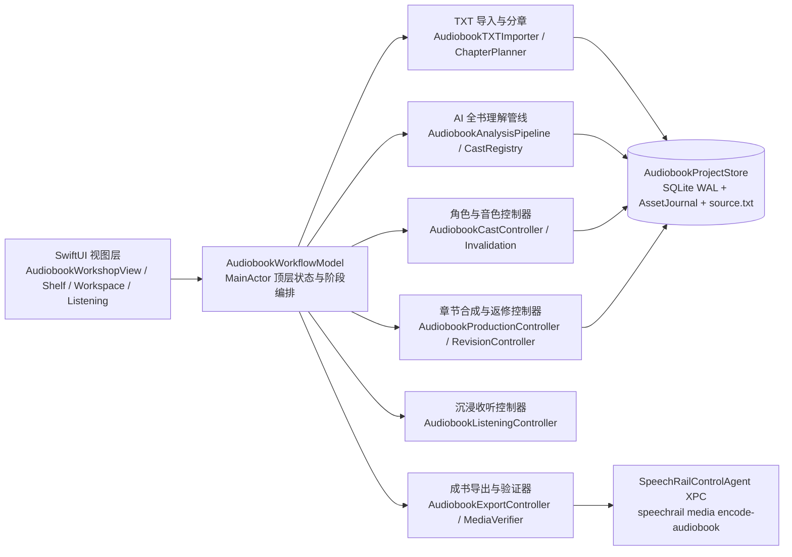

# 有声书工坊系统架构与边界合同

本文档规定 SpeechRail macOS App「有声书工坊」的架构分层、存储与崩溃恢复合同、大模型与语音合成预算边界，以及跨进程媒体封装协议。

## 1. 架构分层与单向职责边界

- **视图层无业务逻辑**：所有 SwiftUI 视图只绑定 `AudiobookWorkflowModel` 的只读投影并转发显式用户意图，全部样式取自 `SpeechRailDesignTokens`。
- **窄依赖注入**：`AudiobookWorkflowModel` 与各子控制器通过协议注入 LLM 调用 (`AudiobookLLMGenerating`)、TTS 渲染 (`AudiobookSpeechSynthesizing`)、能力读取 (`AudiobookCapabilityProviding`)、媒体导出 (`AudiobookMediaEncoding`) 与共享播放 (`SharedPlaybackOwner`)，不反向持有 `AppModel`。

## 2. 核心架构不变量

### 2.1 规范化只读原文与 UTF-8 字节区间真源
- 导入时将支持编码规范化为只读 `<app_home>/audiobooks/books/<book_id>/sources/<source_id>-source.utf8`（LF 换行、UTF-8 标量校验、最大 64 MiB）。
- 章节、文本原子、标注与片段通过规范化原文上的半开 UTF-8 字节区间定位。`AudiobookSourceIndex` 持有原文 `Data` 与标量起点索引，按区间切片；加载时复核书籍原文 SHA-256。

### 2.2 SQLite + `AudiobookAssetJournal` 崩溃恢复合同
- 数据库位于 `<app_home>/audiobooks/library.sqlite3`，开启 `PRAGMA journal_mode = WAL` 与 `PRAGMA foreign_keys = ON`。
- 候选 WAV 提交通过 sidecar 日志和 SQLite `asset_transactions` 登记。`recover()` 核对暂存与最终文件，补齐可恢复的候选提交，隔离已知损坏文件，并报告损坏的已登记候选。
- 未知音频保留并报告；当前与历史章节版本引用的候选保留，恢复不通过删除孤儿 WAV 猜测用户意图。
- Store 打开时记录遗留的运行中书籍及更新时间。首次 `recover()` 仅在记录未被后续工作更新时，将中断的分析与制作置为暂停；重复资产核查不暂停本进程的新任务。Workflow 的启动恢复共享同一个任务，成功后才标记完成，失败可重试。App 使用同一个 Store actor 编排作品库。
- `production_checkpoints` 按书籍保存任务 ID、章节范围、可选单段重录目标及已提交进度，和书籍制作状态原子更新。制作收尾在同一事务提交完成状态、对应的可收听状态和最终检查点；制作队列发布初始章节时保留版本与可收听状态的更新，制作终态仍由队列提交。最终事务开始后等待其保存结果，提交成功才发布完成进度，期间到达的暂停不会撤销已提交的完成结果。恢复以候选依赖摘要、回执与磁盘音频核验为依据，进度计数不替代媒体验证；单段续作只复用同一任务的候选，其他旧候选保留供比较和采用。进度不包含原文或服务错误正文。暂停记录写入失败时保持数据库原事务状态，并在内存进度与界面明确报告保存失败。
- 检查点表通过 `CREATE TABLE IF NOT EXISTS` 附加，书籍恢复区快照保留检查点。作品库 schema 为 2：schema 1 的一致性备份先于事务重建，`voice_bindings.voice_revision` 可空以表达合法 system 缺失身份，其余列、键与记录保留。检查点表及音频可保留；回退实现必须可读 schema 2，不能用旧快照覆盖迁移后的新作品。旧程序忽略任务检查点，不能提供相同的精确范围续作保证。
- 章节范围仅在尚未开始分析且没有分析、制作或资产记录时可重建，检查与写入位于同一数据库事务。重命名使用独立的标题更新，不删除章节行、标注、候选或版本；初始拆合同步旁白出场章节。

### 2.3 有界全书 AI 理解与低置信度护栏
- 章节分析按固定窗口（上限 12,000 UTF-8 字节，跨窗重叠 2 段上下文）顺序或受控并发调用 `LLMModule.audiobook`，单响应上限 256 KiB，严格使用 `LLMJSONParser` 解析并校验 schema。
- 说话人归属必须附带原文区间或显式上下文证据；低置信度、缺少证据或模型漏标的直接对白标记为 `unknown`，阻止对应章节制作，等待用户确认角色或明确选择旁白。纯叙述可以归旁白。

### 2.4 流式合成、48 kHz 主干采样率与精确脏传播
- 每个 `AudiobookFragment` 的签名由 `(sourceId, byteRange, textSha256, characterId, voiceId, voiceRevisionId, speedMillis, capabilityRevision)` 共同决定。
- TTS 响应流式读取受 8 MiB 硬上限保护；服务回执按原始 PCM 核验，本地制作音频按渲染策略转换为 **48 kHz 单声道 16-bit PCM WAV**，候选的帧数、`file_sha256` 与 `pcm_sha256` 均描述本地转换产物。
- 修改单句、重派单段角色或更换某角色音色时，`AudiobookInvalidation` 只将签名变化的切片标为 `stale`，其余切片与章节保持 `ready`。
- 单段重录使用同一制作门禁与生命周期，跳过目标片段的候选复用，只生成一个新候选。新候选不自动替换当前章节版本，采用与撤销由 `AudiobookRevisionController` 完成。

### 2.5 选角规划、原子提交与声音准入

- Registry 以完整能力及目录快照纯计算选角方案，canonical ID 计数，旁白占用容量；未知归属、归档、他书专用、未就绪或参数能力未知均不入池，目录 key/记录身份错配按损坏拒绝。来源角色只影响排序。空池不扩大可见范围；已有绑定保守锁定，自动补全只处理未绑定角色，新增共享建议均须显式接受。
- Store 准备方案时附加原文与章节上下文，并以完整标注证明必需发声角色集合；零台词角色的旧绑定保留但不占发声容量，重新发声后恢复约束。提交事务比较角色、标注、绑定及来源摘要，整批保存绑定、可表达的共享政策与确认失效。生成音色的返回上下文还冻结绑定集合摘要，防止覆盖等待期间的新选择。能力和目录在事务前预检，并在每个新渲染请求前重检；这些跨组件检查不构成联合事务。进行中候选可保留为待复核，不能伪造可采用状态。
- 合成冻结模型/声音身份和参数，正式路径使用严格输出准入。clone 无 caller seed、速度为 1；支持路径的种子使用 header。回执事实与请求预期分离，未知身份不补齐；仅合法 system 允许缺少声音 revision。具体规则与后续资产演进见 [大规模选角规格](../developers/audiobook-mass-casting-spec.md)。

### 2.6 受控 XPC 媒体封装 (`speechrail media encode-audiobook`)
- Swift 侧不直接拼装 shell 命令或调用外部 `ffmpeg`；`AudiobookExportController` 导出前核对已采用候选的资产 SHA-256，按候选帧数与采样率独立计算章节预期时长，并写出 `<app_home>/audiobooks/exports/<request_id>/request.json`。
- `SpeechRailControlAgent` 仅允许白名单子命令 `["media", "encode-audiobook", "--app-home", ..., "--request-id", ..., "--format", "json"]`。Python `speechrail.media` 校验路径不越界、拒绝符号链接、复核输入 SHA-256，并以 `ffmpeg` 编码媒体和写入章节元数据。
- `AudiobookMediaVerifier` 使用 `AVURLAsset` 读取实际音轨、编码与时长，不能读取时拒绝导出；分章 MP3 逐个核对文件名及章节时长。实际媒体 SHA-256 必须匹配编码结果清单；提交前重新验证目标旁的临时副本，并与准备阶段摘要一致后原子安装。
- M4B 使用 AVFoundation 读取实际章节元数据组，核对章节数量、按时间排序的标题及每章起止位置。预期起止位置由逐章帧数累计计算，并与整本帧数一致；章节边界允许一个 codec frame 的容差（24 ms）。缺少或无法读取章节时拒绝导出，返回的 `chapterTitles` 来自实际媒体。
