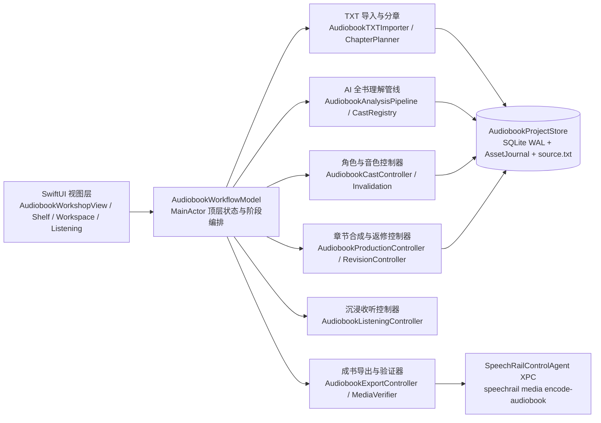

# 有声书工坊系统架构与边界合同

本文档规定 SpeechRail macOS App「有声书工坊」的架构分层、存储与崩溃恢复合同、大模型与语音合成预算边界，以及跨进程媒体封装协议。

## 1. 架构分层与单向职责边界

- **视图层无业务逻辑**：所有 SwiftUI 视图只绑定 `AudiobookWorkflowModel` 的只读投影并转发显式用户意图，全部样式取自 `SpeechRailDesignTokens`。
- **窄依赖注入**：`AudiobookWorkflowModel` 与各子控制器通过协议注入 LLM 调用 (`AudiobookLLMGenerating`)、TTS 渲染 (`AudiobookSpeechSynthesizing`)、能力读取 (`AudiobookCapabilityProviding`)、媒体导出 (`AudiobookMediaEncoding`) 与共享播放 (`SharedPlaybackOwner`)，不反向持有 `AppModel`。

## 2. 核心架构不变量

### 2.1 加工文本修订与 UTF-8 字节区间
- TXT 导入分别封存原始文件、严格解码的 UTF-8 参考文本与加工后的 UTF-8 工作文本。`AudiobookTextPreparation` 复用排版分类，连接段内折行，保留自然段、独立对白、诗行、字形和正文；不做繁简转换或文字纠错。工作文本在分章前生成，版本为 `audiobook_text_preparation_v1`，原文件与加工结果均受导入预算约束。
- 编码歧义不阻断核对：GB18030 等非 UTF-8 但可严格解码的字节流以临时选择进入预览，并标记 `requiresEncodingConfirmation`；用户确认或切换编码后重新生成预览。非法或有损字节仍拒绝导入。
- TXT 与 EPUB 共用同一份规范纯文本真源：EPUB 只读解析容器/OPF/spine 与 XHTML，转成纯文本后再进入导入、分章与重复内容检查；不执行脚本/样式，不保存原始压缩包。
- 书稿自带的目录页（目录标记或后文重复章名，且连续章名之间只隔页码/点引线）识别为 `tableOfContentsRanges`，作为相关章节的 `excludedRanges`。目录字节仍在章节覆盖内，但不生成文本原子、不进入分析、制作或朗读；预览与阅读投影同样跳过排除区间。
- 章节、文本原子、AI primary/context、角色证据、试听、发音词条命中、合成、重录与文字元数据共用工作修订的半开 UTF-8 字节区间。`text(in:)` 直接切片；生产阶段不再动态连行。`workingSourceSnapshot` 校验工作文件、参考文件、来源映射和 SHA-256，文件损坏时拒绝制作。
- 来源映射同时保留逻辑段落的原始标题候选证据，不从加工生成的空行重新推断篇名。来源映射中的参考区间指向解码后的 UTF-8，不指向 UTF-16/GB18030 原文件。保留内容使用准确字节范围；生成的空白映射到排版间隙，删除的空白不伪装为一一对应偏移。原文只经明确的参考入口读取。
- 旧作品启动时只补元数据并标记为 `reference`，不重写正文、坐标、角色或音频。新分析/制作必须先显式准备工作修订；准备生成新 source、章节、atom 和角色 ID，暂存并读回校验后，在事务中比较预期 source 再切换指针。失败或取消不改变活动修订。回退切换已有修订指针，不恢复旧数据库覆盖后续作品。
- 派生查询按活动 source 隔离；新修订重新分析，不沿用旧角色证据、音色确认或候选依赖。部分制作的已有章节也在切换前保存生产快照；历史音频仍按其章节/生产修订读取，可明确选择历史生产版本导出。恢复区快照保留全部 source、派生行和音频引用。

### 2.2 SQLite + `AudiobookAssetJournal` 崩溃恢复合同
- 数据库位于 `<app_home>/audiobooks/library.sqlite3`，开启 `PRAGMA journal_mode = WAL` 与 `PRAGMA foreign_keys = ON`。
- 候选 WAV 提交通过 sidecar 日志和 SQLite `asset_transactions` 登记。`recover()` 核对暂存与最终文件，补齐可恢复的候选提交，隔离已知损坏文件，并报告损坏的已登记候选。
- 未知音频保留并报告；当前与历史章节版本引用的候选保留，恢复不通过删除孤儿 WAV 猜测用户意图。
- Store 打开时记录遗留的运行中书籍及更新时间。首次 `recover()` 仅在记录未被后续工作更新时，将中断的分析与制作置为暂停；重复资产核查不暂停本进程的新任务。Workflow 的启动恢复共享同一个任务，成功后才标记完成，失败可重试。App 使用同一个 Store actor 编排作品库。
- `production_checkpoints` 按书籍保存 source ID、加工版本、任务 ID、章节范围、可选单段重录目标及已提交进度，和书籍制作状态原子更新。制作收尾在同一事务提交完成状态、对应的可收听状态和最终检查点；制作队列发布初始章节时保留版本与可收听状态的更新，制作终态仍由队列提交。最终事务开始后等待其保存结果，提交成功才发布完成进度，期间到达的暂停不会撤销已提交的完成结果。恢复以候选依赖摘要、回执与磁盘音频核验为依据，进度计数不替代媒体验证；单段续作只复用同一任务的候选，其他旧候选保留供比较和采用。进度不包含原文或服务错误正文。暂停记录写入失败时保持数据库原事务状态，并在内存进度与界面明确报告保存失败。
- 作品库 schema 为 7，冻结结构位于 `contracts/audiobook-schema/v7.sql`。schema 6→7 增加 source 身份、参考 source、加工版本、映射资产与摘要、可回退的工作状态，以及角色 source 归属；升级只补元数据。SQLite backup API 保留一致性副本，事务成功才推进版本。旧程序拒绝打开更高版本；回退代码须支持 schema 7，不能用旧数据库覆盖新作品。
- `VoiceCatalogStore` 分离可用范围与生命周期，目录原子保存后才发布通知。设计/克隆返回先写可恢复意图，再幂等登记书籍专用范围，最后提交绑定；新选择和归属冲突保留待确认。配声撤销新增恢复修订，不改写历史候选与采用版本。
- 章节范围仅在尚未开始分析且没有分析、制作或资产记录时可重建，检查与写入位于同一数据库事务。重命名使用独立的标题更新，不删除章节行、标注、候选或版本；初始拆合同步旁白出场章节。

### 2.3 有界全书 AI 理解与低置信度护栏
- 章节分析按固定窗口（单窗 primary 上限 4,000 Unicode 标量 / 256 个 atom，前后各最多 500 标量上下文）顺序或受控并发调用 `LLMModule.audiobook`，单响应上限 256 KiB，严格使用 `LLMJSONParser` 解析并校验 schema。
- 说话人归属必须附带原文区间或显式上下文证据；低置信度、缺少证据或模型漏标的直接对白标记为 `unknown`，阻止对应章节制作，等待用户确认角色或明确选择旁白。纯叙述可以归旁白。
- 重跑分析或二次消歧不得覆盖用户 `user_confirmed` 的归属：窗口标注落库前按 atomID 合并已确认行，保留原 id、来源窗口与修订。二次消歧每簇前检查取消并有默认 200 次调用上限，超限保留剩余 `unknown` 交给人工，不无限重试。
- 分析失败只持久化低基数错误码、可行动提示、时间与失败窗口序号（`analysis_failure_json`），不保存服务错误正文、prompt 或原文；成功或取消会清除，重开作品仍能看到原因。

### 2.4 流式合成、48 kHz 主干采样率与精确脏传播
- 每个 `AudiobookFragment` 的签名包含工作 source ID、加工版本、来源内容、字节区间、有效角色归属、绑定的声音/模型身份、速度/种子及渲染政策。签名不依赖 atom 重分块身份或一次性能力 snapshotID；无关目录变化不全量失效。
- TTS 响应流式读取受 8 MiB 硬上限保护；服务回执按原始 PCM 核验，本地制作音频按渲染策略转换为 **48 kHz 单声道 16-bit PCM WAV**，候选的帧数、`file_sha256` 与 `pcm_sha256` 均描述本地转换产物。
- 修改单句、重派单段角色或更换某角色音色时，`AudiobookInvalidation` 只将签名变化的切片标为 `stale`，其余切片与章节保持 `ready`。
- 单段重录使用同一制作门禁与生命周期，跳过目标片段的候选复用，只生成一个新候选。新候选不自动替换当前章节版本，采用与撤销由 `AudiobookRevisionController` 完成。
- 发音词表是独立于角色/音色的第三类渲染依赖：书级词表按不可变 revision 绑定，请求以 `SpeechRail-Pronunciation-Set` 固定 set@revision；片段依赖只并入命中词条的规范化哈希，未命中片段不失效。词表冲突不自动合并，必须由用户刷新到最新 revision 后再次保存。

### 2.5 选角规划、原子提交与声音准入

- Registry 以完整能力及目录快照纯计算选角方案，canonical ID 计数，旁白占用容量；未知归属、归档、他书专用、未就绪或参数能力未知均不入池，目录 key/记录身份错配按损坏拒绝。来源角色只影响排序。空池不扩大可见范围；已有绑定保守锁定，自动补全只处理未绑定角色，新增共享建议均须显式接受。
- Store 准备方案时附加原文与章节上下文，并以完整标注证明必需发声角色集合；零台词角色的旧绑定保留但不占发声容量，重新发声后恢复约束。提交事务比较角色、标注、绑定及来源摘要，整批保存绑定、可表达的共享政策与确认失效。生成音色的返回上下文还冻结绑定集合摘要，防止覆盖等待期间的新选择。能力和目录在事务前预检，并在每个新渲染请求前重检；这些跨组件检查不构成联合事务。进行中候选可保留为待复核，不能伪造可采用状态。
- 合成冻结模型/声音身份和参数，正式路径使用严格输出准入。clone 无 caller seed、速度为 1；支持路径的种子使用 header。回执事实与请求预期分离，未知身份不补齐；仅合法 system 允许缺少声音 revision。具体规则与后续资产演进见 [大规模选角规格](../developers/audiobook-mass-casting-spec.md)。

### 2.6 受控 XPC 媒体封装 (`speechrail media encode-audiobook`)
- Swift 侧不直接拼装 shell 命令或调用外部 `ffmpeg`；`AudiobookExportController` 导出前核对已采用候选的资产 SHA-256，按候选帧数与采样率独立计算章节预期时长，并写出 `<app_home>/audiobooks/exports/<request_id>/request.json`。
- `SpeechRailControlAgent` 仅允许白名单子命令 `["media", "encode-audiobook", "--app-home", ..., "--request-id", ..., "--format", "json"]`。Python `speechrail.media` 校验路径不越界、拒绝符号链接、复核输入 SHA-256，并以 `ffmpeg` 编码媒体和写入章节元数据。
- `AudiobookMediaVerifier` 使用 `AVURLAsset` 读取实际音轨、编码与时长，不能读取时拒绝导出；分章 MP3 逐个核对文件名及章节时长。实际媒体 SHA-256 必须匹配编码结果清单；提交前重新验证目标旁的临时副本，并与准备阶段摘要一致后原子安装。
- M4B 使用 AVFoundation 读取实际章节元数据组，核对章节数量、按时间排序的标题及每章起止位置。预期起止位置由逐章帧数累计计算，并与整本帧数一致；章节边界允许一个 codec frame 的容差（24 ms）。缺少或无法读取章节时拒绝导出，返回的 `chapterTitles` 来自实际媒体。
- 封面随请求清单版本协商：带封面时写 `audiobook_media_export_v2`，封面路径固定为 `books/<book_id>/cover/cover.<jpg|jpeg|png>` 并附图像 SHA-256；服务端仅接受该固定文件名、限 8 MiB、拒绝 `chapter_mp3` 配封面。旧服务不识别 v2 时返回可见失败，不静默丢弃封面。
- `AudiobookMediaVerifier` 以 AVFoundation 复核封面：请求要求封面时必须能读到封面图，未要求时不得存在封面图；缺失或多余均拒绝导出。检测同时覆盖 `commonIdentifierArtwork` 元数据与非音频图形轨，避免 FFmpeg 附加图未被暴露为美术元数据时误判为「无封面」。
- 交付响度归一同为 v2 的可选扩展：清单带 `loudness` 时，服务先对拼接后的整本节目测量一次，再以测得的 I/LRA/TP/thresh/offset 施加线性增益，M4B 与分章 MP3 共用同一组测量值，因此同一本书内不会逐章漂移。`unit` 固定 `lufs`（按 ITU-R BS.1770-4 计量），`target_i` 必填，`true_peak_db` 与 `loudness_range` 有默认值和范围校验，未知字段拒绝；受管 `ffmpeg` 缺少 `loudnorm` 时直接拒绝导出，不静默产出未归一的媒体。默认值是叙事长内容的产品默认值，不构成 ACX/Audible 合规承诺。
- 导出准备由 Workflow 持有 requestID，可在编码阶段取消；取消后不安装目标文件。提交前对已存在的 M4B 文件或 MP3 目录都必须有与目标绑定的显式覆盖确认，目录不被静默整体替换。整本 M4B 的完整性门槛忽略用户显式跳过的章节，但跳过项仍进入 omitted 清单。
- 导出面板用 `AudiobookExportController.audit` 做只读预检：与 `prepare` 共用 `buildPlan`，逐章判定缺分析、待确认说话人、无当前音频、当前版本失效、候选资产缺失或空片段，只统计未跳过章节；有阻塞时禁用整本 M4B，并提供定位到首个阻塞章节的入口。该预检不写文件、不保存生产版本，也不替代最终媒体帧/编码校验；准备或保存失败仍内联显示在面板中。
- 收听入口只选择未跳过且已有当前/上一版本音频的章节；没有任何可听章节时进入听书模式显示制作引导，不启动空白播放器。

### 2.7 章节跳过与覆盖完整性
- `chapters.is_skipped` 是用户显式选择，不是删除：原文、章节字节范围、已有标注/候选/版本全部保留。分析窗口规划、二次消歧、制作选章和导出均排除跳过章节；恢复只清标记。
- 制作前以正文可读原子校验片段覆盖：缺失或重复标注直接拒绝生成，不能以“少读一段”换取制作成功。该检查与角色、音色校验同属制作门禁，失败不产生候选。
