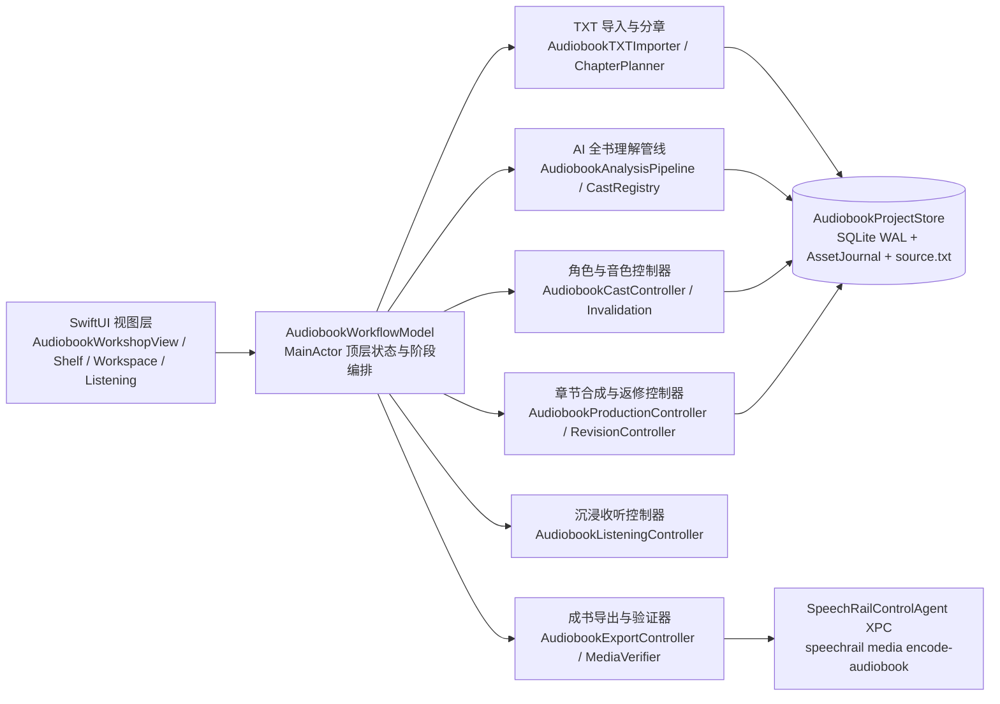

# 有声书工坊系统架构与边界合同

本文档规定 SpeechRail macOS App「有声书工坊」的架构分层、存储与崩溃恢复合同、大模型与语音合成预算边界，以及跨进程媒体封装协议。

## 1. 架构分层与单向职责边界

- **视图层无业务逻辑**：所有 SwiftUI 视图只绑定 `AudiobookWorkflowModel` 的只读投影并转发显式用户意图，全部样式取自 `SpeechRailDesignTokens`。
- **窄依赖注入**：`AudiobookWorkflowModel` 与各子控制器通过协议注入 LLM 调用 (`AudiobookLLMGenerating`)、TTS 渲染 (`AudiobookSpeechSynthesizing`)、能力读取 (`AudiobookCapabilityProviding`)、媒体导出 (`AudiobookMediaEncoding`) 与共享播放 (`SharedPlaybackOwner`)，不反向持有 `AppModel`。

## 2. 核心架构不变量

### 2.1 规范化只读原文与 UTF-8 字节区间真源
- 导入时将任意支持编码流式转码为只读 `<app_home>/audiobooks/books/<book_id>/source/source.txt`（LF 换行、UTF-8 标量校验、最大 64 MiB）。
- `chapters`、`paragraphs`、`blocks`、`speaker_evidences`、`fragments` 全部只存 `source.txt` 上的半开 UTF-8 字节区间 `[startByte, endByte)` 与 `text_sha256`，由 `AudiobookSourceIndex` 按需切片读取，杜绝正本与数据库文本漂移。

### 2.2 SQLite + `AudiobookAssetJournal` 崩溃恢复合同
- 数据库位于 `<app_home>/audiobooks/audiobooks.sqlite3`，开启 `PRAGMA journal_mode = WAL` 与 `PRAGMA foreign_keys = ON`。
- 合成新 WAV、切换采用候选或清理废弃候选时，必须先写入 `asset_journal_entries`：
  - 启动恢复 (`reconcileOnLaunch`) 自动清理 `staged` 临时文件并删除无数据库行引用的孤儿 WAV；
  - 当前 `adopted_candidate_id` 与 `revision_history` 引用的全部历史 WAV 受外键与引用集合双重保护，清理操作绝不误删可撤销资产。

### 2.3 有界全书 AI 理解与低置信度护栏
- 章节分析按固定窗口（上限 12,000 UTF-8 字节，跨窗重叠 2 段上下文）顺序或受控并发调用 `LLMModule.audiobook`，单响应上限 256 KiB，严格使用 `LLMJSONParser` 解析并校验 schema。
- 说话人归属必须附带原文区间或显式上下文证据；置信度低于阈值 (`< 0.65`) 或缺少证据的对白自动标记为 `needsConfirmation` 并绑定旁白音色回退，不编造角色。

### 2.4 流式合成、48 kHz 主干采样率与精确脏传播
- 每个 `AudiobookFragment` 的签名由 `(sourceId, byteRange, textSha256, characterId, voiceId, voiceRevisionId, speedMillis, capabilityRevision)` 共同决定。
- TTS 响应流式读取受 8 MiB 硬上限保护；合成音频统一重采样并归一化为 **48 kHz 单声道 16-bit PCM WAV**，落盘后计算 `file_sha256`、`pcm_sha256`、峰值与静音比例。
- 修改单句、重派单段角色或更换某角色音色时，`AudiobookInvalidation` 只将签名变化的切片标为 `stale`，其余切片与章节保持 `ready`。

### 2.5 受控 XPC 媒体封装 (`speechrail media encode-audiobook`)
- Swift 侧不直接拼装 shell 命令或调用外部 `ffmpeg`；`AudiobookExportController` 在导出前用 `AudiobookMediaVerifier` 逐一核对输入 WAV 的 SHA-256 与帧数，写出 `<app_home>/audiobooks/exports/<request_id>/request.json`。
- `SpeechRailControlAgent` 仅允许白名单子命令 `["media", "encode-audiobook", "--app-home", ..., "--request-id", ..., "--format", "json"]`，Python `speechrail.media` 校验路径不越界、拒绝符号链接、复核输入 SHA-256，并在编码完成后用 `ffprobe` 与 Swift `AVURLAsset` 双重验证输出时长、音轨和章节数。
