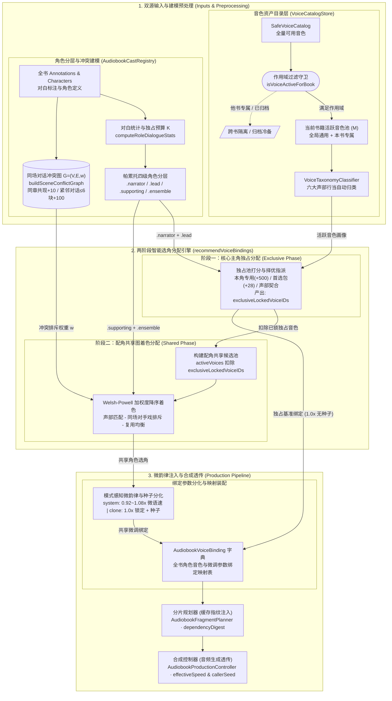

# 有声书工坊大规模角色配音与 100+ 音色库分级架构规范

本文档规范 SpeechRail 有声书工坊（Audiobook Workshop）在长篇多人小说（单书 50～200+ 出场角色）场景下的**自适应四级角色分层、主配角双池音色分配、带权同场对话冲突图着色、模式感知微韵律分化**，以及当用户音色资产突破 **100～500+** 时的**三层作用域隔离、六维声部行当分面分类、剧团音色包与智能选角交互架构**。

---

## 1. 核心设计原则与架构不变量

### 1.1 六大核心不变量

1. **主角独占与配角共享物理隔离（Dual-Pool Isolation）**：
   全书可用音色在逻辑上严格切分为「旁白与核心主角独占池（Exclusive Pool）」与「配角行当共享池（Shared Repertory Pool）」。凡被旁白或核心主角（`allowSharedMinorVoice == false`）锁定的音色，除非全书可用音色总数低于主角人数，否则严禁分配给任何配角或群演，从根源消除主配角撞声与 `.duplicateVoiceRequiresSharedMinorConsent` 绑定死锁。
2. **帕累托自适应主次分层（Pareto-Bounded Cast Stratification）**：
   角色主次层级不采用固定句数硬编码，而是由全书已归属对白的帕累托分布（前 75% 累计对白量）与当前可用音色池预算 $K = \min(6, \max(1, M - 2))$ 联合决定，确保在音色受限环境下优先保障高频核心主角的声线独占。
3. **同场对手戏零撞音优先（Scene Co-occurrence Repulsion）**：
   共享音色池内的配角分配必须受同场对话共现图 $G = (V, E, w)$ 约束。在同一章节相邻 $\le 6$ 个原文块（Atom）内发生交替对话的角色对拥有最高排斥权重，着色器优先为其指派不同音色。
4. **模式感知微韵律与声纹保真守卫（Mode-Aware Micro-Prosody Guard）**：
   当多个配角共用同一音色时，韵律分化严格遵循音色底层合成模式契约：
   - **`system` 预设音色**：允许在 `[0.92, 1.08]` 安全区间内施加确定性微语速偏移与固定随机种子；
   - **`clone` / `design` 克隆与设计音色**：语速强制锁定为 `1.0`（防止声纹畸变或触发服务端参数拒绝），仅通过确定性采样种子（`callerSeed`）在呼吸、停顿与微语调上产生可复现分化。
5. **零台词背景人物门禁豁免（Silent Role Gate Exemption）**：
   在大模型阶段一/二被提取进角色表、但在阶段三全书对白归属中实际发声块数 `dialogueAtomCount == 0` 的“仅提及人物”，自动归入 `.ensemble` 层级并豁免 `confirmCast` 强制配声门禁。
6. **跨书专用音色作用域隔离（Book-Scoped Voice Isolation）**：
   从某本书角色卡片跳转「AI 设计新音色」或「录音克隆」生成的角色定制音色，默认绑定 `VoiceAssetScope.bookExclusive` 与来源 `originBookID` / `originRoleID`。该音色在所属书籍内享有最高自动匹配优先级，对其他书籍及演播台默认隐藏，直至用户显式执行「晋升为全局通用音色」。

### 1.2 端到端数据流拓扑



---

## 2. 领域模型与持久化规范（`AudiobookDomain.swift`）

### 2.1 四级角色分层模型（`AudiobookRoleTier` & `AudiobookRoleDialogueStats`）

| 枚举值 | 中文名称 | 声线独占策略 | 典型角色特征 | 合成确认门禁 (`confirmCast`) |
| :--- | :--- | :--- | :--- | :--- |
| `.narrator` | 旁白 | **强制独占** (`isMajor = true`, `allowSharedMinorVoice = false`) | 全书叙述者 | 必须绑定可合成音色 |
| `.lead` | 核心主角 | **强制独占** (`isMajor = true`, `allowSharedMinorVoice = false`) | 处于全书累计 75% 对白帕累托前沿且在独占预算 $K$ 内 | 必须绑定可合成音色 |
| `.supporting` | 重要配角 | **共享池防撞色复用** (`isMajor = false`, `allowSharedMinorVoice = true`) | 有多轮对话或跨章登场，但超出独占预算或未达主角阈值 | 只要 `dialogueAtomCount > 0` 即须绑定 |
| `.ensemble` | 龙套群演 | **声部基准池共享** (`isMajor = false`, `allowSharedMinorVoice = true`) | 单章仅 1 句台词的路人，或 `dialogueAtomCount == 0` 的仅提及人物 | `dialogueAtomCount == 0` 时**自动豁免门禁** |

`AudiobookRoleDialogueStats` 结构体的精确字段契约如下：

```swift
public struct AudiobookRoleDialogueStats: Codable, Hashable, Sendable {
    public var roleID: UUID
    public var dialogueAtomCount: Int   // 全书归属给该角色的非格式化 Atom 总数
    public var dialogueCharCount: Int   // 估算对白总字数（按 UTF-8 字节数 / 3 折算下限）
    public var chapterCount: Int        // 实际发生对白或登场的去重章节数
    public var dialogueShare: Double    // 占全书非旁白总对白句数的比例 [0.0, 1.0]
    public var tier: AudiobookRoleTier  // 自适应推导的四级角色层级

    /// 旁白或拥有至少 1 句对白的角色必须绑定音色；0 台词背景人物豁免
    public var requiresVoiceBinding: Bool {
        tier == .narrator || dialogueAtomCount > 0
    }
}
```

### 2.2 六大标准声部行当（`AudiobookVoiceArchetype`）

为解决 100+ 音色与数十名配角的快速匹配问题，系统将角色人设与音色资产统一映射到正交的六大标准声部行当：

| 枚举值 (`rawValue`) | 界面标题 (`title`) | 紧凑徽标 (`shortBadgeTitle`) | 性别维 | 年龄维 | 典型声学特征与适用行当 |
| :--- | :--- | :--- | :--- | :--- | :--- |
| `.youngMale` (`young_male`) | 青年男声 | 青年男 | 男 (`male`) | 青年 | 清亮、阳光、少年、公子、侍卫、年轻侠客 |
| `.matureMale` (`mature_male`) | 沉稳中年男声 | 中年男 | 男 (`male`) | 中年 | 浑厚、中低音、沉稳、掌柜、将军、父亲、旁白 |
| `.elderMale` (`elder_male`) | 苍老老者男声 | 老年男 | 男 (`male`) | 老年 | 沙哑、苍老、低沉、老叟、族长、长老、老掌柜 |
| `.youngFemale` (`young_female`) | 清亮青年女声 | 青年女 | 女 (`female`) | 青年 | 清脆、明快、甜美、少女、小姐、丫鬟、女侠 |
| `.matureFemale` (`mature_female`) | 成熟温柔女声 | 成熟女 | 女 (`female`) | 中年 | 温婉、知性、柔和、母亲、夫人、掌门师姐、女旁白 |
| `.elderOrChild` (`elder_or_child`) | 慈祥老妪与童声 | 老幼特型 | 中性/特型 | 老妪/幼童 | 慈祥老妇、婆婆、祖母、男童、女童、孩童 |

同性别兜底关系（`isSameGenderGroup`）：
- 男性组：`{.youngMale, .matureMale, .elderMale}`；
- 女性组：`{.youngFemale, .matureFemale, .elderOrChild}`。

### 2.3 100+ 音色三层作用域与扩展元数据（`VoiceAssetScope` & `VoiceAssetMetadata`）

在不破坏后端 `SafeVoiceEntry` / `CreatorVoice` 协议的前提下，客户端通过 `VoiceCatalogStore` 维护每个 `voiceID` 的生命周期作用域与分类元数据：

```swift
public enum VoiceAssetScope: String, Codable, Sendable, CaseIterable, Identifiable {
    case globalReusable = "global_reusable" // 全局通用常备音色
    case bookExclusive  = "book_exclusive"  // 特定书籍剧组专用音色
    case archived       = "archived"        // 已归档冷备音色
}

public enum VoiceCreationSource: String, Codable, Sendable, CaseIterable {
    case systemBuiltIn  = "system_builtin"  // 系统内置预设音色
    case voiceDesign    = "voice_design"    // AI 音色设计生成
    case voiceClone     = "voice_clone"     // 参考音频克隆生成
    case externalImport = "external_import" // 外部导入
}

public struct VoiceAssetMetadata: Codable, Hashable, Sendable, Identifiable {
    public var id: String { voiceID }
    public var voiceID: String
    public var scope: VoiceAssetScope
    public var originBookID: UUID?
    public var originBookTitle: String?
    public var originRoleID: UUID?
    public var originRoleName: String?
    public var archetypeOverride: AudiobookVoiceArchetype?
    public var customTags: [String]
    public var isFavorite: Bool
    public var creationSource: VoiceCreationSource
    public var createdAt: Date
}
```

### 2.4 剧团音色包与本地持久化契约（`VoiceCollection` & `VoiceCatalogStore`）

`VoiceCatalogStore` 采用 `@unchecked Sendable` + `NSLock` 线程安全封装，持久化路径为：
- **生产默认路径**：`~/Library/Application Support/SpeechRail/voice_catalog_metadata_v1.json`（原子写入 `.atomic`）；
- **测试隔离注入**：支持通过 `VoiceCatalogStore(storageURL:)` 注入临时目录 URL，确保单元测试 100% 隔离且零污染用户真实配置。

首次初始化时自动注入 3 个内置剧团音色包（`isBuiltIn = true`）：
1. **经典旁白与主角包**（`id: 00000000-0000-0000-0000-000000000101`）：适用于长篇小说旁白与男女主角核心声线；
2. **古风仙侠剧团包**（`id: 00000000-0000-0000-0000-000000000102`）：适用于武侠、仙侠、历史题材的多行当常备音色组；
3. **现代都市剧团包**（`id: 00000000-0000-0000-0000-000000000103`）：适用于现代悬疑、职场、言情题材的多行当常备音色组。

**跨书可见性过滤守卫（`isVoiceActiveForBook`）**：
```swift
public func isVoiceActiveForBook(voiceID: String, currentBookID: UUID?) -> Bool {
    guard let meta = metadata(for: voiceID) else {
        return true // 未登记扩展元数据的系统/存量音色默认视为 .globalReusable
    }
    switch meta.scope {
    case .globalReusable:
        return true
    case .bookExclusive:
        guard let currentBookID, let originBookID = meta.originBookID else {
            return false
        }
        return currentBookID == originBookID
    case .archived:
        return false
    }
}
```

---

## 3. 核心算法与数学模型规范

### 3.1 六维声部行当双向推导算法（`VoiceTaxonomyClassifier`）

#### 3.1.1 音色资产声部自动分类（`classify(voice:metadata:)`）
按以下四级优先级确定任意 `SafeVoiceEntry` 的声部行当：
1. **人工显式指定优先**：若 `metadata?.archetypeOverride != nil`，直接返回该行当；
2. **描述符结构化字段（`SafeVoiceDescriptor`）结合文本语料融合判定**：
   将 `voice.id`、`voice.name`、`voice.descriptors.styleTags`、`voice.descriptors.pitchBand`、`voice.descriptors.timbreFamily` 与 `metadata?.customTags` 拼接为小写检索语料 `corpus`；
3. **性别与年龄段特征词典匹配**：
   - **老幼特型（`.elderOrChild`）**：命中 `童 / 小孩 / 正太 / 萝莉 / child / kid / boy / girl` 或（女性且命中 `老妇 / 老太 / 婆婆 / 奶奶 / 姥姥 / 慈祥老`）；
   - **女性分支**：命中 `女 / 姐 / 妹 / 娘 / 妇 / 婆 / 姑 / 嫂 / 姨 / 妃 / 婢 / 丫鬟 / female / woman /vivian / serena / cherry / chelsie / momo / maia`：
     - 若同时命中 `成熟 / 温婉 / 御姐 / 知性 / 中年 / 夫人 / 母亲 / 沉稳 / 低沉 / 磁性 / serena` 或 `pitchBand == "low"` $\rightarrow$ **`.matureFemale`**；
     - 否则 $\rightarrow$ **`.youngFemale`**；
   - **男性分支**：命中男性词表（`男 / 哥 / 叔 / 爷 / 伯 / 公子 / 少侠 / 老汉 / 老叟 / 老者 / 掌柜 / 将军 / 大叔 / male / man / dylan / ethan / ryan / aiden / uncle`）：
     - 若命中 `老 / 叟 / 爷 / 苍老 / 沙哑 / 鹤发 / 长老 / 老者 / elder / old` $\rightarrow$ **`.elderMale`**；
     - 若命中 `中年 / 大叔 / 沉稳 / 浑厚 / 低沉 / 磁性 / 掌柜 / 将军 / 父亲 / 旁白 / uncle / mature` 或 `pitchBand == "low"` $\rightarrow$ **`.matureMale`**；
     - 否则 $\rightarrow$ **`.youngMale`**；
4. **未知标签确定性散列兜底**：
   若自定义克隆音色未携带任何性别或年龄关键词，基于 `voice.id` 的 UTF-8 字节模运算在 `.matureMale`、`.youngMale`、`.youngFemale`、`.matureFemale` 之间稳定映射，保证分类结果 100% 确定且无随机漂移。

#### 3.1.2 角色声部行当推导（`AudiobookCharacter.inferredVoiceArchetype(peers:)`）
复用 `AudiobookCastRegistry.inferVoicePersona(for:peers:)` 提取出的六维声学画像（`AudiobookVoicePersona`），将 `(gender, ageBand)` 确定性映射至 `AudiobookVoiceArchetype`：
- `ageBand == .child` $\rightarrow$ `.elderOrChild`；
- `gender == .female`：`.elder` $\rightarrow$ `.elderOrChild`，`.middleAged` $\rightarrow$ `.matureFemale`，其余 $\rightarrow$ `.youngFemale`；
- `gender == .male`：`.elder` $\rightarrow$ `.elderMale`，`.middleAged` $\rightarrow$ `.matureMale`，其余 $\rightarrow$ `.youngMale`；
- `gender == .neutral`：`.elder` $\rightarrow$ `.elderMale`，`.young` $\rightarrow$ `.youngMale`，其余（含默认旁白）$\rightarrow$ `.matureMale`。

---

### 3.2 帕累托自适应四级角色分层算法（`computeRoleDialogueStats`）

输入：`characters: [AudiobookCharacter]`、`annotations: [AudiobookAnnotation]`、`availableVoiceCount: Int`（当前可见且 `productionReady` 的音色数 $M$）。

#### 步骤 1：统计全书已归属对白分布
遍历 `annotations`，若 `assignment.roleID == r.id`，累加该角色的发声块数 `atomCounts[r.id] += 1`、估算字符数 `charCounts[r.id] += max(1, byteCount / 3)` 及登场章节集合 `chapterSets[r.id]`。记非旁白角色总发声块数为：
$$T_{\text{dialogue}} = \sum_{r \notin \text{narrator}} \text{atomCounts}[r]$$

#### 步骤 2：计算主角独占预算 $K$ 与帕累托阈值
- 当非旁白角色总数 $N_{\text{nonNarrator}} \le 4$ 时，属于少角色短篇，允许全部有台词角色独占（$K = N_{\text{nonNarrator}}$）；
- 当 $N_{\text{nonNarrator}} > 4$ 时，为确保配角共享池至少留有 2 个可轮转音色（当 $M \ge 3$ 时），核心主角独占名额上限为：
  $$K = \min\left(6,\ \max(1, M - 2)\right)$$
- 成为核心主角的最低台词句数门槛为：
  $$C_{\min} = \max\left(3,\ \lceil 0.08 \times T_{\text{dialogue}} \rceil\right)$$

#### 步骤 3：四级层级判定与共享标志同步
按 `atomCounts[r]` 降序（同句数按登场章节数及姓名稳定排序）扫描非旁白角色，维护累计对白占比 $S_{\text{cum}}$：

1. **`.ensemble`（龙套群演 / 0 台词背景人物）**：
   满足 `atomCounts[r] == 0`，或（$N_{\text{nonNarrator}} > 6$ 且 `atomCounts[r] <= 1` 且登场章节数 $\le 1$）。
   - 自动设置：`isMajor = false`，`allowSharedMinorVoice = true`。
2. **`.lead`（核心主角）**：
   已入选主角数 $< K$，且满足以下任一条件：
   - $N_{\text{nonNarrator}} \le 4$ 且 `atomCounts[r] > 0`；
   - 全书对白量排名第 1 的第一主角；
   - 入选前累计对白占比 $S_{\text{cum}} < 0.75$ 且 `atomCounts[r] >= C_min`；
   - `atomCounts[r] >= 6` 且跨 $\ge 2$ 章登场。
   - 自动设置：`isMajor = true`，`allowSharedMinorVoice = false`。
3. **`.supporting`（重要配角）**：
   其余所有有台词角色。
   - 自动设置：`isMajor = false`，`allowSharedMinorVoice = true`。

> **人工锁定保护规则**：若全书非旁白角色数 $\le 6$ 且用户已显式将某有台词角色设为 `isMajor == true && allowSharedMinorVoice == false`，分层器保留其 `.lead` 独占身份。

---

### 3.3 带权同场对话冲突图与双池 Welsh-Powell 着色算法

#### 3.3.1 同场对话冲突图构建（`buildSceneConflictGraph`）
定义无向带权图 $G = (V, E, w)$，顶点集 $V$ 为全书非旁白角色：
1. **同章共现弱边（$+10$）**：在同一 `chapterID` 内出现过的任意两个非旁白角色 $(u, v)$，边权累加 $10$；
2. **同场紧邻对话强边（$+100$）**：将每章内的非旁白已归属标注按 `sourceRange.lowerBound` 升序排列为序列 $a_1, a_2, \dots, a_m$。对任意 $1 \le i < j \le \min(m, i + 6)$：
   若 $\text{role}(a_i) \ne \text{role}(a_j)$，令边权：
   $$w(\text{role}(a_i), \text{role}(a_j)) \mathrel{+}= 100$$

#### 3.3.2 双池隔离与多因子着色打分（`recommendVoiceBindings`）

1. **阶段一（独占池分配）**：
   按 `.narrator` $\rightarrow$ `.lead`（台词量降序）遍历核心角色。候选池为 `activeVoices`。优先从尚未被占用的 `unusedVoices` 中选取最高分音色，并将选中音色加入 `exclusiveLockedVoiceIDs`。
2. **阶段二（配角共享池 Welsh-Powell 着色）**：
   构建配角共享池：
   $$\mathcal{P}_{\text{shared}} = \{ v \in \text{activeVoices} \mid v.\text{id} \notin \text{exclusiveLockedVoiceIDs} \}$$
   （仅当 $\mathcal{P}_{\text{shared}} = \varnothing$，即全书可用音色总数 $M$ 小于等于核心主角数时，才回退至 `activeVoices`）。
   将所有 `.supporting` 与 `.ensemble` 角色按冲突图加权度 $\deg_w(r) = \sum_{u} w(r, u)$ 与对白句数降序排列，依次对每个候选音色 $v \in \mathcal{P}_{\text{shared}}$ 计算综合得分：

| 评分维度 | 计算公式 / 条件 | 分值权重 | 设计目的 |
| :--- | :--- | :--- | :--- |
| **基础六维声学匹配分** | `scoreVoiceForCharacter(voice:character:peers:)` | $-80 \sim +180$ | 匹配性别、年龄段、音调高低、音色质地与语速倾向 |
| **本书本角色专用音色** | `meta.scope == .bookExclusive && meta.originBookID == bookID && meta.originRoleID == role.id` | **$+500$** | 用户专为该角色设计/克隆的声线以绝对优先级绑定回本角色 |
| **同书专用音色加成** | `meta.scope == .bookExclusive && meta.originBookID == bookID` | $+35$ | 本书剧组内定制的音色优先于外部通用音色 |
| **首选剧团音色包加成** | `preferredVoiceIDs.contains(v.id)` | $+28$ | 优先采用本书绑定的剧团音色包（如「古风仙侠剧团包」） |
| **星标常用音色加成** | `meta.isFavorite == true` | $+10$ | 适度向用户收藏的高品质常备音色倾斜 |
| **声部行当精确命中** | `voiceArchetype == roleArchetype` | $+45$ | 确保青年男/中年男/老者/青年女/成熟女行当对位 |
| **同性别跨龄行当兼容** | `voiceArchetype.isSameGenderGroup(as: roleArchetype)` | $+15$ | 当目标年龄段无空闲音色时，优先同性别邻近声部 |
| **跨性别行当强排斥** | `!voiceArchetype.isSameGenderGroup(as: roleArchetype)` | **$-120$** | 严防男角配女声或女角配男声 |
| **同场紧邻对手戏冲突惩罚** | 存在已绑音色 $v$ 的邻居 $u$ 且 $w(r, u) \ge 100$ | **$-600 \times \min(5, \lfloor w(r, u)/100 \rfloor)$** | 强制同场交替对话的对手戏角色错开音色 |
| **同章非紧邻共现惩罚** | 存在已绑音色 $v$ 的邻居 $u$ 且 $10 \le w(r, u) < 100$ | $-120$ | 尽量减少同一章节内不同配角撞音 |
| **全局复用负载均衡惩罚** | `usageCount = voiceUsageCounts[v.id, default: 0]` | **$-35 \times \text{usageCount}$** | 将多个配角均匀分散到共享池的多个同声部音色中 |

---

### 3.4 模式感知微韵律与确定性种子分化算法（`computeMicroProsodyAndSeed`）

当角色 $r$ 作为共享音色 $v$ 的第 $k$ 位使用者（$k = \text{slotIndex} \ge 0$）时：

1. **若 $r$ 为核心主角/旁白（`!isSharedMinor`）或首位使用者（$k = 0$）**：
   $$\text{allowedSpeed} = 1.0,\quad \text{callerSeed} = \text{nil}$$
2. **若 $k \ge 1$ 且 `v.mode.lowercased() == "system"`**：
   - 计算 `SHA256("\(r.id.uuidString):\(k)")` 的首字节 $d_0$ 与次字节 $d_1$；
   - 从预设微语速表 $\mathcal{S} = [0.94, 1.06, 0.96, 1.04, 0.92, 1.08]$ 中按索引 $(k - 1 + d_0) \bmod 6$ 选取基准微语速 $s_{\text{base}}$；
   - 叠加角色人设语速倾向修正：若人设含 `慢 / 缓 / 迟滞 / 从容` 则 $-0.02$；若含 `快 / 急 / 利落 / 干脆` 则 $+0.02$；
   - 钳制并四舍五入至两位小数：
     $$\text{allowedSpeed} = \text{round}_{0.01}\left(\min(1.08, \max(0.92, s_{\text{base}} + \Delta_{\text{pace}}))\right)$$
   - 分配确定性种子：
     $$\text{callerSeed} = 100 + ((k \times 97 + d_1) \bmod 899)$$
3. **若 $k \ge 1$ 且 `v.mode.lowercased() != "system"`（即 `clone` / `design` 模式）**：
   - 严格锁定语速防止声纹失真：
     $$\text{allowedSpeed} = 1.0$$
   - 从克隆安全种子表 $\mathcal{C} = [101, 202, 303, 404]$ 中按 $(k - 1) \bmod 4$ 分配 `callerSeed`。

**合成管线与脏标记联动契约**：
- `AudiobookFragmentPlanner` 在计算每个合成片段的 `dependencyDigest` 时，将 `binding.allowedSpeed` 与 `binding.callerSeed` 纳入 SHA-256 摘要输入；
- `AudiobookProductionController.renderSingleFragmentWithFiniteRetry` 读取 `let effectiveSpeed = binding.allowedSpeed`，连同 `binding.callerSeed` 一并填入 `AudiobookSynthesizeRequest`，并把实际合成语速写入 `AudiobookCandidate.speed` 审计字段。

---

## 4. 控制器与工作台交互规范

### 4.1 配声控制器扩展契约（`AudiobookCastController.swift`）

1. **`confirmCast(bookID:revisionID:)` 零台词门禁豁免**：
   - 读取全书 `annotations`，统计每个 `roleID` 的实际发声块数 `dialogueCounts[roleID]`；
   - 仅收集满足 `(role.isNarrator || dialogueCounts[role.id, default: 0] > 0)` 且 `bindings[role.id] == nil` 的角色进入 `missing` 数组；
   - 若 `missing.isEmpty`，门禁顺利通过，不再因 0 台词背景角色未配声而阻断章节合成。
2. **`batchBindArchetypeVoice(...)` 按声部行当一键批量配声**：
   ```swift
   public func batchBindArchetypeVoice(
       bookID: UUID,
       archetype: AudiobookVoiceArchetype,
       voice: SafeVoiceEntry,
       onlyMinorRoles: Bool = true,
       onlyUnbound: Bool = false
   ) async throws -> Int
   ```
   - 筛选满足 `role.inferredVoiceArchetype(peers: characters) == archetype` 的非旁白角色；
   - 当 `onlyMinorRoles == true` 时自动跳过 `tier == .lead` 的核心主角，防止误覆盖主角独占声线；
   - 自动将目标配角的 `allowSharedMinorVoice` 置为 `true`，并为第 $2\dots N$ 个角色调用 `computeMicroProsodyAndSeed` 注入微语速与种子分化，单次事务写回 `characters` 与 `voiceBindings`。

### 4.2 有声书工作台选角与筛选交互（`AudiobookBookWorkspaceView.swift` & `AudiobookWorkflowModel.swift`）

1. **右侧角色检查器顶栏统计与五维筛选（`CastFilterScope`）**：
   - 实时计算并展示 `主角独占 X · 配角共享 Y · 同场撞音 Z`；
   - 支持五维过滤：`全部 (.all)`、`核心主角 (.majorOnly)`、`本章登场 (.currentChapter)`、`未配声 (.unboundOnly)`、`同场冲突 (.conflictsOnly)`；
   - 提供「按行当批量配声」下拉菜单，按六大声部行当显示配角人数，支持一键将某音色赋给某行当的「未配声配角」或「全部配角」。
2. **智能选角浮层（`AudiobookVoicePickerPopover`）**：
   - 取代原生扁平 `Menu`，内置关键词实时搜索框、四级范围胶囊（`智能推荐 / 星标收藏 / 本书专用 / 全部活跃`）与六大声部行当过滤胶囊（打开时默认定位到当前角色的推断声部）；
   - 每行清晰展示音色占用状态（`当前已绑` / `主角「XXX」独占` / `配角共享 ×N` / `空闲可用`）及行内试听按钮；
   - 底部提供 `0.92x ~ 1.08x` 微语速滑块（`system` 模式激活，`clone` 模式显示固定 `1.00x` 声纹保真说明）及跳转「AI 设计新音色 / 录音克隆」入口。
3. **设计/克隆新音色返回自动归入 `.bookExclusive`**：
   - `AudiobookWorkflowModel.completeVoiceRoundTrip` 在完成音色绑定后，自动调用 `VoiceCatalogStore.shared.registerBookExclusiveVoice(...)` 记录 `originBookID`、`originBookTitle`、`originRoleID`、`originRoleName` 与推断声部行当。

### 4.3 全局音色库与演播台分面管理（`CreatorSurfaceViews.swift`）

1. **`VoiceLibraryView`（音色库）**：
   - 顶部第一层为四级作用域分段导航：`通用活跃 (.activeReusable)`、`星标收藏 (.favorites)`、`剧组专用 (.bookExclusive)`、`已归档 (.archived)`（各自带实时数量徽标）；
   - 顶部第二层为六大声部行当胶囊过滤栏（`全部声部` + `AudiobookVoiceArchetype.allCases`）；
   - 音色卡片头部展示星标收藏开关、声部行当胶囊与 `《书名·角色名》专用` 溯源徽标；
   - 卡片上下文菜单提供完整生命周期动作：`晋升为全局通用音色`（将剧组专用音色开放给全书架与演播台复用）、`设置声部行当`（手动覆盖自动分类）、`归档音色 / 恢复音色`。
2. **`DubbingDeskView`（演播台）**：
   - 演播台音色选择器自动通过 `VoiceCatalogStore.shared.isVoiceActiveForBook(voiceID:currentBookID: nil)` 过滤掉单书专用音色与归档音色，并将星标收藏音色置顶排列。

---

## 5. 代码模块映射与自动化验收规范（AC1～AC10）

### 5.1 源文件职责映射

| 源文件路径 | 核心类型与函数 |
| :--- | :--- |
| `macos/SpeechRailApp/SpeechRailApp/AudiobookDomain.swift` | `AudiobookRoleTier`, `AudiobookVoiceArchetype`, `AudiobookRoleDialogueStats`, `VoiceAssetScope`, `VoiceCreationSource`, `VoiceAssetMetadata`, `VoiceCollection`, `VoiceTaxonomyClassifier`, `VoiceCatalogStore`, `AudiobookCharacter.inferredVoiceArchetype(peers:)` |
| `macos/SpeechRailApp/SpeechRailApp/AudiobookCastRegistry.swift` | `computeRoleDialogueStats`, `refreshCharacterMajorStatusAndOrder`, `buildSceneConflictGraph`, `recommendVoiceBindings`, `resolveVoiceArchetype`, `computeMicroProsodyAndSeed` |
| `macos/SpeechRailApp/SpeechRailApp/AudiobookCastController.swift` | `confirmCast`（0 台词角色门禁豁免）, `batchBindArchetypeVoice` |
| `macos/SpeechRailApp/SpeechRailApp/AudiobookProductionController.swift` | `renderSingleFragmentWithFiniteRetry`（透传 `binding.allowedSpeed` 与 `binding.callerSeed`） |
| `macos/SpeechRailApp/SpeechRailApp/AudiobookWorkflowModel.swift` | `CastFilterScope`, `roleStatsByID`, `filteredCharacters`, `sceneConflictPartnerNames(for:)`, `batchBindArchetype`, `updateRoleAllowedSpeed`, `completeVoiceRoundTrip`（自动注册 `.bookExclusive`） |
| `macos/SpeechRailApp/SpeechRailApp/AudiobookBookWorkspaceView.swift` | 剧组统计与五维筛选条、行当批量配声菜单、同场撞音预警条、`AudiobookVoicePickerPopover` |
| `macos/SpeechRailApp/SpeechRailApp/CreatorSurfaceViews.swift` | `VoiceLibraryView`（四级作用域 Tab + 六大声部胶囊 + 星标/晋升/归档）、`DubbingDeskView`（通用活跃音色过滤） |
| `macos/SpeechRailApp/SpeechRailMacControlTests/AudiobookCastTests.swift` | `AC1～AC10` 自动化验收测试套件 |

### 5.2 自动化验收测试矩阵（AC1～AC10）

所有验收项均已固化在 `AudiobookCastTests.swift` 中，可通过以下命令执行确定性回归验证：

```bash
swift test --package-path macos/SpeechRailApp --filter AudiobookCastTests
```

| 验收编号 | 验收场景（GIVEN / WHEN） | 强制断言判据（THEN） | 对应测试方法 |
| :--- | :--- | :--- | :--- |
| **AC1** | 全书含 1 旁白、3 高频主角（各 20 句台词）、25 个仅说 2 句台词的配角及 5 个 0 台词背景人物，可用音色数 $M = 6$ | 仅旁白与 3 名高频主角 `tier == .lead && isMajor == true && allowSharedMinorVoice == false`；25 名 2 句配角与 5 名 0 台词人物全部自动标为 `isMajor == false && allowSharedMinorVoice == true` | `testAC1_ParetoAdaptiveRoleStratification` |
| **AC2** | 全书含 50 名角色（1 旁白 + 2 主角 + 45 配角 + 2 零台词人物），可用音色库仅有 5 个音色 | 全部 50 名角色 100% 生成推荐绑定，逐一调用 `bindVoice` 零 `.duplicateVoiceRequiresSharedMinorConsent` 异常；旁白与 2 名主角各自独占 1 个不同音色，配角共享池零侵占主角独占音色 | `testAC2_50RolesVs5VoicesDualPoolZeroDeadlockAndAC6_SilentRoleExemption` |
| **AC3** | 同章内配角「张掌柜」与「李掌柜」（同为 `.matureMale`）在相邻段落交替对话 12 次，共享池有 $\ge 2$ 个可用音色 | 经冲突图着色后，「张掌柜」与「李掌柜」分配到的 `voiceID` 严格不相等（`bindingA.voiceID != bindingB.voiceID`） | `testAC3_ScenePartnerGraphColoringAndAC4_MicroProsodyAndAC5_BatchArchetypeBinding` |
| **AC4** | 多个配角共用同一 `system` 音色，另有多个配角共用同一 `clone` 音色 | 共用 `system` 音色的后续配角获得差异化 `allowedSpeed`（落在 `[0.92, 1.08]` 且 $\ne 1.0$）；共用 `clone` 音色的配角 `allowedSpeed` 严格等于 `1.0` 且 `callerSeed` 互不相同 | `testAC3_ScenePartnerGraphColoringAndAC4_MicroProsodyAndAC5_BatchArchetypeBinding` |
| **AC5** | 全书存在多名 `.matureMale` 配角与属于 `.matureMale` 的核心主角 | 调用 `batchBindArchetypeVoice(archetype: .matureMale, onlyMinorRoles: true)` 后，所有中老年男配角全部换绑至目标音色并开启共享，核心主角保持原独占音色不被覆盖 | `testAC3_ScenePartnerGraphColoringAndAC4_MicroProsodyAndAC5_BatchArchetypeBinding` |
| **AC6** | 全书所有有对白归属（`dialogueAtomCount > 0`）的角色均已绑定音色，仅剩 2 名 `dialogueAtomCount == 0` 的仅提及人物未绑定 | 调用 `confirmCast` 正常通过，不抛出 `.missingVoiceBindings` 错误 | `testAC2_50RolesVs5VoicesDualPoolZeroDeadlockAndAC6_SilentRoleExemption` |
| **AC7** | 音色库共 120 个音色（含《书籍 A》40 个专用音色、《书籍 B》30 个专用音色、50 个全局通用音色） | 在《书籍 A》选角时，《书籍 B》的 30 个专用音色被 `isVoiceActiveForBook` 100% 隔离；且《书籍 A》内为角色「林远」定制的专用音色以最高优先级自动绑定回「林远」 | `testAC7_AC8_AC9_AC10_100PlusVoiceScopeIsolationPromotionTaxonomyAndCollections` |
| **AC8** | 某音色初始为《书籍 A》专用音色（`scope == .bookExclusive`），执行 `promoteToGlobalReusable` | 该音色 `scope` 更新为 `.globalReusable`（同时保留 `originBookID` 与 `originBookTitle` 溯源字段），并立即对《书籍 B》和全局通用池可见 | `testAC7_AC8_AC9_AC10_100PlusVoiceScopeIsolationPromotionTaxonomyAndCollections` |
| **AC9** | 120 个混合中英文描述与 `system/clone` 模式的音色列表 | 每个音色均被 `VoiceTaxonomyClassifier.classify` 确定性归入六大 `AudiobookVoiceArchetype` 之一，且支持 `archetypeOverride` 手动覆盖 | `testAC7_AC8_AC9_AC10_100PlusVoiceScopeIsolationPromotionTaxonomyAndCollections` |
| **AC10** | 创建剧团音色包并设为本书 `preferredCollectionID`；将旧书专用音色批量归档（`archiveVoices`） | `recommendVoiceBindings` 优先选用首选剧团包内的音色；已归档音色（`scope == .archived`）从所有书籍的活跃选角池中 100% 隐藏，调用 `restoreVoices` 后立即恢复 | `testAC7_AC8_AC9_AC10_100PlusVoiceScopeIsolationPromotionTaxonomyAndCollections` |
