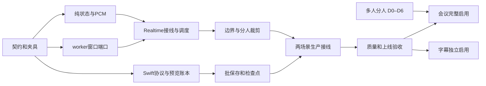

# Meeting and Caption ASR Implementation Plan

> **For agentic workers:** REQUIRED SUB-SKILL: Use executing-plans to implement this plan task-by-task. Steps use checkbox (`- [ ]`) syntax for tracking. 本文仅规划，执行以用户后续实施范围为准；不自动 commit、安装、下载模型或接管 UI。

**Goal:** 会议优先文字与分人准确性，支持“超过 4 位参与者、主要发言者在 4 位以内”的真实场景；字幕快速显示、在近期窗口内自动纠错，并将正式记录可靠保存。

**Architecture:** 单个共享 Qwen ASR worker；新增非终态窗口解码端口、连续 PCM 所有权账本和窗口协议；App 原子替换预览，以幂等批事务追加正式行。alignment/diarization 不反向修改正式正文。

**Tech Stack:** 项目锁定的 Python 3.14、FastAPI/asyncio、MLX Qwen3-ASR、Qwen3-ForcedAligner、固定 revision 的 FluidAudio、Swift 6/SwiftUI、SQLite schema v13。

**Spec:** [会议助手与实时字幕识别策略设计](../specs/2026-10-16-meeting-caption-asr-design.md)，尤其 §9。核验日期：2026-10-16。下述新文件、端口、字段和测试尚未实现。

## Global Constraints

- 保留当前 CPU/对齐修复和其他任务改动；开始前检查工作区，不还原整个文件。每个任务的文件由一个执行者写入。
- 不新增 ASR 模型进程，不用 REST batch 做直播旁路；旧场景未协商新模式时保持原契约。正常关闭窗口不 reap 模型，异常回收确认前不释放资源。
- 内部 16 kHz、wire 24 kHz，半开整数样本区间；PCM/embedding 仅 RAM，真实测试素材与制品在仓库外。日志不含正文、词表、原音频或绝对模型路径。
- `window_revision` 管整个快照，`text_revision` 管单元正文，`metadata_revision` 管辅助投影；ASR seal、DB ack、speaker drain、source seal 独立。
- 首个主线交付维持 schema v13 与既有 `final/partial`、`asr` origin；不依赖持久化中间识别轨迹。App 分别设置会议、字幕的实验开关，均默认关闭。
- 本计划中的命令在仓库根运行，使用原生命令；单元测试用 fake backend。真实模型、基准、安装和 UI 验收单独依有效授权执行，UI 还须当次明确授权。

## Review Focus

| 关键失败类 | 必须覆盖的任务 |
| --- | --- |
| 中文 codepoint/emoji、重复短语、跨块词、标点和采样率舍入造成重复或漏字 | T1、T4、T5 |
| deadline/cancel 只是停止等待，底层同步 MLX 仍在运行；旧代次晚到 | T2、T3、T5 |
| 掉预览、终态重放、快照跳版本、混合旧事件与保存重试 | T0、T3、T5、T6 |
| 空 final、静音、尾 PCM、来源切换、停止时输入与辅助水位不同 | T3、T4、T7 |
| 词表泄漏、unknown 被错误算成准确、会话时长导致账本/扫描增长 | T4、T6、T8 |

## 任务依赖与交付边界



T0–T6 可合入但保持关闭；T7 提供可供验收的文字窗口功能；T8 为各场景选择参数并决定是否启用。[多人分人支线 D0–D6](2026-10-16-meeting-diarization-implementation.md) 已按用户补充列为会议必要依赖，须在会议完整验收前完成；字幕路径不依赖该后端。

## 文件与责任地图

| 层 | 现有事实源／主要修改文件 | 新文件 |
| --- | --- | --- |
| 契约 | `contracts/realtime-openai.md`、`contracts/realtime-events.schema.json`、`src/speechrail/compatibility/openai_realtime.py`、`src/speechrail/application/capability_snapshot.py` | 共享 JSON fixtures，位于 `tests/fixtures/realtime-current/` |
| 纯领域 | `domain/ports.py`、`domain/asr_policy.py`、`domain/audio_timeline.py` | `src/speechrail/domain/asr_window.py` |
| worker | `backends/qwen3_worker.py`、`qwen3_stream_decoder.py`、`qwen3_shared.py`、`runtime/worker_protocol.py` | `src/speechrail/backends/qwen3_window.py` |
| 应用 | `application/services.py`、`realtime_openai.py`、`realtime_asr.py`、`realtime_auxiliary.py`、`realtime_state.py`、`realtime/speech_admission.py`、`config/__init__.py` | `src/speechrail/application/asr_window_coordinator.py`、`src/speechrail/runtime/window_pcm.py` |
| 分人 | `domain/diarization/attribution.py`、`application/diarization/session.py`、`native/diarization/Sources/SpeechRailDiarizationWorker/main.swift` | native protocol 增加纯帧 cursor helper；不改第三方 checkout |
| App | `SpeechRailControlKit/RealtimeContractTypes.swift`、`SpeechRailApp/RealtimeASRClient.swift`、`ASRScenePreset.swift`、`MeetingSession.swift`、`MeetingSessionProductionWiring.swift`、`CaptionSession.swift` | `SpeechRailApp/TranscriptWindowLedger.swift`、`TranscriptWindowPersistence.swift` |
| 保存/UI | `SessionStore.swift`、`AssistantInputPersistenceQueue.swift`、`MeetingViewLiveTranscript.swift`、`CaptionBandWindow.swift`、`Package.swift`、`.xcodeproj/project.pbxproj` | 测试文件；视觉值只按需加入现有 Token |
| 验收 | `examples/perf/realtime_asr_benchmark.py`、`asr_quality.py`、`benchmark_manifest.py`、`bench_realtime_json.py`、`observability/metrics.py` | 新增窗口证据测试与脱敏结果 schema |

上表 `domain/`、`backends/`、`runtime/`、`application/` 均相对 `src/speechrail/`；App 行相对 `macos/SpeechRailApp/`。下面明确新接口，避免把已存在的相近类型当作实现完成。

## T0 — 固定模式契约、回显和跨语言夹具

**Files:** 契约层文件；`tests/test_realtime_current_schema.py`、`test_realtime_openai.py`、`test_capability_snapshot.py`；`macos/SpeechRailApp/SpeechRailMacControlTests/RealtimeContractTests.swift`。

**Consumes:** 有效 ASR/profile/worker readiness 与客户端请求。**Produces:** `session.speechrail.window` 请求/回显和 §9.2 三种窗口事件。

- [ ] 先补测试：`window` 与旧 `asr` 同传拒绝；未支持/未 ready 不协商；mode/scene 未知拒绝；bool 不能冒充整数；空/倒置/越界 span 拒绝；旧模式 fixtures 仍合法。
- [ ] 用合成文字创建 updated r2、跳到 r5、sealed r6、failed r7、重放 sealed、同版本不同内容、跨 sealed frontier 篡改、未见预览直接 sealed 的共享 fixtures；更新 fixture manifest，所有事件都带 envelope。
- [ ] 新增 `WindowPolicy` 回显 schema：`preview_interval_ms/owned_ms/review_grace_ms/left_context_ms/max_decode_ms/pcm_budget_bytes/finalization_budget_ms`，额外字段拒绝。模式仅接收 mode/scene，参数候选由服务策略表控制。grace 的音频/等待边界与排队计算预算按 spec §9.5 分开，不能要求在刚取得最后一帧未来音频的同一时刻完成计算。
- [ ] 在 `asr_operations()` 新增 revision_window 能力，独立于 batch 和普通 streaming 的现有能力；以 ASR＋window IPC＋word alignment readiness 联合判定，diarization 独立；`asr_revision_windows_enabled=False` 时稳定 unsupported，不假称整项 ASR 不可用。
- [ ] 为 sealed/failed 定义 closed_span、完整 remaining_units、coverage 和 terminal 顺序；为 commit receipt 定义窗口水位。将 `window.*` 写成完整的 `speechrail.transcription.window.*` 名称。
- [ ] 运行并检查实际断言：

```bash
uv run --no-sync pytest --no-cov tests/test_realtime_current_schema.py tests/test_capability_snapshot.py
swift test --package-path macos/SpeechRailApp --filter RealtimeContractTests
```

**Done:** Python 与 Swift 使用相同样本，缺字段/混合模式能稳定拒绝，旧 fixtures 全部有效。行为实现前相应新增集成测试应明确处于 red，不能删断言使其通过。

## T1 — 纯窗口账本和按借用计费的 PCM

**Files:** 新建 `domain/asr_window.py`、`runtime/window_pcm.py`；新建 `tests/test_asr_window.py`、`test_window_pcm.py`；按需扩展 `domain/ports.py`。

**Consumes:** 单调的样本追加、关闭原因、冻结候选与完整识别结果。**Produces:** 无 I/O 的状态变化、借用句柄和待发送快照。

- [ ] 建立不可变 dataclass：`WindowIdentity(session_id,input_epoch,window_id)`、`WindowPolicy`、`OwnedBlock`、`WindowUnit`、`WindowDecodeRequest`、`WindowDecodeResult`、`WindowSeal`。span 统一 `SampleSpan`；kind=`preview|review`；完整结果明确 `complete`，截断不能只返回字符串。
- [ ] 确定接口：`WindowLedger.append(span)`、`close_block(end,reason)`、`accept(candidate,expected_parents)`、`seal(through)`、`fail(through,reason)`、`snapshot()`；返回新值/命令，不直接发事件或写库。
- [ ] `WindowPcmRing.append(start,pcm16)` 验证连续；`borrow(span)` 返回必须显式释放的只读借用；计费包含快照、binary IPC、float 转换及待辅助副本，超过 16 MiB 拒绝新复制，不能覆盖 pin。保留硬限 60 s，结束释放归零。
- [ ] 测试 16/24 kHz 水位映射、511/512/513 尾样本、奇数字节拒绝、块合并/拆分、空文字仍有覆盖、重复 seal、旧父版本、清空后旧 epoch、借用未释放、内存将满但最老块仍待复核。预算组合测试必须包含 `4+8+2=14`。
- [ ] 运行：`uv run --no-sync pytest --no-cov tests/test_asr_window.py tests/test_window_pcm.py`。

**Done:** 纯状态机能重放 T0 夹具；无计时 sleep、模型或网络；终态 frontier 从不后退，事务覆盖无重叠/缺口。

## T2 — 同 worker 非终态解码与真实清理

**Files:** 新建 `backends/qwen3_window.py`；修改 worker、shared dispatcher、services 注入；`tests/test_qwen3_worker.py`、`test_qwen3_worker_limits.py`、`test_shared_worker_recovery.py`；新建 `tests/test_qwen3_window.py`。

**Consumes:** T1 的请求。**Produces:** `WindowAsrSession.decode(request)` 与 `close()`；由 `WindowAsrFactory.create()` 提供，和旧 `RealtimeAsrFactory` 并列注入，不导入 vendor 到主进程。

- [ ] fake worker 先证明 100 次 preview/review/正常 close 只加载一次模型，review 不发公共 completed；frame 二进制样本数与 span 相等，超过 30 s/奇数字节/错 attempt 失败。
- [ ] 加 `window.decode/result/close/closed` 私有 frame 与 ready 能力；result 同步返回真实 decoded span、完整性、身份。沿用既有 PROTOCOL_VERSION framing，语义能力单独握手，旧 worker 无能力必须拒绝。
- [ ] preview 仅在相同输入起点、语言/context、epoch 且音频向后扩展时复用一个 decoder state；review prefix-free 且检查 finish/truncation，之后清空旧 token 前缀。不调用第三方异步线程池，加载和推理保留在现有 worker 执行上下文。
- [ ] `WindowAsrSession` 取得 streaming mode 逻辑占用，计算取得既有 `REALTIME_ASR` Governor 准入；同机第二个 ASR owner 和 batch 冲突保持受控 busy。一个 decode 完成前不发送第二个重请求。
- [ ] 正常 close 等在途结果，再发 close 并等真实 closed ack，仅释放该窗口缓存；超时或强取消才走现有精确 worker reap。使用 shield/cleanup task；reap 失败隔离 lane，禁止 successor 提前启动。
- [ ] 测试超时后计算仍忙、close waiter 被取消、reap 失败后重试、旧 generation 晚到、异常 ready、重复 result、queue overflow；断言 lease/PCM 一直保留到 ack 或 reap 成功。
- [ ] 运行：

```bash
uv run --no-sync pytest --no-cov tests/test_qwen3_window.py tests/test_qwen3_worker.py tests/test_qwen3_worker_limits.py tests/test_shared_worker_recovery.py tests/test_qwen3_streaming.py
```

**Done:** 旧流式回归保持通过；fake 加载次数/同时重计算峰值分别为 1/1。真实速度尚未由此证明。

## T3 — 单 owner 调度、连续输入与终态屏障

**Files:** 新建 `application/asr_window_coordinator.py`；修改 `realtime_asr.py`、`realtime_openai.py`、`realtime_state.py`、`services.py`、`realtime/speech_admission.py`、`config/__init__.py`；新建 `tests/test_asr_window_coordinator.py`、`test_realtime_revision_window.py`。

**Consumes:** 现有 InputTimeline/重采样/SpeechAdmission 的事件，不复制第二套 VAD。**Produces:** T0 窗口事件、最终 FrozenTranscript、commit receipt。

- [ ] 保留 `RealtimeAsrOwner` 为现有输入/采样入口；首次配置冻结模式后，在 `_resampler.process` / kernel timeline accept 之后、SpeechAdmission 之前将原始连续 PCM 入环一次，辅助分人也只送一次。admission 的 audio PCM 只引用环范围，不能再次 append 重复的 pre-roll。EOF resampler tail 走相同分叉路径。
- [ ] 新增只读 `SpeechAdmission.retained_from_sample`，与调用者尚未评分 VAD buffer 的最早样本共同约束 silence frontier。覆盖 long silence→candidate→start、失败 candidate、300 ms pre-roll 和 511/512/513 尾部，断言不会先封存静音后又回写语音；VAD 未接纳不算人工真值中的真实静音。
- [ ] 调度为一个 active、一个最新 preview、一个合并 review 和一个最早 seal 意图；排队意图仅引用环范围，执行时才借用/复制。closed 候选参与 review 后锁父版本，preview 继续处理独立活动尾块。
- [ ] 使用注入单调 clock/可控 fake decoder，实现 §9.5 顺序、≤20 s 积压和预算拒绝；deadline 包含排队、实际计算与边界处理。seal 优先规则只在安全边界生效。
- [ ] 顺序发送 window transaction、segment_closed、唯一 terminal；由封存结果生成 FrozenTranscript，旧 item 永不复活。空结果、静音、失败都推进覆盖；failed 保留恢复文字和原因。
- [ ] commit 先冻结已接纳样本，刷新重采样/VAD 尾部，再排空所有已冻结窗口；停止不等待未来音频。若事务未全送出，不发成功 receipt。新 receipt 不承担 Store ack。
- [ ] 测试掉光预览后成功封存、慢 consumer、duplicate commit、部分失败后 receipt、stop/clear/source switch、尾样本、断连和旧 attempt；断言不同分包的 admitted 顺序/覆盖一致，没有双 terminal 或重复 diarization append。
- [ ] 运行：

```bash
uv run --no-sync pytest --no-cov tests/test_asr_window_coordinator.py tests/test_realtime_revision_window.py tests/test_realtime_commit_tail.py tests/test_realtime_openai.py tests/test_asr_turn_coordinator.py
```

**Done:** fake 调度可确定性覆盖全部状态；资源过载有明确出口，没有轮询忙等。模式切换只在新输入代次开始前发生。

## T4 — 边界证据、降级和长期分人账本

**Files:** `realtime_auxiliary.py`、`application/alignment.py`、`domain/diarization/attribution.py`、`application/diarization/session.py`；native worker 的 `main.swift`，新建 `native/diarization/Sources/SpeechRailDiarizationProtocol/RetainedFrameCursor.swift` 并扩展 `SpeechRailDiarizationProtocolSelfTest/main.swift`；新建 `tests/test_asr_window_boundaries.py`；扩展 `test_diarization_attribution.py`、`test_realtime_auxiliary_attribution.py`、`test_diarization_worker.py`。

**Consumes:** 已冻结的 contextual review、父版本及已有 alignment/说话人 stable watermark。**Produces:** 可接纳的窗口替换或 owned_only/failed；正式 item 的独立辅助事件。

- [ ] 实现 spec §9.4：真实 word 单元裁上下文、跨两个已锁 closed 块才合并；跨 sealed/active 边界不裁词；标点依附相邻 token。同一候选只允许一次 owned_only 重试，并受原 deadline/PCM 预算约束。
- [ ] 拆开 ASR decode、边界对齐、final 固定文本对齐与连续分人四类预算；不直接删当前 8 s guard。扩大对齐输入前验证请求长度、worker 最大时长、token 输出和复用的 AlignmentAdmission/Governor；未 ready/unsupported/overloaded 时走明确降级。
- [ ] review 阶段的私有对齐只服务边界决策，不使用正式 item ID；seal 后可复用完全匹配的固定文本证据，否则按正式 item 重对齐。任何缓存必须同时匹配正文、revision、PCM span、epoch 和 granularity，不能把旧偏移搬到新文。
- [ ] `AttributionLedger.compact(before_sample)` 删除已最终投影的旧 unit、已不再被借用的稳定帧与旧 step，保留 slot label、单调水位、最近 64 指纹。协调器保留所有仍可能回溯的帧；超保留限的辅助任务先终结 unknown 再压缩。
- [ ] native timeline 配置 `maxStoredFrames=ceil(60/frameDurationSeconds)`、`storeSegments=false`；用新纯 helper 将累计绝对 cursor 映射到 retained array 局部下标。遇到未发帧已被裁掉则稳定 activity-gap 错误，不静默推进。测试 750/751/752 帧、append 大于保留长度、EOF padding 裁到 accepted_samples；无需加载 CoreML 模型。
- [ ] 反例至少含：同词重复、跨 4 s 的英文词、中文/emoji codepoint、标点漂移、所有 token 同时间格点、对齐缺字/多字、词级 unsupported、alignment 超时、第五人不能推断成新 slot、压缩后晚到 step 不能复活历史。
- [ ] 用 fake 活动流模拟 2 h：未决账本和每步参与扫描的帧/unit 数进入固定上限，最终文字保留；压缩前后当前合法区间的归属一致，unknown 覆盖不可因压缩消失。
- [ ] 运行：

```bash
uv run --no-sync pytest --no-cov tests/test_asr_window_boundaries.py tests/test_diarization_attribution.py tests/test_realtime_auxiliary_attribution.py tests/test_alignment_runtime_regressions.py tests/test_diarization_session.py tests/test_diarization_worker.py
swift run --package-path native/diarization SpeechRailDiarizationProtocolSelfTest
```

**Done:** 边界失败不阻止已有预览；只有完整识别可成为正式正文；长时纯账本有界。此处测试不证明真实多人准确率。

## T5 — Swift 窗口协议和原子预览账本

**Files:** `RealtimeContractTypes.swift`、`RealtimeASRClient.swift`；新建 `TranscriptWindowLedger.swift`、`SpeechRailMacControlTests/TranscriptWindowLedgerTests.swift`；更新 SwiftPM 和 Xcode 测试清单。

**Consumes:** 共享 fixtures 与本地 record/connection/generation 绑定。**Produces:** `TranscriptWindowLedger.apply(event,binding) -> Admission`；Admission 为 snapshot/seal/failure/duplicate/rejected，返回冻结命令数据，绝不自行写库。

- [ ] 添加显式 Codable 类型，不用松散 Any 字典穿过业务层。新模式 session.update 省略旧 asr；回显缺字段、预算不符或能力未确认时在采集前失败。
- [ ] ledger 检查 epoch、window、frontier、版本和完整快照限制；合并/拆分退休旧 provisional ID。snapshot 可跳 revision，sealed 无需先收到 preview，remaining_units 防止旧尾文复活。
- [ ] TypedEvent 加窗口 case；新模式只以窗口事件更新预览，official completed 核对并去重；旧场景继续 `TranscriptPreviewLedger`。将两条路径封装在模式分支，不能同时消费。
- [ ] 覆盖 r2→r5、r6 sealed→r5、同版本不同内容、旧连接/记录切换、单元删除、Unicode codepoint、用户已编辑正式行、重复 seal、先收 terminal 的非法顺序、连续 10000 更新的内存上限。
- [ ] 运行：

```bash
swift test --package-path macos/SpeechRailApp --filter TranscriptWindowLedgerTests
swift test --package-path macos/SpeechRailApp --filter RealtimeContractTests
python3 scripts/check_macos_test_target_coverage.py
```

**Done:** fake transport 可重放服务器夹具，旧模式的预览/终态测试通过；新文件同时进入两套构建/测试清单。

## T6 — schema v13 批保存、检查点与重试

**Files:** 新建 `TranscriptWindowPersistence.swift`；修改 `SessionStore.swift`、`AssistantInputPersistenceQueue.swift`；新建 `SpeechRailMacControlTests/TranscriptWindowPersistenceTests.swift`；扩展 `AssistantInputPersistenceQueueTests.swift`、`AssistantPersistenceTests.swift`。

**Consumes:** `SealedWindowCommand` 与 `WindowCheckpointCommand`。**Produces:** `WindowSaveAck(transactionID,lineOrdinals,savedThrough)` 或原命令可重试 Failure。

- [ ] 冻结 Command 内所有 line/revision/checkpoint ID、createdAt、正文、范围、本地身份；不能执行时再调用 UUID/当前 record/clock。queue 同时约束批数和总字符数，过期 checkpoint 合并，sealed 批不可丢弃。
- [ ] 从 `appendLine` 提取同类型内部 `appendLineInTransaction`，保留原冻结字段比较；外层 `appendSealedWindow` 只开一次事务，逐行和 revision 同 ID 比较，并写索引 outbox。
- [ ] 检查点只写旧 App 支持的 partial/speaker 或 user/source/timingQuality；compare-and-set 仅更新精确 ID 的 partial，封存同事务缩为剩余尾文或删除已完全替代的检查点。不得更新 final，不能清掉其他代次恢复材料。
- [ ] **事务重试顺序：**先判断本批全部正式行/revision 已存在且字段一致，成立则直接 ack，不能再因旧 checkpoint 已被更新而失败；只有未执行的新批才校验 checkpoint parent 并写。部分已存在而其余不一致属于冲突，不隐式修复。
- [ ] 故障注入：第二行、revision、outbox、checkpoint 各位置抛错，断言整批回滚；提交成功但 ack 丢失后重试仍只有同一组行/ordinal/revision。父值冲突、final 同 ID 篡改、保存期间切记录、磁盘失败、慢保存上限都保留可恢复原命令。
- [ ] 检查点每 2 s 至多更新一次，重启按 partial 展示恢复；正式索引、默认导出、纪要来源不包含 partial。检查点失败可见，不能显示成已保存。
- [ ] 来源封存仍在正文 ack/drain 后使用 `sealMeetingSource`，不逐 cue 调用。验证正式行初始 origin=`asr`、旧 snapshot 不随人工修改漂移；未完成文字保持 coverage/recovery 状态。
- [ ] 使用上一发布版本的只读读取逻辑检查临时数据库：新建 final/partial/revision 均可访问、user_version=13；只在临时目录构造 fixture，不替换用户数据库或启动旧 App。
- [ ] 运行：

```bash
swift test --package-path macos/SpeechRailApp --filter TranscriptWindowPersistenceTests
swift test --package-path macos/SpeechRailApp --filter AssistantInputPersistenceQueueTests
swift test --package-path macos/SpeechRailApp --filter AssistantPersistenceTests
```

**Done:** ASR 成功/保存失败严格分离；重复保存不重复行，崩溃只损失尚未完成检查点的有界尾文，不声称零丢失；旧记录与新记录都可读取。

## T7 — 会议与字幕接线、状态和展示

**Files:** `ASRScenePreset.swift`、`MeetingSessionProductionWiring.swift`、`MeetingSession.swift`、`CaptionSession.swift`、`MeetingViewLiveTranscript.swift`、`CaptionBandWindow.swift`；相关 lifecycle/scroll/preset tests；`docs/users/api-contract.md`、`docs/architecture/transcript-persistence-contract.md`、`docs/developers/macos-app-design-system.md`。

**Consumes:** T3–T6 的协议、窗口 admission 与保存 ack。**Produces:** 独立可启用的会议/字幕策略和普通用户可理解的状态。

- [ ] 服务开关 `asr_revision_windows_enabled`、App UserDefaults `speechrail.meetingRevisionWindowEnabled` 与 `speechrail.captionRevisionWindowEnabled` 均默认 false；值只在开始前读取并冻结。开发验收注入不改真实配置。能力不支持时用既有模式并在开始前解释回溯范围。
- [ ] 新模式会议默认 owned=20 s、grace=2 s、left=2 s、maxdecode=24 s、preview=1500 ms；字幕 owned=4 s、grace=8 s、left=2 s、maxdecode=14 s、preview=500 ms。VAD 默认仍为 900/400 ms；准生产参数以 T8 胜出组合替换，不直接扩大旧模式段长。
- [ ] 显示 `正在识别/正在确认文字/文字已确认，正在保存/已保存/部分内容未完成`；说话人单独 pending/unknown；允许保留当前词表为空，进阶词表严格校验并只在新输入代次生效。
- [ ] 将窗口末尾视图与正式历史分开，只发布变化的单元；音量状态不重建全文。复制默认看到的文字，但导出/纪要依赖正式记录，并在未完成时说明状态。人工修改只作用于正式行 revision。
- [ ] 保留 `TranscriptFollowState` 当前滚动修复；用 fake session 验证修订不改变用户回看/选区、不制造几何反馈环。UI 视觉验证留到明确授权的人工/自动验收。
- [ ] 停止顺序：停止采集 → commit 输入屏障 → 窗口终态 → Store ack → 独立辅助有限 drain → 来源封存/释放。每步失败保留对应状态，不统一改成 ended。
- [ ] 在 Swift fake lifecycle 中覆盖停止、暂停、关闭窗口、来源切换、断网/worker crash、保存失败、归属迟到与用户编辑。测试单位按实际 XCTest/Swift Testing suite 命名更新，不跳过难复现路径。
- [ ] 运行：

```bash
swift test --package-path macos/SpeechRailApp --filter ASRScenePresetTests
swift test --package-path macos/SpeechRailApp --filter MeetingSessionLifecycleTests
swift test --package-path macos/SpeechRailApp --filter CaptionSessionLifecycleTests
swift test --package-path macos/SpeechRailApp --filter TranscriptFollowStateTests
python3 scripts/check_macos_test_target_coverage.py
scripts/macos_app_build.sh --configuration Debug
```

**Done:** 两场景完整 fake 生产链路通过且可单独回退；App 构建包装脚本成功，不等于真机 UI 或模型质量通过。

## T8 — 证据工具、真实质量与各场景启用门

**Files:** perf 文件与 metrics；`tests/test_realtime_asr_benchmark.py`、`test_asr_quality_metrics.py`、`test_realtime_asr_timing.py`；新增 `tests/test_asr_window_evidence.py`；正式验收记录另建带日期文件，原始素材/结果不入仓库。

**Consumes:** 锁定语料、代码/profile/制品版本、窗口事件与 UI 提交时刻。**Produces:** 脱敏可审计的配对结果与 enable/no-go 决策。

- [ ] 先测试证据工具：丢了所有 preview 仍能按 sealed 评分；terminal 镜像不重复计数；empty/silence/failed 覆盖检查；同 ID 不同正文、重叠/遗漏、封存后改字必须判失败。
- [ ] 新证据格式用独立 `schema_version=1, tool="speechrail-asr-window-benchmark"`，不覆写既有 ASR benchmark schema 2 的语义。新增 replay 读取 manifest 中的场景 window 请求；旧工具对新事件显式拒绝或路由到新审计器，不能忽略后算通过。
- [ ] 按 spec §9.8 增加会话级配对 bootstrap（固定随机种子）、原文/规范化 CER/WER、事实词、词表负对照、DER/JER/unknown覆盖、correct→wrong 与 churn。分人采用锁定版本的独立评分工具环境，不把评测依赖塞进服务请求路径；先用小型人工构造标注核对 collar/overlap 和整场匹配。没有人工真值/词时间参考的指标保持 not_observed，不用同模型输出作真值。
- [ ] 服务端阶段时延与 App 本地时延分开；App 在 UI 状态实际提交时记录本地 clock，不用收包时刻替代显示。已有 replay 的名义回放结束也不是声学结束，只有独立标注的音频起止可支持该指标。
- [ ] 执行 spec §9.7 的顺序实验，先开发集选候选，再只对锁定验收集评估。质量与实时性门槛沿用 spec §8；两种场景分别判断，不把未知样本或失败窗口删出分母。
- [ ] 30–60 min 长时采样分别报告 App、ASR、aligner、diarizer 的 CPU/RSS、队列/PCM/账本峰值、stop drain 和保存；CPU 空转门只用于 App 静止 UI，不把正常 worker 推理一核负载判为 UI 死循环。
- [ ] fake 证据工具命令：

```bash
uv run --no-sync pytest --no-cov tests/test_asr_window_evidence.py tests/test_realtime_asr_benchmark.py tests/test_asr_quality_metrics.py tests/test_realtime_asr_timing.py
```

- [ ] 已有真实基线入口如下，仅在基准授权和仓库外 manifest/全新 output 准备后运行。新模式也由此 CLI 路由到新审计器，参数保持有效；文件路径由验收人员设置，不复制本机缓存路径：

```bash
uv run python examples/perf/bench_realtime_json.py --asr-manifest "$ASR_MANIFEST" --profile quality --sessions 3 --output "$ASR_OUTPUT"
```

- [ ] 开启前检查：自然语料门、字幕 UI 延迟门、边界/终态零违规、保存故障/旧读取通过、长期资源有界；无胜出候选则 no-go，保留当前模式并交付 Pareto 数据。不得只凭 readyz 或单次 smoke 开启。
- [ ] 经有效安装/运行授权后按项目 release/local-deploy skill 安装，记录 app home/label/PID/端口/release/profile；UI 当次授权后在会议和字幕分别验收。回退先关 App 场景开关/服务能力或旧服务 release，保留新 App 和全部数据库记录。不可回滚数据库覆盖新数据。

**Done:** 每场景有可追溯数据支持其独立启用决定；未达到目标如实 no-go。报告需区分 fake、真实模型回放、真实采集 UI 和长时压力四类证据。

## 会议必需支线 D — 动态人数与跨窗身份

用户已确认会议会有超过 4 位参与者，主要发言者通常在 4 位以内。本支线由[独立实施计划](2026-10-16-meeting-diarization-implementation.md)定义，包含已核对的制品快照、内部类型去四槽假设、30 s/10 s 滚动调度、全场匿名匹配、App 能力接线和多人验收。主线 T0、T4、T7 与支线 D1/D3/D5 修改共享文件时必须串行交接，不能由两个执行者同时写同一文件。

ASR 文字窗口可先交付但保持独立标识；会议“文字＋多人分人”完成必须同时满足主线 T8 和 D6。T7 的重连/clear/来源切换还须验证 D5 speaker scope，不能把新分人 session 的 S1 关联到旧人的保存行。制品准备或新运行态操作需要届时有效授权；本计划不进行下载/加载。若动态后端未达质量门，报告未完成，不静默切回 4 槽并宣称多人支持。

## 计划自审与完成证据

- [ ] T0–T8 的接口输入输出使用同一字段、身份和采样口径；所有新增文件在任务和清单中有 owner。
- [ ] Review Focus 每项都有具体反例；没有“测试等于照抄实现”的断言；fake 不调用真实模型。
- [ ] 每个 task 的命令文件/过滤器都与最终代码一致，测试失败有证据，修复后只重跑受影响集合。
- [ ] 新公共事件、能力、文档、Python/Swift fixtures 同步；schema v13 和旧读取以临时库实证。
- [ ] 最终说明实际变更、核验时间、运行态动作、未验证项和回退；未受明确要求不 commit/push/发布。估时在 T2/T4 风险验证后按测量更新，不以虚构工期代替可验收任务。
