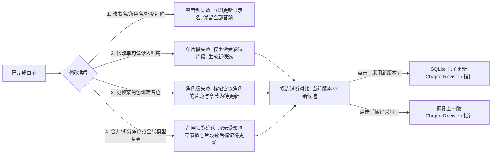

# 有声书工坊（Audiobook Workshop）用户旅程与 UX/UI 设计规格

本规格依据 [有声书工坊实施计划](../plans/2026-10-14-audiobook-workshop.md) 与 [有声书工坊产品与交互设计](./2026-10-14-audiobook-workshop-design.md) 制定，并与 [macOS App 设计系统与 Token](../../developers/macos-app-design-system.md)、[全 App UX/UI 统一规范](../../design/UX-UI-SPEC.md) 及 [会话能力端到端用户旅程](../../design/2026-09-17-session-closures/USER-JOURNEYS.md) 保持单一骨架、统一 Token 与一致交互语义。

本文件直接指导实施计划 **T06、T08、T09、T10、T12、T13、T14** 的界面状态投影、视图拆分、窗口布局响应、键盘与无障碍契约。

---

## 1. 设计原则与全局架构映射

### 1.1 四条体验铁律

1. **原文神圣不可篡改（Source Fidelity）**：界面展示的所有章节、段落与对白均直接映射自不可变规范原文（`AudiobookSourceRange` / `AudiobookTextAtom`）。AI 仅提供角色与归属标注，界面绝不提供“AI 润色改写稿”编辑器；排除范围（如目录、广告）以显式视觉降噪呈现，可随时恢复。
2. **三态分离，绝不混用 `completed`**：每本书在书架与工作台中独立表达 **分析状态（Analysis）**、**制作进度（Production）** 与 **可收听版本（Listenable Revision）**。未完成全书分析不可进入正式制作；单章存在 `unknown` 未知说话人仅阻塞该章（显示“确认说话人后继续”），不阻塞其他已确认章节制作。
3. **同一工作台，双模式演进**：书籍的“准备（确认角色/消解疑义）”与“制作（队列合成/局部返修）”在同一个 `AudiobookBookWorkspaceView` 内切换，不拆分成两个割裂的项目或二级窗口。
4. **用户任务语言优先，渐进式披露技术细节**：主路径只使用明确的任务语言（“分析全书”“人物与声音”“确认说话人后继续”“制作已确认章节”“正在暂停”“继续听”“之前的版本”）。`atomID`、字节偏移、模型 revision、PCM 摘要、回执等追溯信息仅在 Inspector 底部或候选详情的折叠区（`SpeechRailDisclosureGroupStyle`）内按需展开。

### 1.2 路由与入口契约（14 → 15 路由）

在 `AppRoute.swift`、`ControlCenterView.swift`、`App.swift`、`scripts/check_macos_route_contract.py` 与 `UIUX-AUDIT-MATRIX.md` 中同步登记第 15 个路由：

| 属性 | 规格值 | 依据与说明 |
| --- | --- | --- |
| `AppRoute` case | `.audiobook` | 位于 `AppRouteGroup.creator`（创作组），排在 `.dubbing` 之后或 `.works` 之前（与 `check_macos_route_contract.py` 顺序一致） |
| `title` | `"有声书工坊"` | 工具栏 `PageIdentityToolbarItem` 唯一身份名，正文不重复渲染标题 |
| `pageSubtitle` | `"导入 TXT 电子书，完成全书角色分析与配声确认后逐章制作、收听或导出。"` | `PageScaffold` 页首一句话说明（限制 2 行内） |
| `purpose` | `"把 TXT 电子书制作成多角色有声书"` | 侧边栏 `.help()` 与无障碍说明 |
| `systemImage` | `"books.vertical"` | 单色 SF Symbol，与 `developerDocs`（`"book"`）区分，置于 `Icon.navigationFrame` (20pt) |
| `shortcutSpec` | `.init(key: "b", modifiers: .commandShift)`（`⌘⇧B`） | T13 明确指定，不改动现有 14 项快捷键（`⌘1–⌘0`、`⌘⇧T/M/D/H`） |

### 1.3 视图文件与职责切分（对应 T13）

| 文件 | 宿主布局 (`PageScaffoldLayout`) | 核心职责 |
| --- | --- | --- |
| `App/AudiobookWorkshopView.swift` | 路由级外壳容器 | 绑定 `@Environment(AppModel.self)` 的 `audiobookWorkflow`（`AudiobookWorkflowModel`），管理书架、书籍工作台、听书模式三层子场景切换及 Sheet 宿主；离开工坊时触发 `leaveWorkshop()` 释放播放 |
| `App/AudiobookBookShelfView.swift` | `.scroll(minimumHeight: 0)` 或 `.fill(minimumHeight: 520)` | 工坊书架（空态引导、书籍卡片/列表、三态摘要、唯一继续动作按钮、导入 TXT 入口、废纸篓恢复入口）与导入预览 Sheet |
| `App/AudiobookBookWorkspaceView.swift` | `.fill(minimumHeight: 540)` | 三栏书籍工作台：左栏章节目录（280pt）、中栏原文标注与片段流（≥500pt）、右栏人物与声音面板（360pt，支持响应式收起與 `SessionPanelToggle` 恢复） |
| `App/AudiobookListeningView.swift` | `.fill(minimumHeight: 500)` | 沉浸听书视图：左栏已完成章节目录与版本标记（280pt）、中栏跟随音频实际采样时序高亮的原文阅读区、底部固定播放控制带（`SharedPlaybackOwner` 文件播放、±15s、0.5x–2.0x 倍速、书签同步） |

---

## 2. 端到端用户旅程设计（User Journeys）

沿用 SpeechRail 的 **E0–E7 旅程坐标系**（起念 → 进入 → 前置 → 设置/准备 → 主交互 → 插曲/异常 → 交还 → 产物与复用），覆盖 5 条核心路径。

### 2.1 J1 · 主旅程：从导入 TXT 到全书制作与收听

| 阶段 | 用户动作 | 界面落点与反馈 | 状态/数据落点 (`AudiobookWorkflowModel`) | 异常与退路 |
| --- | --- | --- | --- | --- |
| **E0 起念** | 拿到一本中文 TXT 小说，想做成旁白+多角色有声书在 Mac 或手机上听 | — | — | 若只需短文单音色配音，侧栏有 `配音台 (⌘1)` |
| **E1 进入** | 点击侧栏「创作 ▸ 有声书工坊」或按 `⌘⇧B` | `AudiobookWorkshopView` → 书架页（若无书展示 `SessionEmptyState` 空态引导） | 读取 `AudiobookProjectStore.listBooks` | 数据库版本不兼容时显示 `SessionConclusionBand(.critical)` 拒绝降级并保护原文件 |
| **E2 导入与预览** | 点击「导入 TXT…」，在文件面板选择 `.txt` 文件 | 弹出 **导入预览 Sheet**（`Layout.Sheet.wideWidth = 560pt`）：显示检测到的编码（UTF-8 / UTF-16 BOM / GB18030）、书名、作者输入框、前 6,000 字预览及识别出的章节列表（支持纠正边界或标记“不朗读”区间） | `AudiobookTXTImporter.prepare` 生成 `AudiobookImportPreview`；**不触发任何网络或 AI 请求** | 编码存在乱码或歧义时，顶部 `StatusBanner(.attention)` 要求用户手动切换编码下拉框并实时刷新预览；文件 >64 MiB 或 >1,000 万字明确提示拒绝 |
| **E3 全书分析** | 确认导入后进入书籍工作台（准备模式），点击主按钮「分析全书」 | 弹出或展开 **AI 发送确认条**：明确展示当前生效的 AI 服务商/模型（默认继承全局，`LLMModule.audiobook` 可覆盖）、将处理的章节数与窗口预算；确认后顶部状态带显示三阶段进度：「正在提取人物线索 → 正在归并全书角色 → 正在标注对白 (窗口 18/42)」 | `AudiobookAnalysisPipeline.run`；按窗口写入 SQLite checkpoint | 暂态失败自动在窗口预算内恢复（最多 4 次 `completeJSON`）；鉴权失败或配额耗尽立即暂停，展示「去设置检查连接」与「继续分析」；已校验窗口不丢失 |
| **E4 确认角色与试听门禁** | 全书分析完成后，在右栏「人物与声音」核对旁白与主要角色声音，点击「试听片段」 | 右栏展示角色卡（旁白置顶 + 主要角色 + 次要角色），每个角色带 `SessionVoiceCapsule` 选声音；点击「试听片段」播放一段含旁白与主要角色的预览，试听后点击「确认人物与声音」 | `AudiobookCastController.confirmAudition` + `confirmCast`；冻结 `voiceSetDigest` | 未完成旁白与主要角色试听确认前，「制作已确认章节」按钮保持禁用并提示「请先试听并确认旁白与主要角色声音」 |
| **E5 存疑对白处理** | 点击章节或顶部提示中的「待确认 (3)」，在原文高亮处点击推荐角色或「选择其他角色」 | 中栏滚动并聚焦到含 `unknown` 说话人的对白气泡，展示前后文、AI 线索证据与快捷角色胶囊（含「旁白」「新建角色…」） | `AudiobookCastController.assignRole`；支持 `⌘Z` 或历史记录撤销 | 若用户暂不处理第 4 章的疑义，第 4 章标为 `确认说话人后继续`，不影响第 1–3 章和第 5 章进入制作队列 |
| **E6 逐章制作** | 点击「制作已确认章节」（或勾选指定已确认章节制作） | 顶部状态带切换为制作进度：「正在制作第 1 章 (片段 12/38) · 已完成 0/12 章」；每完成一章，左栏该章立即点亮绿标并出现行内「播放」图标 | `AudiobookProductionController.start`；冻结能力快照与 pins，串行调用 `createSpeechRender` | 点击「暂停制作」后按钮变为「正在暂停…」（禁用重复点击），等待当前在途片段落盘或取消完毕后变为「继续制作」 |
| **E7 听书与导出** | 点击已完成章节的「听书」进入 `AudiobookListeningView`，或点击「导出…」选择整本 M4B / 分章节 MP3 | 听书模式按真实音频帧时序高亮当前段落，每 5 秒及切章/离开自动存书签；导出弹窗验证章节完整性后调用受管 FFmpeg 写入目标路径 | `AudiobookListeningController` / `AudiobookExportController` | 若整本尚有未完成或待更新章节，「整本 M4B」选项置灰并说明原因，引导使用「分章节 MP3（仅导出已完成的 N 章）」 |

---

### 2.2 J2 · 存疑对白消解与局部返修旅程（Local Revision & Invalidation Flow）

当书籍已有部分或全部已完成章节，用户发现某句台词分错人、某个角色想换音色、或角色改名时：



- **精准影响提示**：在用户点击「更换音色」或「合并角色」前，界面以轻量内联提示（或确认弹层）告知精确范围：`“更换「林晚」的声音将需要更新第 2、5、7 章中的 18 个片段；其余章节不受影响。”`
- **“之前的版本”可继续收听**：当某章因改归属或换声音进入「待更新」状态时，其已存在的完整历史版本不会消失，在章节行与听书模式中显式标记为 **`之前的版本`** 供用户继续收听或对比，直到新候选全部生成并被采用（`adopt`），绝不把半成品或过期版本混入当前整本 M4B 导出。

---

### 2.3 J3 · 跨模块音色往返旅程（Voice Library & Voice Design Round-Trip）

用户在工坊内为主要角色挑选或定制专属音色时，复用既有 `voiceLibrary` 与 `voiceDesign` 路由，通过 `AudiobookVoiceReturnContext(bookID, roleID, castRevisionID, generation)` 保持上下文不丢失：

1. **发起跳转**：在工作台右栏「人物与声音」某角色卡上点击音色胶囊 → 选择「去音色创作定制专属声音…」或「在音色库中浏览…」。
2. **上下文横幅常驻**：跳转至 `VoiceDesignView` 或 `VoiceLibraryView` 后，页首下方展示一条紧凑的往返导航带（`StatusBanner` / `recessedField`）：
   - 文案：`正在为《雾港来信》的角色「林晚」配置声音`
   - 动作：保存并成为可合成音色（`synthesis-ready`）后，主动作按钮直接显示 **「绑定到『林晚』并返回工坊」**；右侧附带次按钮「仅返回工坊」。
3. **安全返回校验**：
   - 若返回时 `bookID`、`roleID`、`castRevisionID` 与 `generation` 均有效，自动将该音色绑定到「林晚」并定位回该角色卡片，同时重置该角色的试听确认状态（提示重新试听一处片段）。
   - 若用户在此期间切换了书籍、删除了该角色或刚创建的是 `design-only`（未完成入库准入）草稿，则音色仅保存在音色库，返回后通过 `NoticeBar` 温和说明：`“新音色已保存到音色库；由于当前书籍角色状态已变更，请手动选择绑定。”`

---

### 2.4 J4 · 播放所有权抢占与恢复旅程（Shared Playback Ownership）

全 App 共享唯一 `SharedPlaybackOwner`（单音频输出 token）：

1. **听书中触发角色试听**：用户在听第 3 章（04:18）时，切回工作台点击某角色或返修候选的「试听」。
2. **自动保存与让位**：`AudiobookListeningController` 立即在切换 token 前将当前位置（`bookID`、`chapterRevisionID`、`fragmentID`、片段内秒数 `offsetSeconds`、当前倍速 `rate`）持久化至 SQLite `bookmark` 表，并暂停听书。
3. **显式继续入口**：试听结束后，绝不突然自动恢复长书朗读（避免惊吓用户）；工作台顶部状态带与书架卡片常驻显示 **「继续听：第 3 章 · 04:18」** 按钮，点击即按原倍速无缝续播。
4. **章节返修后的书签锚点恢复**：若第 3 章某片段被返修替换，用户点击「继续听」时：
   - 若书签所在片段未改动，精确恢复到该片段内原秒数；
   - 若书签所在片段已被重做替换，则定位到该新片段的起点（`0.0s`）开始播放，并在播放条上方浮现一行温和提示：**`“章节已更新，已从当前段落起点继续播放”`**。

---

### 2.5 J5 · 异常、中断与重启恢复旅程（Resilience & Crash Recovery）

| 异常/中断场景 | 界面状态表达（`StatusTone` + 文案） | 用户可执行的唯一主动作与次动作 |
| --- | --- | --- |
| **TXT 编码无法自动确认** | `.attention` · `需要确认文字编码`：自动检测发现多字节歧义，请切换下方编码查看正文预览，确认无乱码后再导入 | 编码分段选择器（`UTF-8` / `GB18030` / `UTF-16 LE` / `UTF-16 BE`）+ `确认导入` |
| **AI 分析鉴权失败 / 未配置** | `.critical` · `分析已暂停：AI 服务无法连接`：已完成 14/42 个窗口并保存检查点，修复配置后将从断点继续 | 主按钮：`打开设置检查连接`；次按钮：`继续分析` |
| **AI 分析局部窗口超限/失败** | `.attention` · `全书分析尚未完成（剩余 2 个窗口需重试）`：其余窗口已保存，全部窗口通过后才可开始制作 | 主按钮：`重试未完成窗口`；次按钮：`查看位置` |
| **语音服务繁忙 (`backend_busy`)** | `.attention` · `语音服务繁忙，正在等待恢复 (第 2/3 次尝试，约 8 秒后继续)…` | 次按钮：`暂停制作`（不静默更换音色或档位） |
| **制作条件冲突（音色被删/模型换档）** | `.attention` · `制作条件已变化`：角色「陈默」绑定的音色版本或当前运行档位已改变，队列已暂停 | 主按钮：`核对人物与声音`；次按钮：`打开模型组合` |
| **音频已到达但本地磁盘满/保存失败** | `.critical` · `片段保存失败：可用磁盘空间不足`：已收到音频但未能写入作品库，该章未标记为完成 | 主按钮：`释放空间后重试保存`；次按钮：`暂停制作` |
| **App 退出重开 / 崩溃恢复** | `.neutral` / `.attention` · `上次制作已保存至第 3 章（已完成 24/38 片段）`：有效片段已保留，中断的片段将重新生成 | 主按钮：`继续制作`；次按钮：`继续听已完成章节` |
| **受管导出工具缺失 (`capabilities` 失败)** | `.attention` · `导出工具不可用`：当前受管运行环境不支持媒体封装，您仍可在 App 内正常收听全部已完成章节 | 主按钮：`重试检测`；次按钮：`打开系统诊断` |

---

## 3. 核心视图 UX/UI 详细设计

全模块严格复用 `PageScaffold`、`SessionPanel`、`SessionPanelHead`、`SessionHairline`、`SessionConclusionBand`、`SessionStatusBar`、`SpeechRailInspectorPanel` 与 `SpeechRailDesignTokens`。

### 3.1 视图一：工坊书架与导入预览（`AudiobookBookShelfView`）

#### 3.1.1 布局结构与线框图（1440×900 基准，最小 1120×720）

```
+--------------------------------------------------------------------------------------------------+
| [Toolbar] 左侧: [books.vertical] 有声书工坊                右侧: [导入 TXT…] [废纸篓 (1)] [搜索] |
+--------------------------------------------------------------------------------------------------+
| 页首说明 (purpose): 导入 TXT 电子书，完成全书角色分析与配声确认后逐章制作、收听或导出。          |
|                                                                                                  |
| +----------------------------------------------------------------------------------------------+ |
| | [最近收听 / 进行中横幅 (可选，当存在最近收听书签时显示)]                                      | |
| | 🎧 《雾港来信》 · 第 3 章 夜航船 (04:18 / 18:40)                      [继续听] [打开工作台]   | |
| +----------------------------------------------------------------------------------------------+ |
|                                                                                                  |
| 全部书籍 (3)                                                                                     |
| +----------------------------------------------------------------------------------------------+ |
| | 📖 《雾港来信》                                   [制作中 · 已完成 5/12 章]  [待确认 2 处]   | |
| |    作者：沈青 · 共 12 章 (18.4 万字) · 6 位角色已配声 · 上次收听：第 3 章 04:18              | |
| |    分析状态：全书已分析   |   制作进度：5/12 章已完成 (第 6 章待确认说话人)                  | |
| |                                                   [听书]  [导出…]  [⋯]  [[继续制作 (主按钮)]] | |
| +----------------------------------------------------------------------------------------------+ |
| | 📖 《北纬四十度》                                 [准备中 · 分析已完成 28/45 窗口]           | |
| |    作者：林海 · 共 24 章 (32.0 万字) · 尚未确认全书角色表                                    | |
| |    分析状态：已暂停 (28/45)   |   制作进度：未开始                                           | |
| |                                                                    [⋯]  [[继续准备 (主按钮)]] | |
| +----------------------------------------------------------------------------------------------+ |
| | 📖 《钟表匠的学徒》                               [可收听 · 全书 8/8 章已完成]               | |
| |    作者：周行 · 共 8 章 (9.2 万字) · 4 位角色 · 已导出 M4B                                   | |
| |    分析状态：全书已分析   |   制作进度：8/8 章已完成                                         | |
| |                                                   [打开工作台]  [导出…]  [⋯]  [[继续听 (主)]] | |
| +----------------------------------------------------------------------------------------------+ |
+--------------------------------------------------------------------------------------------------+
```

#### 3.1.2 书架卡片状态与“唯一主动作”映射规则

每本书在书架上展示三项独立事实（**分析状态**、**制作进度**、**可收听版本**），但行尾只提供一个最符合当前阶段的 `.speechRailButton(.primary)`（或 `.secondary`）主动作，杜绝让用户猜测下一步：

| 书籍当前阶段 | 状态胶囊 (`StatusPill`) | 行尾唯一主动作 | 次要动作（行内按钮与 `⋯` 菜单） |
| --- | --- | --- | --- |
| 刚导入 / 分析未完成 | `准备中 · 待分析` 或 `分析中 (M/N)` | **继续准备**（进入工作台准备模式） | `⋯` ▸ 修改书籍信息、移入废纸篓 |
| 全书分析完成，角色/试听未确认 | `待确认人物与声音` | **继续准备** | `⋯` ▸ 修改书籍信息、移入废纸篓 |
| 角色已确认，有可制作章节或制作暂停中 | `可制作` / `制作已暂停 (K/M 章)` | **继续制作** | 若 `K > 0` 显示 `继续听`、`导出…` |
| 全部已确认章节制作完，仅剩 `unknown` 阻塞章 | `待确认说话人 (N 处)` | **确认说话人后继续** | `继续听`、`导出已完成章节…` |
| 全书所有章节均在当前版本完成 | `全书已完成 (M/M 章)` | **继续听** | `打开工作台`、`导出…` |

- **空态（Empty State）**：当书架无书籍时，使用 `SessionEmptyState(systemImage: "books.vertical", title: "还没有有声书项目", message: "导入一本 TXT 电子书，SpeechRail 会保留原文、识别章节与人物对白，帮你在本机制作多角色有声书。")`，主按钮为「导入 TXT…」。
- **可恢复废纸篓入口**：工具栏右侧提供 `PageActionsMenu`（「已删除书籍」），展示 `Application Support/SpeechRail/audiobooks/.trash/` 内的书籍名称与占用空间，支持「恢复到书架」与「永久删除（需二次确认，明确说明不影响原始 TXT 文件与已导出到外部的 M4B/MP3）」。

#### 3.1.3 导入预览与章节划分 Sheet（`AudiobookImportPreviewSheet`）

采用 `Layout.Sheet.wideWidth`（560pt）或 `prominentWidth`（720pt）：

```
+----------------------------------------------------------------------------------+
| 导入 TXT 电子书                                              [编码: UTF-8 (自动)]|
+----------------------------------------------------------------------------------+
| 书名: [ 雾港来信                                ]  作者 (选填): [ 沈青          ]|
| 文件信息: 184,320 字 · 严格 UTF-8 解码通过 · 识别到 12 个章节                    |
+----------------------------------------------------------------------------------+
| 左侧：章节划分预览 (240pt)          | 右侧：规范原文预览 (前 6,000 字，只读)     |
| [✓] 序章 雾中灯塔 (3,210 字)        | 序章 雾中灯塔                              |
| [✓] 第 1 章 旧邮差 (14,800 字)      |                                            |
| [✓] 第 2 章 铜钥匙 (16,120 字)      | 1998 年深秋，雾港的邮政局收到了一封没有    |
| ...                                 | 贴邮票的信。“你也看见灯了？”他问。         |
| [ ] 附言与鸣谢 (已排除，不朗读)     | ...                                        |
|                                     | [在此处切分新章节]  [标记所选区间不朗读]   |
| [+ 按规则重新划分] [合并至上一章]   |                                            |
+----------------------------------------------------------------------------------+
| 🔒 预览仅在本机读取文件，不会向任何 AI 服务发送正文。                            |
|                                                        [取消]  [[确认导入书籍]]  |
+----------------------------------------------------------------------------------+
```

- **严格解码守卫**：若 `AudiobookTXTImporter.prepare` 检测到字节无法按默认 UTF-8 解码，顶部编码选择器高亮为琥珀色注意态（`StatusTone.attention`），用户切换 `GB18030` / `UTF-16 LE` / `UTF-16 BE` 后实时重刷右侧前 6,000 scalars 预览；若所选编码仍含非法字节序列，「确认导入书籍」按钮禁用并明确提示不可有损导入。
- **无标题回退**：若全书未识别出章节标题，左侧默认显示唯一的 `全文 (N 字)` 章节，提示用户可直接导入，或选中右侧正文标题行点击「在此处切分新章节」。

---

### 3.2 视图二：三栏书籍工作台（`AudiobookBookWorkspaceView`）

工作台采用 `PageScaffold(route: .audiobook, layout: .fill(minimumHeight: 540))`，将页面锁定在视口高度内，左、中、右三栏各自独立滚动。

#### 3.2.1 顶部工具栏与工作台状态带

- **工具栏（Toolbar）**：
  - Leading：系统侧栏切换按钮 + `PageIdentityToolbarItem(.audiobook)`（`有声书工坊`）。
  - Trailing：
    - `返回书架`（`PageActionButton`，带左箭头图标）
    - 模式分段切换器（`Picker(..., selection: $workspaceMode)` `.pickerStyle(.segmented)`）：**`准备` | `制作`**
    - `听书`（当至少有 1 章完成时可点，进入 `AudiobookListeningView`）
    - `导出…`（弹出导出 Sheet）
    - 右栏折叠切换按钮：`SessionPanelToggle(panelName: "人物与声音", isCollapsed: isCastPanelCollapsed)`（遵循 `UX-UI-SPEC §6` 非主框体收起规则，置于内容区首行右端分界线上）。
- **状态与主动作横幅（Workbench Status Header）**：
  - 位于三栏上方，高度紧凑，左侧显示当前书籍名称、AI 服务标识胶囊（如 `AI 分析：本机 Qwen2.5` 或 `外部 OpenAI`，点击可查看或修改模块配置）及当前阶段进度；右侧放置**当前阶段的唯一主动作按钮**。
  - **状态机与主动作映射（保证 `testWorkflowOnlyShowsNextValidAction` 100% 成立）**：

| 当前工作台状态 | 顶部横幅文案与事实摘要 | 右侧唯一主动作按钮 | 辅助/次要按钮 |
| --- | --- | --- | --- |
| **1. 未分析 / 分析未完成** | `待分析全书 · 共 12 章 (42 个分析窗口) · 将使用「全局默认 AI 服务」` | **`分析全书`** (`.primary`) | `章节设置…` |
| **2. 分析进行中** | `正在分析全书：第 2 阶段 角色归并 (窗口 18/42)` + 线性进度条 | **`暂停分析`** (`.secondary`) | — |
| **3. 分析已完成，待确认角色与试听** | `全书分析已完成 · 识别出旁白与 6 位角色 · 2 处对白待确认说话人` | **`试听并确认声音`** (`.primary`，聚焦右栏试听卡) | `下一处待确认 (2)` |
| **4. 角色与试听已确认，准备就绪** | `人物与声音已确认 · 11 章可制作，1 章待确认说话人` | **`制作已确认章节 (11 章)`** (`.primary`) | `下一处待确认 (2)` |
| **5. 制作进行中** | `正在制作第 2 章《铜钥匙》 (片段 14/36) · 已完成 1/12 章` + 进度条 | **`暂停制作`** (`.secondary`) | `去听已完成章节` |
| **6. 制作正在暂停收尾** | `正在暂停… 等待当前片段保存完成` | **`正在暂停…`** (禁用态) | — |
| **7. 制作已暂停 / 重开待恢复** | `制作已暂停 · 已完成 3/12 章，第 4 章已完成 12/30 片段（有效音频已保留）` | **`继续制作`** (`.primary`) | `仅制作当前章` |
| **8. 已确认章节全部完成，剩存疑章** | `已完成 11/12 章 · 第 6 章有 2 处对白待确认说话人` | **`确认说话人后继续`** (`.primary`，直接跳转第 6 章疑义处) | `导出已完成章节…` |
| **9. 全书全部完成（且无待更新项）** | `全书 12/12 章制作完成 · 当前版本可完整收听或导出` | **`导出整本有声书…`** (`.primary`) | **`继续听`** (`.secondary`) |

#### 3.2.2 三栏工作台线框布局（准备模式 vs. 制作模式）

```
+----------------------------------------------------------------------------------------------------------+
| 《雾港来信》 · 全书分析已完成 · 6 位角色已配声 · 2 处对白待确认      [下一处待确认 (2)] [[制作已确认章节]] [◫]|
+--------------------------+-----------------------------------------------+-------------------------------+
| 章节 (12)   [全部|待确认] | 第 6 章 雾中来客 · 共 38 段 · 2 处待确认      | 人物与声音 (7)     [+ 新建角色]|
| (定宽 280pt)             | (中栏自适应，最小 500pt)                      | (定宽 360pt，可收起)          |
| ------------------------ | --------------------------------------------- | ----------------------------- |
| ● 序章 雾中灯塔   已完成 | [旁白 · 沉稳男声]                              | 🎙 旁白与主要角色试听 (已确认) |
| ● 第 1 章 旧邮差  已完成 | 海雾在午夜漫过栈桥，煤气灯在湿冷的空气里只剩  | [▶ 试听第 1 章多角色预览片段] |
| ● 第 2 章 铜钥匙  可制作 | 下一圈昏黄的光晕。                            | ----------------------------- |
| ● 第 3 章 夜航船  可制作 |                                               | 👤 旁白 (默认叙述)            |
| ● 第 4 章 钟楼    可制作 | [林晚 · 清冷女声]                             |    [🔊 沉稳叙事男声 v1 ▾] [▶] |
| ● 第 5 章 暗流    可制作 | “信封上的火漆印不是邮局的，”她低声说，“我     | ----------------------------- |
| ▲ 第 6 章 雾中来客 待确认| 在父亲的旧怀表背面见过同样的海燕纹章。”       | 👤 林晚 (主角 · 出现于 11 章) |
|   └ 确认说话人后继续 (2) |                                               |    别称：晚姐、林小姐         |
| ● 第 7 章 归途    可制作 | +-------------------------------------------+ |    依据：“她低声说…” (第1章)  |
| ...                      | | ⚠️ 待确认说话人 (第 1/2 处)               | |    [🔊 清冷青年女声 v2 ▾] [▶] |
|                          | | 原文：“那艘船今晚不会靠岸了。”            | |    [去音色创作定制…]  [⋯]     |
|                          | | 线索：多层引号嵌套，前文提及「老船长」与  | | ----------------------------- |
|                          | |       「陈默」，无法单凭代词唯一定位。    | | 👤 陈默 (主角 · 出现于 9 章)  |
|                          | | 指派给：[老船长(推荐)] [陈默] [旁白] [其他▾]| |    别称：小陈                 |
|                          | +-------------------------------------------+ |    [🔊 温和青年男声 v1 ▾] [▶] |
| ------------------------ |                                               | ----------------------------- |
| [章节划分设置…]          | [老船长 · 沙哑老者]                           | 👥 次要角色 (4 人)            |
|                          | 他掐灭了烟斗，转身走进雨幕里。                |    [✓ 允许共用「叙事配角音色」]|
+--------------------------+-----------------------------------------------+-------------------------------+
```

#### 3.2.3 左栏：章节导航列（定宽 `Layout.sessionListWidth = 280pt`）

- **结构**：复用 `recordListColumn` 设计基因：顶部为章节数统计与紧凑筛选胶囊（`全部` | `待确认` | `待更新` | `已完成`），中部为系统 `List(selection: $selectedChapterID)`（应用 `.speechRailSelectableList()`），底部为「章节划分与排除设置…」按钮。
- **章节行（`AudiobookChapterRow`）**：
  - 最小高度 `List.compactRowHeight` (42pt) 或 `pageRowMinimumHeight` (64pt)。
  - 行首：`StatusTone` 状态图标（16pt 框 `Control.diagnosticIconFrame`）+ 章节序号与标题（单行按宽度尾部截断，绝不预截断）。
  - 副标题（第二行）：严格区分状态：
    - 未分析：`待分析`
    - 含未知说话人：`⚠️ 确认说话人后继续 (N 处)`（琥珀色 `Color.attention`）
    - 已确认待制作：`可制作 · 预计 M 段`
    - 制作中：`正在制作 14/36 段…`
    - 已完成：`已完成 · 18:40`（等宽数字 `.monospacedDigit()`）
    - 局部修改后待更新：`待更新 (2 段) · 可听之前的版本`
  - 行尾独立动作：已完成章节提供行内播放按钮 `RowActionGlyph`（点击直接试听本章）；存在待确认项完毕后提供内联「继续这章」快捷入口。

#### 3.2.4 中栏：原文标注与制作片段流（最小宽度 `500pt`）

中栏顶部为**章节页眉条**（章节标题、字数/片段数统计、「仅看本章待确认」开关、「定位下一处疑义 `⌥↓`」按钮），下方根据工作台模式切换视图焦点，但**底层数据源始终是同一组不可变原文区间**：

1. **在「准备」模式下（聚焦说话人归属与角色校对）**：
   - 按 `AudiobookAnnotation` 顺序展示原文段落卡片。
   - **普通已归属段落**：左侧或顶部展示紧凑角色胶囊（旁白用中性色 `Color.recessedField`，人物用声学琥珀色 `Color.voice` 淡底 `Surface.voiceBadgeFill` + 当前绑定音色名），点击胶囊即可弹出原生 `Menu` 快速改派给其他角色、设为旁白或新建角色；多选（`⇧` + 点击或勾选框）后底部浮现批量操作条（`“已选 4 段对白 → 指派给 [角色 ▾]”`，操作前明确展示数量与范围，完成后带「撤销」按钮）。
   - **待确认说话人卡片（`unknown` 焦点卡）**：使用 1pt `Color.attention` 描边与 `Surface.attentionTint` 底色醒目突出。卡片内包含：
     - 原文高亮句子（保留引号与标点原貌）；
     - 折叠/展开的前后相邻上下文只读预览；
     - AI 留存的疑义原因与证据说明（如同名冲突、跨窗代词、嵌套引号）；
     - 一排一键指派按钮：`[推荐角色 A]`、`[候选角色 B]`、`[旁白]`、`[选择其他角色 ▾]`、`[+ 新建角色…]`。点击任一按钮立即解除该处 `unknown`，若本章所有 `unknown` 清零，章节顶部立刻浮现绿色的 **「本章已就绪 · 制作本章」** 确认条。
   - **已排除范围（Exclusions）**：以折叠灰态条展示（如 `已排除不朗读：附言与广告 (320 字) [查看原文] [恢复朗读]`），满足 T01/T02 全文覆盖可审计要求。

2. **在「制作」模式下（聚焦合成片段、候选对比与局部返修）**：
   - 按 `AudiobookFragmentPlanner` 切分合并后的合成片段（`AudiobookFragment`，每段 ≤240 scalars，绝不跨说话人合并）展示。
   - **每个片段行（`AudiobookFragmentRow`）包含**：
     - 片段序号 + 角色与音色徽标 + 状态胶囊（`排队中` / `生成中…` / `已采用` / `待更新` / `有新候选待采用` / `失败`）+ 真实音频时长（如 `00:08.4`）；
     - 原文切片文本（只读，100% 提取自 `AudiobookSourceIndex`，带字数 scalar 提示）；
     - 真实包络波形条（复用 `SpeechRailDesignTokens.Waveform.resultBar` 与 `AudioEnvelope`，播放时反映真实进度）；
     - 行内动作按钮：`[▶ 试听]`、`[重做此段]`、`[改派角色 ▾]`。
   - **返修与候选采用内联抽屉（對應 T09 `AudiobookRevisionController`）**：
     - 当某片段因重做或改角色生成了新的 `AudiobookRenderCandidate` 时，该片段行展开候选对比区：
       - `当前版本 (v1 · 00:08.4)` `[▶ 试听]`
       - `新生成候选 (v2 · 00:08.1)` `[▶ 试听]` **`[采用此候选]`** `[丢弃]`
     - 采用后若不满意，片段行尾保留 **`[撤销采用]`**（调用 `undoAdoption`），一键恢复到上一版 `AudiobookChapterRevision` 指针。
     - 底部可展开 `开发者与追溯详情`（`SpeechRailDisclosureGroupStyle`）：展示 `fragmentID`、`dependencyDigest` 前 8 位、固定音色/模型 revision、PCM 摘要及服务端回执状态（若回执待核验，显式标为 `待核验候选`，禁止自动采用）。

#### 3.2.5 右栏：人物与声音面板（定宽 `Layout.inspectorColumnWidth = 360pt`）

遵循 `SpeechRailInspectorPanel` 结构规范，分为四段，段间以 `SessionHairline`（1pt）分隔：

1. **面板头部（`SessionPanelHead`）**：
   - 标题：`人物与声音`
   - 徽标：`旁白 + N 位角色 · M 处待确认`
   - 动作：`[+ 新建角色]`、`[合并/拆分角色…]`（渐进式披露入口）。
2. **试听确认门禁卡（Audition Gate Card，对应 T06 `confirmAudition`）**：
   - 采用 `.speechRailInspectorPreviewPanel()`（`recessedField` + 1pt `separator` + 10pt 圆角）。
   - 展示一段自动选取的、同时包含旁白与主要角色对白的代表性试听片段。
   - 动作：`[▶ 试听多角色搭配]` + **`[✓ 确认当前声音搭配]`**。
   - 规则：一旦任何主要角色或旁白更换了绑定音色，该卡片状态自动回退为「声音已变更，请重新试听确认」，防止未经确认的声线直接批量跑完整本书。
3. **角色列表滚动区（`ScrollView`）**：
   - **旁白卡（置顶常驻）**：角色名「旁白（叙述与章节标题）」、音色选择胶囊 `SessionVoiceCapsule`、行内 `[▶ 试听音色]`。
   - **主要角色卡**：
     - 第一行：角色名称（可原位重命名，改名不改 `roleID`，不触发音频失效）+ 登场章节数徽标（如 `9 章`）+ 行尾 `⋯` 菜单（`编辑别称…`、`合并到其他角色…`、`拆分同名角色…`、`在正文中筛选该角色`）。
     - 第二行：已归并的别称列表（如 `别称：晚姐、林小姐`）。
     - 第三行：带原文出处的特征线索（如 `原文依据：「她声音清冷，像冬夜的雾」（第 1 章）`；若原文无年龄/性别描述，则写 `原文未提及声线特征`，绝不把 AI 猜测包装成原著事实）。
     - 第四行：`SessionVoiceCapsule`（仅列出当前能力快照下 `synthesis-ready` 的可用音色；`design-only` 未入库音色标灰并注明原因）+ `[▶ 试听]` + `[定制专属声音…]`（携带 `AudiobookVoiceReturnContext` 跳转 `voiceDesign`）。
   - **次要角色分组区**：
     - 顶部显式提供开关或选择行：**`允许多个次要角色共用同一配角音色`**（对应 T06 `testSharedMinorVoiceRequiresVisibleChoice`）。若多个角色绑定了相同音色，角色卡旁显示醒目标签 `与「店员」共用音色`，绝不静默合并角色身份。
4. **面板底部固定动作区（在 `ScrollView` 之外）**：
   - 汇总当前角色基线版本状态与一键定位按钮。

---

### 3.3 视图三：听书模式（`AudiobookListeningView`）

当用户在书架或工作台点击「听书」或「继续听」时，切换到专注于收听的 `AudiobookListeningView`（同一路由 `.audiobook` 内的子模式，保留左上角「返回工作台」与「返回书架」）。

```
+----------------------------------------------------------------------------------------------------------+
| [← 返回工作台]  《雾港来信》 · 正在收听：第 3 章 夜航船                         [导出…] [打开章节目录 ◫] |
+------------------------------+---------------------------------------------------------------------------+
| 章节目录 (12)                |                          第 3 章  夜航船                                   |
| (定宽 280pt)                 |                     (当前版本 v2 · 共 18:40)                              |
| ---------------------------- | ------------------------------------------------------------------------- |
| ✓ 序章 雾中灯塔       04:12  |   [旁白]                                                                  |
| ✓ 第 1 章 旧邮差      16:05  |   海雾在午夜漫过栈桥，煤气灯在湿冷的空气里只剩下一圈昏黄的光晕。          |
| ✓ 第 2 章 铜钥匙      19:22  |                                                                           |
| ▶ 第 3 章 夜航船      18:40  | ┏━━━━━━━━━━━━━━━━━━━━━━━━━━━━━━━━━━━━━━━━━━━━━━━━━━━━━━━━━━━━━━━━━━━━━━━┓ |
|   (正在播放 · 04:18)         | ┃ 🔊 [林晚 · 清冷青年女声]                                  04:18 / 04:26┃ |
| ✓ 第 4 章 钟楼        15:10  | ┃ “信封上的火漆印不是邮局的，”她低声说，“我在父亲的旧怀表背面见过同样   ┃ |
|   └ 🕓 正在听：之前的版本    | ┃ 的海燕纹章。”                                                         ┃ |
| ⏳ 第 5 章 暗流     制作中…  | ┗━━━━━━━━━━━━━━━━━━━━━━━━━━━━━━━━━━━━━━━━━━━━━━━━━━━━━━━━━━━━━━━━━━━━━━━┛ |
| ⚠️ 第 6 章 雾中来客 待确认   |                                                                           |
|   (去工作台确认说话人)       |   [陈默]                                                                  |
| ○ 第 7 章 归途       未制作  |   “那我们得在天亮前找到那艘邮轮。”陈默把信折好放进大衣口袋。              |
+------------------------------+---------------------------------------------------------------------------+
| 底部播放控制带 (固定高度 64pt, Surface.recessedField)                                                    |
| [⏮ 上一章] [↺ 15秒]  [[ ⏸ 暂停 ]]  [↻ 15秒] [⏭ 下一章]   04:18 ━━━━━━●───────── 18:40   [倍速: 1.25x ▾] |
+----------------------------------------------------------------------------------------------------------+
```

#### 3.3.1 听书交互细节与硬约束（对应 T10）

- **真实采样时序驱动**：
  - 底部总时长与当前进度（如 `04:18 / 18:40`）严格由本章各片段 WAV 文件的实际采样帧数（48 kHz）累加与当前 `AVAudioPlayer.currentTime` 计算得出，绝不用文本字数估算时长。
  - 点击正文任意已完成段落，可直接跳转到该 `AudiobookFragment` 的文件起点播放。
  - 点击 `↺ 15秒` / `↻ 15秒` 支持跨 `AudiobookFragment` 文件边界无缝定位（`testSkipFifteenSecondsAcrossFragments`）。
- **播放器倍速与合成语速解耦**：
  - 倍速选择器提供 `0.5x / 0.75x / 1.0x / 1.25x / 1.5x / 2.0x` 档位，直接作用于 `AudioPlaybackController.setRate(_:)`，**绝不触发重新合成音频**，也不受克隆音色合成固定 `speed=1.0` 的限制（`testRateNeverChangesRenderSpeed`）。
- **版本可见性**：
  - 未完成且无历史完整版本的章节在左栏置灰，点击时提示「本章尚未完成制作，去工作台查看」。
  - 正在返修但拥有完整旧版的章节，在左栏与正文顶部明确挂出 **`之前的版本`** 胶囊，允许用户无中断收听旧版，也可一键切回工作台采用新候选。

---

### 3.4 模态弹窗四：角色合并/拆分与导出 Sheet

#### 3.4.1 角色合并与同名拆分 Sheet（`AudiobookCastMergeSplitSheet`，宽 `Layout.Sheet.formWidth = 520pt`）

- **合并角色**：当 AI 将同一人物识别为两个候选（如「老船长」与「独眼老人」）时，用户在右栏选择「合并角色…」。弹层展示：
  - 主角色（保留其 `roleID` 与已绑定声音）与被合并角色；
  - **影响范围证据列表**：列出将被归并的别称、涉及的章节与原文字句预览（如 `将更新第 3、6 章共 9 处对白归属`）；
  - 确认后生成新的标注版本，支持一键撤销。
- **拆分同名角色**：勾选属于另一人物的若干对白区间或章节范围，拆分为新 `roleID`，并提示为其绑定独立声音。

#### 3.4.2 成品导出 Sheet（`AudiobookExportSheet`，宽 `Layout.Sheet.wideWidth = 560pt`）

```
+----------------------------------------------------------------------------------+
| 导出有声书 · 《雾港来信》                                                        |
+----------------------------------------------------------------------------------+
| 导出格式：                                                                       |
| (●) 整本有声书 (M4B · 带章节目录与封面元数据)                                    |
|     AAC 128 kbit/s · 支持 Apple Books 与主流听书播放器章节跳转                   |
| ( ) 分章节音频包 (MP3 文件夹 · 含章节范围说明清单)                               |
|     libmp3lame 128 kbit/s · 按章节序号独立命名，可选择部分已完成章节导出         |
+----------------------------------------------------------------------------------+
| 章节与版本检查：                                                                 |
| ⚠️ 当前「整本 M4B」不可导出：全书共 12 章，已完成 11 章。                        |
|    遗漏原因：第 6 章《雾中来客》仍有 2 处对白待确认说话人。                      |
|    👉 您可以先 [去确认第 6 章说话人]，或切换上方为「分章节 MP3」仅导出已完成的   |
|       11 个章节。                                                                |
+----------------------------------------------------------------------------------+
| 元数据核对： 书名 [ 雾港来信 ]   作者 [ 沈青 ]   (不导出私有配置、密钥或分析日志)|
|                                               [取消]  [[选择导出位置… (主按钮)]] |
+----------------------------------------------------------------------------------+
```

- **整本 M4B 铁门槛**：只要有任一章节未完成、存在 `unknown` 说话人、或存在已失效未更新的片段，「整本 M4B」立即给出具体阻塞章节与原因，绝不静默跳过章节拼出残缺 M4B（`testFullExportRejectsMissingStaleOrUnknownChapter`）。
- **分章节 MP3 显式清单**：选择分章节导出时，提供已完成章节勾选列表，并在预览区明确列出 `本次导出：11 章` 与 `未包含章节及原因：第 6 章（待确认说话人）`，落盘为独立目录 bundle。
- **原子提交与覆盖保护**：通过 `NSSavePanel` 选择目标位置；若存在同名文件，记录具体目标身份（`AudiobookOverwriteConsent`），在受管 FFmpeg stage 生成并通过 `AudiobookMediaVerifier`（AVFoundation 音轨、时长、章节数校验误差 ≤1 codec frame）后，若发现目标文件在授权后被外部修改，拒绝覆盖并提示用户重新确认（`testTargetChangedAfterConsentPreservesExistingFile`）。

---

## 4. 响应式窗口布局、Token 与无障碍规范

### 4.1 响应式窗口布局策略（对接 `WindowLayoutPolicy`）

工坊严格读取 `AppNavigationState.layoutContract`（绝不在视图内自行用 `GeometryReader` 猜窗口断点）：

| 窗口等级 (`WindowLayoutTier`) | 窗口宽度区间 | 侧边栏 (`sidebar`) | 工坊三栏工作台 (`AudiobookBookWorkspaceView`) 行为 |
| --- | --- | --- | --- |
| **`.expanded`** | `≥ 1,340pt`（收起阈值 `< 1,260pt`） | `.visible` (240pt) | **完整三栏同屏**：左栏章节 (280pt) + 中栏原文/片段 (≥ 500pt) + 右栏人物与声音 (360pt)。用户也可主动点击 `SessionPanelToggle` 收起右栏 |
| **`.medium`** | `960pt – 1,260pt`（恢复阈值 `≥ 1,340pt`） | `.collapsed`（由 `NativeSidebarBridge` 自动收起） | **保持三栏或优先原文**：系统侧栏收起释放 240pt 后，左栏 (280pt) + 中栏 (≥ 500pt) + 右栏 (360pt) 在 `≥ 1,180pt` 时仍可同屏；若可用内容宽度不足以同时保证中栏 `500pt` 下限，自动收起右栏「人物与声音」（区分 `autoCollapsedDueToWidth` 与用户手动收起），在工作台右上角保留醒目的 **`[人物与声音 (待确认 N)]`** 按钮与 `SessionPanelToggle` |
| **`.compact`** | `< 960pt`（最小窗口 `1,120×720` 下仅在极端分屏出现） | `.collapsed` | **聚焦主栏**：右栏收起为 Sheet/Popover 呼出，左栏章节可通过顶部章节下拉菜单快速切换，确保中栏原文与「确认说话人 / 制作章节」主按钮 100% 落在窗口可视区域内 |

### 4.2 设计 Token 复用与唯一声明点（`SpeechRailDesignTokens.swift`）

T13 规定“修改 Token 只在唯一声明点”。工坊 95% 直接复用现有 Token，仅在 `SpeechRailDesignTokens.Layout` 中集中补充以下结构性常量：

| 语义 | 复用或新增符号 (`SpeechRailDesignTokens`) | 数值 | 用途 |
| --- | --- | --- | --- |
| 页面边距与块间距 | 复用 `Layout.contentPadding` / `Spacing.gutter` | `20pt` | 页面四周留白与纵向模块间距 |
| 栏间间距 | 复用 `Spacing.md` | `16pt` | 左栏章节 ↔ 中栏原文 ↔ 右栏人物面板间距 |
| 左栏章节目录宽 | 复用 `Layout.sessionListWidth` | `280pt` | 与会议记录库、提词器目录、模型列表保持全 App 唯一目录列宽 |
| 右栏人物与声音宽 | 复用 `Layout.inspectorColumnWidth` | `360pt` | 与全 App Inspector 保持唯一 360pt 定宽 |
| 听书底部控制条高 | 新增 `Layout.audiobookTransportBarHeight` | `64pt` | `AudiobookListeningView` 底部播放控制带固定高度（与 `List.pageRowMinimumHeight` 对齐） |
| 工作台最小高度 | 新增 `Layout.audiobookWorkbenchMinimumHeight` | `540pt` | `PageScaffoldLayout.fill(minimumHeight:)` 槽位下限 |
| 弹窗宽度阶梯 | 复用 `Layout.Sheet.formWidth` / `wideWidth` / `prominentWidth` | `520 / 560 / 720pt` | 角色合并拆分 (520pt)、导入预览与导出 (560pt)、深度片段对比 (720pt) |
| 角色声学强调色 | 复用 `Color.voice` + `Surface.voiceBadgeFill` | 琥珀色系 | 已确认角色徽标、音色胶囊 |
| 待确认疑义警示色 | 复用 `Color.attention` + `Surface.attentionTint` | 系统 `.orange` | `unknown` 说话人待确认卡片与章节徽标 |

### 4.3 键盘快捷键与菜单栏契约（HIG & Accessibility）

所有高频工具栏动作均同步注册到 `SpeechRailCommands`（菜单栏）并支持键盘直达，不占用全局裸键：

| 动作 | 快捷键 | 作用域与规则 |
| --- | --- | --- |
| 打开有声书工坊 | `⌘⇧B` | 全局路由切换（`AppRoute.audiobook.shortcutSpec`） |
| 导入 TXT 电子书… | `⌘I` 或 `⌘O`（工坊内） | 菜单栏 `File ▸ 导入 TXT 电子书…`，打开文件选择与编码预览 |
| 定位下一处 / 上一处待确认对白 | `⌥↓` / `⌥↑` | 在工作台内快速跳转到下一个 `unknown` 或冲突标注段落并移动无障碍焦点 |
| 试听 / 暂停当前选中片段或章节 | `Space` | 当焦点位于章节列表、原文片段行、候选卡片或角色卡上时（输入框聚焦时除外） |
| 展开 / 收起「人物与声音」右栏 | `⌘⌃I` | 绑定 `SessionPanelToggle`，与会话页右栏切换保持一致 |
| 导出有声书… | `⌘E` | 复用 `FocusedValues.selectedWorkCommand` 机制，打开当前书籍导出 Sheet |

### 4.4 无障碍语义与平台偏好适配（macOS 26 基线）

1. **不依赖颜色表达状态**：章节行、片段行与角色卡上的状态除了颜色（绿/琥珀/红/灰）外，必须同时具备 SF Symbol 图标与明确中文状态词（`已完成`、`确认说话人后继续`、`待更新`、`正在暂停`）。
2. **VoiceOver 容器与标签**：
   - 每个待确认对白卡片合并为一个语义容器（`.accessibilityElement(children: .contain)`），`accessibilityLabel` 读出：`“待确认说话人对白，原文：……，推荐角色：老船长”`。
   - 听书模式的播放进度滑杆与倍速按钮提供清晰的 `accessibilityValue`（如 `“当前进度 4 分 18 秒，共 18 分 40 秒”`、`“播放倍速 1.25 倍”`）。
3. **Reduce Motion 与 Reduce Transparency**：
   - 所有面板收起/展开、候选抽屉切换、听书原文跟随滚动统一通过 `SpeechRailDesignTokens.Motion.resolved(..., reduceMotion: reduceMotion)` 解析；开启“减弱动态效果”时直接切换状态，波形条显示静态真实包络。
   - 浮动控制带与表面严格使用 `Color.canvas` / `Color.field` / `Color.recessedField` 四级显式表面阶梯，在“降低透明度”与“增强对比度”下保持清晰边界。

---

## 5. 与实施计划任务（T01–T14）的 UI 验收对齐清单

| 计划任务 | UI/UX 关键验收点 | 对应测试或检查命令 |
| --- | --- | --- |
| **T02 导入与章节预览** | 编码歧义必选、前 6,000 字预览不触发 AI 请求、无标题回退“全文”章节、排除区间可见可恢复 | `AudiobookImportTests` (`testStrictEncodingPreview`) |
| **T05 全书分析** | 分析前展示实际 AI provider 与范围；修改设置不偷换在途 provider；窗口失败阻塞全书分析完成标志 | `AudiobookAnalysisTests` (`testFailedWindowBlocksWholeBookCompletion`) |
| **T06 人物确认与往返** | `unknown` 仅阻塞所在章节；旁白与主要角色试听门禁；次要角色共用音色须显式勾选；`AudiobookVoiceReturnContext` 安全往返 | `AudiobookCastTests` (`testUnknownBlocksOnlyItsChapterAfterGlobalAnalysis`, `testVoiceReturnCannotBindToAnotherBook`) |
| **T07/T09 返修与恢复** | 改名不丢音频；改归属/换声音精准标记“待更新”；返修候选需显式采用（`adopt`）并支持撤销（`undoAdoption`）；旧完整版标“之前的版本” | `AudiobookInvalidationTests`、`AudiobookRevisionTests` |
| **T08 制作队列与停止** | 暂停按钮显示“正在暂停”直至在途请求收尾；`backend_busy` 有限重试倒计时；切路由不丢后台制作任务 | `AudiobookProductionTests` (`testPauseWaitsForInFlightAndRejectsLateCommit`) |
| **T10 听书模式** | 共享唯一播放 owner；角色试听自动保存书签并提供“继续听”；±15s 跨片段跳转；倍速不重算音频；返修后从新片段起点恢复并提示“章节已更新” | `AudiobookListeningTests` (`testFilePlaybackUsesSingleOwnerAndPreviewKeepsBookmark`) |
| **T12 成品导出** | 整本 M4B 拒绝任何缺章/失效/待确认；分章节 MP3 列出实际导出与遗漏原因；目标被篡改拒绝静默覆盖；工具缺失显示“导出工具不可用” | `AudiobookExportTests` (`testFullExportRejectsMissingStaleOrUnknownChapter`) |
| **T13 路由与页面接线** | 15 路由契约（`audiobook` / `⌘⇧B`）；宽/中/窄窗口 `WindowLayoutPolicy` 响应；视图只读投影 `AudiobookWorkflowModel`，每阶段仅暴露唯一有效下一步主动作 | `AudiobookWorkflowTests`、`WindowLayoutPolicyTests`、`scripts/check_macos_route_contract.py` |
