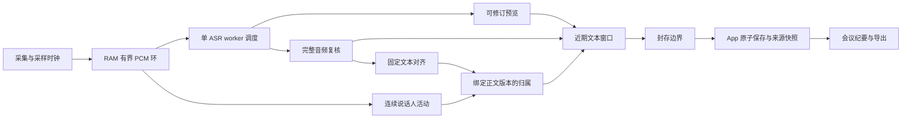

# 会议助手与实时字幕识别策略设计

本文是调研与设计提案，不表示完整方案已经实施或完成质量验收。初始调研于 2026-10-16（Asia/Shanghai）只读取代码、契约、能力快照与公开资料；边界复核规则于 2026-10-18 按开发实测更新，运行与验收事实见[实施审计](../../implementation/2026-10-18-meeting-diarization-handoff-audit.md)。可执行任务、接口和验证命令见[实施计划](../plans/2026-10-16-meeting-caption-asr-implementation.md)。

## 1. 推荐决策

保留一个共享 ASR worker，采用两套应用策略：**会议延后定稿，以文字和说话人归属准确性为先；字幕即时显示，允许近期内容自动回溯修正，再封存为正式记录。** 两种策略共用采样时间轴、有界音频、完整音频复核、版本账本和资源调度。

关键变化是把「屏幕上已经显示」「文字较稳定」「识别已定稿」「说话人已确认」「记录已保存」分开。字幕行数与换行不决定 ASR 切段；VAD 检测到停顿不直接等于文字定稿；说话人信息晚到也不阻塞文字展示。

ASR 优先复用已接入的 Qwen3-ASR-1.7B 与 Qwen3-ForcedAligner。用户补充“会议会有更多人，主要讲话人会在 4 人以内”，因此**会议完整方案必须包含动态人数分人**，不能因主要发言者较少就沿用 4 槽模型假称支持整场会议。推荐先验证固定 FluidAudio SDK 已有的分割＋embedding＋VBx 内存管线；现有 Sortformer 保留为 ≤4 人对照。新分人制品尚未准备，本次选型不包含下载或加载。所有下文数值均为**待验证的初始候选**，不是已测得的最优值或性能承诺。

## 2. 当前能力与缺口

> 🧠 **From Hindsight memory (四场景共享 ASR：策略与契约落地)** — 既有设计决定采用单 worker、共享识别内核、App 场景预设、可修订预览与整段复核。当前源码已实现这些机制；该记忆页截至 2026-10-06 的“尚未实施”状态不能代表今天，已另存 Correction。

| 项目 | 核验结果 | 对设计的含义 |
| --- | --- | --- |
| 本机发现快照 | `quality/quality`，profile 一致；ASR/diarization readiness 为 true；ASR 配置为 `mlx-community/Qwen3-ASR-1.7B-8bit`；查询时 worker 为 `cold_evicted`、runtime revision 未知 | 支持路线与制品配置已确认；本次没有执行推理，不能由 readiness 推出准确率或延迟 |
| 会议预设 | 预览 1000 ms，静音 900 ms，请求段长 20 s，`full_segment` | 已有准确性复核；开启分人后有效段长仍被压到最多 8 s |
| 字幕预设 | 预览 500 ms，静音 400 ms，段长 8 s，`full_segment` | 已支持边说边显示，以及当前段从预览到终稿的整段纠错 |
| 预览解码 | 累计音频重解码；默认 `rollback_tokens=5`；当前服务始终发送 `stable_prefix_codepoints=0` | 回退 token 数只是省计算的启发式，不能当作不可改写前缀的证据 |
| 最终识别 | `full_segment` 用已加载 session 对完整有界 PCM 再识别；两种 finalization 的 final 都不强制保留预览前缀 | 无需增加第二个 ASR 模型进程，就能修正此前整个预览 |
| 文本终态 | 一个 utterance 恰好一个 `completed` 或 `failed`；客户端退休已完成 item | 当前不支持改写已经发布终态的旧 item，也不支持跨旧 item 的正文回溯 |
| 对齐与分人 | 文本 final 后独立产生辅助事件，带 transcript/metadata revision；归属可后续更新 | 已有辅助版本与失效保护，但不等于正文自动修订已接通 |
| 分人后端 | 固定 FluidAudio revision，`SortformerNvidiaLow_v2.1`、`balancedV2_1`，4 个槽位；仅输出 finalized frames | 当前最多 4 人；重叠、短应答或远距离声音可能保持未知，不能按段轮流猜人 |
| 人数边界贯穿各层 | `ActivityFrame.scores`、归属计算和 App `SpeakerLabeling.maxSpeakers` 都含 4 人假设 | 动态分人不是只换模型；必须同步内部活动类型、能力协商和 UI 上限 |
| App 存储 | 有正文保存队列、转录 revision 和 source snapshot；`appendLine` 已核对固定 ID 的冻结字段 | 正式正文继续只追加一次；新增可变窗口检查点与整批幂等保存，不自动改写已定稿行 |
| 音频 | 会话 PCM 不落盘；Realtime wire 是 24 kHz mono PCM16，识别内核 16 kHz | 回溯只在 RAM 保留的有限区间内成立；不能承诺会后重跑整场会议 |

8 s 是当前 `effective_segment_ms()` 在分人开启时施加的软件能力上限，并非 Qwen 模型本身只能识别 8 s。单独开启 alignment 没有同样的这条分人硬限制。当前 App 在开启分人时同时开启 alignment，两者在客户端配置中仍耦合。

本次修复验证过的“有终态、对齐成功、匿名标签能到达”，只证明相关链路可工作；短合成样例不证明真实会议 CER、多人归属质量或持续字幕延迟已达标。

## 3. 调研结论与适用边界

| 一手资料 | 可采用的实践 | 在 SpeechRail 中的处理 |
| --- | --- | --- |
| [Qwen3-ASR 官方实现](https://github.com/QwenLM/Qwen3-ASR)、[技术报告](https://arxiv.org/abs/2601.21337) | 流式与完整音频识别可以由同一模型承担；时间对齐是独立能力 | 继续复用本机 MLX 适配器；官方 vLLM 路径及其硬件指标不直接适用于本 Mac |
| [Whisper-Streaming 论文](https://aclanthology.org/2023.ijcnlp-demo.3.pdf) | 滚动音频、跨更新比较、上下文与按句裁剪；计算时间必须计入延迟 | 采用有界滚动复核；LocalAgreement 仅帮助显示稳定，不作为语义正确或永久不变证明 |
| [SimulStreaming 官方实现](https://github.com/ufal/SimulStreaming) | AlignAtt 利用 encoder-decoder attention 判断何时继续输出 | 当前 Qwen adapter 没有对应 attention 证据，不能把 AlignAtt 当作可直接打开的选项 |
| [Apple SpeechAnalyzer volatileRange](https://developer.apple.com/documentation/speech/speechanalyzer/volatilerange) | 明确哪些音频区间的结果仍可替换，范围之外可合并为正式内容 | 借鉴“可变窗口＋单向封存边界”的协议语义；不因此更换识别后端 |
| [Google StreamingRecognitionResult](https://docs.cloud.google.com/speech-to-text/docs/reference/rest/v2/StreamingRecognitionResult) | interim、stability、final 语义分开 | UI 稳定提示不能冒充 confidence；final 只能在不再自动改写时发布 |
| [Partial Rewriting for Multi-Stage ASR](https://arxiv.org/abs/2312.09463) | 及时展示与较慢的高质量复核需要明确的合并机制 | 借鉴分阶段结果合并；本文采用同 worker 串行复核，不照搬双模型部署 |
| [在线分人研究](https://arxiv.org/abs/2109.06483) | 分人存在前视、稳定性与延迟的取舍，重叠应显式处理 | 会议可以等待稳定归属；字幕不等待分人，证据不足保留未知 |
| [固定版本 Sortformer 文档](https://github.com/FluidInference/FluidAudio/blob/5c19d5e12320e22bbfb7a1877b089d2665a69add/Documentation/Diarization/Sortformer.md) | 4 人上限；上下文参数受编译模型形状约束 | 不通过改配置把现有 low 模型伪装成 high-context 模型，也不承诺 5 人以上可分 |
| [流式识别稳定性研究](https://arxiv.org/abs/2006.01416) | 准确率、延迟、文字反复改写需要分别衡量 | 验收同时统计 CER/WER、字词显示延迟和改写量，不能只看首字速度 |
| [Qwen 官方流式状态实现](https://github.com/QwenLM/Qwen3-ASR/blob/main/qwen_asr/inference/qwen3_asr.py) | 累计音频与可回退前缀是解码状态；最初若干块可不用历史前缀 | 核对本机 adapter 的独立实现；不把 token 回退解释为声学流式编码器或质量保证 |
| [Qwen 上游问题 #186](https://github.com/QwenLM/Qwen3-ASR/issues/186) | 用户报告提示词混入转录，弱音和近音时偏向热词 | 这是风险线索，尚未在 SpeechRail 复现；术语默认空，增加静音、无关词、近音负对照 |
| [固定版本 FluidAudio 离线入口](https://github.com/FluidInference/FluidAudio/blob/5c19d5e12320e22bbfb7a1877b089d2665a69add/Documentation/Diarization/GettingStarted.md) | 已有内存数组入口及分割、embedding、PLDA/VBx 组件 | 5+ 人路线无需强制落盘音频，但需要额外制品、匿名跨窗口匹配和独立资源验收 |

这些资料支持架构选择，不证明下文候选参数最优。2026-09 的 [Qwen-Audio-3.0-ASR 报告](https://arxiv.org/abs/2609.07549) 也讨论了专门的 streaming variant；本项目尚未核验其可用本机制品、MLX 适配和资源需求，不能据此替换当前模型。

## 4. 两类场景的处理策略

### 4.1 会议：完整语义与归属准确性优先

会议按自然停顿关闭候选段；连续发言达到预算时，在邻近停顿优先切分，并保留边界两侧的声学上下文。完整音频复核不锁定预览文本。初始比较当前 8 s 基线与 16–20 s 上下文候选，确认后者确实改善中文专名、长句、否定词与中英混说才启用；更长不自动等于更准。

预览可每 1–2 s 更新，供用户确认正在记录。段关闭后允许约 1–2 s 后续音频参与边界复核；没有新音频时按有限等待完成，不为等待上下文无限挂起。完整复核成功后再定稿，随后补齐已经稳定的说话人。会议纪要只消费已封存且保存确认的来源快照；人工编辑和纪要润色都不反向覆盖声学转录。

会议术语通过用户提供的少量名称、缩写和产品词传入现有 `keywords`/context 能力，不把会议议程、预期答案或上一段全文作为强制识别文本。默认词表为空，先比较空词表、相关词、无关词三组；候选上限 32 词、总计 512 Unicode codepoint，去重并拒绝超限，不静默截断。静音和未提到术语的样本必须检测词表泄漏；不能通过删除输出中所有术语掩盖问题，因为其中可能有真实发言。混合语言默认自动识别；只有语言明确时才固定语言，并用中英混说语料验证副作用。当前会议/字幕工厂没有把这类场景词表完整接入，是需要补齐的 App 能力。

远程会议优先使用选定会议 App 的直接音频；同时录本地麦克风时提示使用耳机，检查双路重复、削波和丢帧。当前会议混音链路不能被当作已经具备语音助手同等的系统 AEC。按来源保留时钟和诊断计数，先保证输入正确，再评价识别；来源本身不等于某个说话人。

### 4.2 字幕：即时预览＋近期自动回溯

显示从第一份非空 hypothesis 开始，不等待停顿、整段复核或说话人标签。以现有 500 ms 预览为基线，比较 300/400/500 ms；只有真实计算余量足够时才缩短。最新预览整段替换，不能逐次拼接全文；预览任务合并为最新版本，PCM 保持连续。

界面维护“已经封存的历史＋仍可修改的近期内容”。近期内容继续显示，也可以换行成为多个字幕 cue，但尚未对外承诺不可变。停顿、预算边界及后续上下文触发 prefix-free 复核，自动原位修正错字、漏字、数字和断句。

初始候选为：输入所有权块不超过 4 s，关闭后保留最多 8 s 的复核宽限。因而最早可能被改写的字距当前约 8–12 s，而不是严格的“屏幕上最后 8 s”。完整解码窗口上限修正为 **14 s = 4 s 所有权块＋8 s 后续观察＋2 s 左锚**；此前 12 s 的候选不能同时容纳这三项。快速预览只计算当前活动块，不携带需裁剪的左右音频；左锚和后续上下文只用于较低频的完整复核，避免预览还要等对齐去重。相邻未封存块可经有证据的边界事务合并，正式 item 不必与 4 s 输入块一一对应。可替换窗口在连接内单向推进，封存后的历史不再自动改字。

连续两次独立音频更新的一致前缀可呈现为“较稳定”，末尾仍呈现“正在识别”。如果两次预览共享强制 token 前缀，这种一致甚至不是独立证据；不得将它转换成 `stable_prefix_codepoints>0` 或提前锁死文字。正式复核有权修正整个未封存区间，包括较稳定前缀。

字幕浮层默认显示少量近期行；换行由显示空间与语义决定，不触发 ASR commit。文本修订保持当前阅读位置，不整块清屏、不抢焦点；向上回看时不自动跳到底部。字号、材质、状态提示和 Reduce Motion 复用现有设计系统。识别中/已定稿的区别同时有文字或无障碍状态，不能只用颜色表达。

渲染只更新实际改变的近期单元，相同正文快照不触发整场重排；音量等高频状态不驱动历史转录布局。保持当前修复中的原生滚动与用户交互判定，不重新引入几何测量→状态写入→再次测量的反馈环。滚动、选区、复制与窄窗口重排都要纳入字幕修订回归。

### 4.3 候选参数与边界

| 参数 | 会议候选 | 字幕候选 |
| --- | --- | --- |
| 预览间隔 | 1000–2000 ms，起点 1500 ms | 300–500 ms，先保留 500 ms 基线 |
| VAD 静音 | 900–1200 ms，起点 900 ms | 400–600 ms，起点 400 ms；仅关闭候选段 |
| 音频所有权单元上限 | 16–20 s 候选，必须与 8 s 配对 | 4 s；与现有 8 s 配对 |
| 完整解码窗口上限 | 24 s，包含最多约 2 s 左/右上下文 | 14 s，满足 4＋8＋2 s；另比较 8/10/12 s 的短窗组合 |
| 定稿前后续观察 | 候选段关闭后最多 2 s | 单元关闭后最多 8 s；提前停止时立即进入收尾 |
| 完整复核调度 | 段关闭/窗口封存时必做 | 关闭后必做；近期候选合并调度，起点至多每 2 s 一次 |
| 说话人 | opt-in；动态人数后端，等稳定证据后确认 | 默认关闭且不等待；≤4 人分人仍可用当前后端 |
| 模型 | 当前 1.7B Q8 基线；BF16 只作候选对照 | 同一个已选 ASR 模型，不另起低延迟模型 |

16–24 s 解码以及大于当前辅助 PCM 预算的对齐，均是**需要实施与验证的新能力**。不能仅修改 `max_segment_ms`，也不能直接删除 8 s 限制：必须先拆开 ASR 上下文预算、对齐窗口预算和分人流式输入预算，并通过内存/超时/取消验收。候选组合必须满足 `max_decode_ms ≥ owned_ms + review_grace_ms + left_context_ms`；调短窗口时同步缩短宽限或输入块，不能裁掉仍需复核的音频。

## 5. 共同架构与版本语义



### 5.1 职责与采样坐标

服务负责可修订语音事实、PCM 生命周期、识别/对齐/分人和资源准入；App 负责 cue 布局、窗口状态、文字存储、用户编辑与纪要。服务不引入会议数据库、LLM 编排或跨会话声纹库。

必须区分四种区间：连续采集时间轴、模型实际看到的解码窗口、该结果拥有的正文音频区间、屏幕显示 cue。左右上下文可以重复送给模型，但拥有的区间必须明确，不能把上下文文字再追加一遍。内部用 16 kHz 整数样本，公开延续 24 kHz wire 半开区间及确定性映射，时长与归属不由回包时间推算。

归并不能只靠字符串最长公共前缀。重复短语、停顿、说话人轮换和模型改字都可能使字符串重叠歧义；跨边界裁剪必须有真实时间对齐与音频所有权证据。边界证据不足时保留整个有界候选，不猜单字时间、不把 phrase 均分。

### 5.2 新增可修订窗口协议

目标需要一个显式协商的 `revision_window_v1` 能力。以下名称是**设计中的新增字段/事件**，现在调用会被拒绝，不应写成现有公共能力。

- `session.updated` 回显可变窗口、解码上下文、预算及封存策略；未确认前不开始该模式。
- `speechrail.transcription.window.updated` 是**完整窗口快照**，包含连接身份、`window_id`、严格递增的 `window_revision`、`audio_span`、`sealed_through_sample` 与有序 `units[]`。unit 带独立 ID、全文、拥有的音频范围、`text_revision`、当前复核状态。它们是 provisional unit，不提前冒充官方已完成 item。
- 每个新快照原子替换同一窗口的旧快照；允许跳过中间 revision 接纳更大的完整快照，不要求连续收到所有预览。分裂、合并和删除通过快照中的 unit 集合变化表达。不存在的旧 provisional unit 被退休，迟到结果失效。不发送一串可部分应用的“删字/插字”补丁。
- 已封存范围只前进，不允许新快照跨过去改写。封存时为最终 unit 建立正式 item，恰好发送一次官方 `completed`；真正失败才 `failed`。解码尝试使用内部 `decode_id`，不把每次尝试冒充一个必须产生终态的公共 utterance。
- `speechrail.transcription.window.sealed` 携带唯一事务 ID、窗口 revision、新封存边界、完整的本批最终 unit 快照及其正式 item ID，作为原子接纳依据；不依赖此前每份预览都送达。对应官方 `completed` 与这些固定 ID 一一相符，客户端只通过窗口事务投影/保存一次，不再从同批 `completed` 重复追加。重复事务幂等，冲突版本或退回的边界显式拒绝并保留最近一份有效快照。
- 原有其他场景没有请求该模式时继续使用已定义的 hypothesis/terminal 路径。新模式只消费窗口快照进行预览，避免同时拼接旧 hypothesis。官方 `completed` 的“此后不自动改写”语义不变。

窗口状态为 `preview → reviewed → sealed`；`reviewed` 仍可被后续完整音频复核修改，`sealed` 才不可自动修改。人工编辑属于封存后的文档 revision，不能被迟到 ASR 自动覆盖。

窗口还维护不面向 UI 的输入覆盖账本：有语音但识别为空、失败和静音都不能凭空从采样覆盖中消失。曾显示非空文字而最终为空时保留未完成恢复材料，不把预览当作正确终稿。结束输入的 commit 屏障必须覆盖其累计样本水位内全部待封存窗口；窗口事务、文字终态与失败证据发送完毕后才发输入回执。辅助归属另走既有 drain，不能拿最后一个 item 的成功替代整个输入完成。停止时不再等未来音频，以实际保留 PCM 复核尾窗；模型私有 EOF padding 不计入输入或公开时间轴。

识别失败和保存失败按两个状态机处理，顺序与重试规则如下：

| 情形 | 服务文字终态 | App 保存与恢复 |
| --- | --- | --- |
| 合格复核完成并封存 | `window.sealed` 固定正式 item 与正文，各 item 唯一 `completed`；不等待 App 数据库 | 冻结本批保存命令，再执行 Store 事务；确认前显示“正在保存” |
| 到期仍无合格复核或识别失败 | `window.failed` 给出已退休候选、覆盖范围及唯一失败身份，对相应正式失败 item 发唯一 `failed`；不发 `completed` | 最近非空预览仅作为未完成恢复材料，排除正式正文与纪要；失败的保存仍可按同一恢复命令重试 |
| 服务成功、Store 事务失败 | 已发的 `completed` 不撤销，也不补发 `failed` | 冻结正文与 ID 保留待保存/失败状态；重试同一批命令和同一 line ID，不重跑 ASR、不生成新 UUID 绕过去重 |
| Store 成功 | 不产生第二个 ASR 终态 | 保存确认后才推进 App 已保存边界、来源封存与纪要准入 |

ASR 已产生失败终态的 item 不会在重试中变成成功；终态前可在同一预算内重新计算，终态后显式重新识别必须使用新身份并仍有合法 PCM 来源。已释放音频无法重识别，保留文字恢复/人工处理出口。输入回执不证明 Store 成功；App 的停止完成要同时满足协议 drain 和保存确认，缺任何一项都保留未完成状态。

### 5.3 对齐、说话人与正文同步

任何文本替换都会递增 `text_revision`，并立即作废旧 codepoint 范围、旧对齐及依赖它的说话人归属。旧标签不能按字符偏移搬到新文本上。重新对齐与归属成功后，按 `text_revision + metadata_revision` 接纳；慢任务即使后来成功，只要版本已变就丢弃。

分人引擎持续看连续 PCM，不能按每条字幕重开或重置匿名 label。当前 Sortformer 的模型结构和 session 内 4 个槽位保持不变，不能用它承接多人会议目标；更大的 ASR 复核窗口不等于更改 Sortformer 的编译输入形状。会议目标采用单独协商的 `meeting_dynamic` 后端，跨窗口维护 session-scoped 匿名 ID，字幕不因此增加等待。

归属使用实际对齐单元与说话人稳定水位；必要时在有证据的说话人边界拆成多个展示单元，不能把一整个多说话人段强贴给一个人。`segment` 输出可能已经包含多个有效单元，不能把这个名称误解成一整段只有一个时间块。精细粒度不足时合并到可信范围，保留 `unknown`/重叠状态，不能制造每字时间。

对齐失败只说明缺少文字到音频的时间证据，不是“听错了”的检测器。它不修改已经确认的正文，也不能证明一次候选纠错更准确。字幕文字显示不依赖对齐；需要精确跨边界裁剪的候选若对齐失败，则不采用该跨边界替换，保留最近有效预览，并在同一预算内尝试只用拥有区间的 prefix-free 完整识别。后者完整返回时可按 `owned_only` 复核封存，记录 `boundary_context_unused`，分人可保持 unknown；它不宣称利用了邻段纠错。两种完整识别均不合格才进入恢复失败，绝不把预览改名为终稿。

4 人上限属于现有后端能力声明，不能由“主要发言者只有 4 位”绕过。动态人数分人已按用户场景列为会议必选工作包，见[多人分人实施计划](../plans/2026-10-16-meeting-diarization-implementation.md)。当前 checkout 已核对 `process(audio: [Float])`、`initialize(models:)`、可变人数配置和输出 embedding；SDK 存在 API 不代表本机已安装相关制品。请求路径禁止调用会下载、重编译甚至在加载失败时清理缓存的 `prepareModels()`，须在运维准备后只读加载本地模型。滚动窗口的跨窗口匿名身份、资源、制品许可和质量都须单独验收，禁止把各窗口 A/B 编号直接拼接成全场身份。

## 6. 有界资源、调度与失败出口

### 6.1 PCM 与计算生命周期

内核只在 RAM 保留最长 60 s 的 16 kHz mono PCM16，原始样本约 1.83 MiB；一个 24 s 快照约 0.73 MiB，float32 转换另约 1.46 MiB。环、借用、复制、下一段输入与辅助任务必须一起计费，不能只算原始 PCM。设计先给 PCM 及其副本 16 MiB 硬预算；模型特征、KV/cache 和进程 resident bytes 另由实际资源声明与 Governor 计费，此预算不是整个服务内存上限。

只能保留一个正在运行的重解码操作和一个可替换的待执行预览；复核任务按受影响窗口合并，但封存任务不可丢弃。一次只向同 ASR worker 发一个重操作，复核通过内部执行端口复用已加载 session，不在流式会话旁调用 REST batch ASR 或创建第二个模型进程。

字幕按最近预览需求与封存截止时间调度；会议优先完成复核，预览可降频。已经开始的 MLX 操作不能假定可抢占；Python timeout/cancel 后，必须等实际计算结束或 worker 确认回收后才能归还槽位。单次重操作的最长阻塞也必须进入字幕 p95 延迟评估。

预览和复核共用计算预算：按代表性样本测得的计算耗时与触发频率核算总占用，初始为输入处理保留至少约 20% 余量。若一次不可抢占复核本身已超过字幕的及时性门槛，仅缩短预览间隔没有用；应比较更短上下文与更少复核的质量/延迟曲线，仍无法同时达标时报告该单模型路线的实测上限，再评估解码器内部可中断调度或其他模型，不虚构硬实时保证。

负载增加时先合并/降频可替换预览与额外复核，保留已接纳 PCM、必要的完整复核与封存。回溯宽限是上限，不强迫每段重复计算到期；可在已取得合格完整复核时按预算提前封存。无合格复核且期限/内存到限时，将最后预览保存为可恢复未完成材料并明确提示，不能把它标成复核成功。所有降级都有稳定原因码。

已封存且无任务借用的 PCM 立即释放；不能借 TTL 无限 pin。停止、暂停、来源切换、清空和断连都确定边界：先停止追加，完成输入屏障，再有限排空待封存文字和辅助信息，最后释放环与任务。来源切换不拿新来源补旧窗口上下文；切换前未完成部分保留明确缺口。

60 s RAM 环是容量上限，不是允许积压 60 s 的调度目标。至少 20 s 的输入积压即判定处理追不上，进入明确中断/恢复；不静默丢 PCM，也不无限延长字幕延迟。阈值应在实际压力验收中收紧。

### 6.2 保存与派生内容

活跃可变窗口由 App 内存维护；需要崩溃恢复时，只以有界、合并后的 provisional 文本恢复材料落本机 SQLite，明确排除正式索引、默认导出和纪要。不中间保存 PCM、embedding 或完整识别轨迹。

封存保存沿用唯一 persistence owner，并增加原子事务：验证冻结命令和检查点父值，写正式正文、必要的起始 revision 与索引待办，同时缩短或退休对应 partial 检查点；提交成功才确认并退休内存中的旧 provisional unit。**不在每条字幕封存时重建整场 `source_snapshot`**：现有 `sealMeetingSource` 会扫描全部 final 行，应在停止排空、用户生成纪要或显式来源封存时调用，避免频繁快照形成随会议时长增长的重复扫描。现有 `recordTranscriptRevision` 单独写入也不能代替整批事务。

首个交付不提升 SQLite schema v13：正式记录、修订、来源快照与未完成恢复材料复用现有表、字段和旧 App 可识别的枚举值；窗口 ID、计算尝试及尚可替换的候选账本只存在于连接/进程内。每个捕获代次最多一个 `line.status='partial'` 检查点，以固定 line ID、原字段比较和单队列顺序更新；不经严格禁止覆盖的 `appendLine` 冒充幂等重试。初始每 2 s 至多更新一次，落盘也可能落后 2 s 加队列/事务时间，不能承诺零丢字。封存事务只更新或删除自己精确匹配的检查点，留下仍未封存的尾文；重启只把残留 partial 视为恢复材料，不能自动续接旧音频或纳入正式来源。实施者需用旧版本读取新生成记录的测试证明可访问性；若必须新增持久化字段，先提交具体加法迁移和旧版本读取方案。

会议纪要以封存并保存的 `source_snapshot` 固定来源。识别尾段未完成、保存失败或分人部分缺失必须保留其状态；纪要生成失败不损失转录，也不能通过 LLM 润色把未知词或未知说话人伪造成确定事实。本设计不包含先前观察到的纪要 HTTP 400 故障修复。

### 6.3 可观测性

分开记录捕获丢帧/削波/静音、输入采样水位、队列等待、预览计算、首字显示、完整复核、封存、对齐、归属及 Store 确认延迟。使用单调时钟，明确麦克风本地计时与服务端计时的起终点；不要把预览间隔当作端到端延迟。

失败原因至少覆盖 `review_queue_overflow`、`review_audio_expired`、`review_deadline`、`revision_conflict`、`stale_result`、`boundary_unresolved`、`capture_gap` 与已有 alignment 原因码；`boundary_context_unused` 属于成功但降级的诊断，不伪装成识别失败。新增名称要经统一 envelope/schema 落地，不能临时透传异常正文。指标只用有限维度 reason/mode，request/session/window ID 只用于受控诊断关联，不作指标标签。日志不包含原始音频、全文、词表、embedding 或绝对模型路径。

## 7. 方案取舍

| 方案 | 收益 | 代价与结论 |
| --- | --- | --- |
| 只调整现有预设 | 成本最低，保留当前段预览纠错 | 解决不了已完成 item 的跨段回溯，也没有扩大真实上下文；作为基线保留，不能独立满足目标 |
| 单模型＋两种策略＋可变窗口 | 复用现有 worker，保持即时字幕，给近期纠错和较完整会议复核统一语义 | 需要协议、预算、客户端与存储联动；推荐目标 |
| 独立快模型＋精模型并行 | 有机会进一步减少首字时间 | 多模型驻留、治理与对齐成本显著增加，并违反当前同机 batch/streaming 产品边界；不作为本轮路线 |
| 保存全场音频，会后完整重跑 | 有机会做全局 ASR/分人优化 | 改变 PCM 不落盘的产品隐私边界，且无法仅靠有限 RAM 满足无限时长；不是当前方案，另行明确决策 |

本方案提升的是有音频依据的识别与修订能力，不能恢复根本没采到的声音，也不能保证同时重叠发言都被完整识别。高精度 BF16、其他 ASR 或动态人数分人只在实际语料证明收益、明确制品和资源预算后进入后续选择；不会因“会议准确性优先”自动换档或下载。

## 8. 实施顺序与验收门

1. **建立当前基线。** 固定现有制品、preset、代码与运行身份；准备独立人工参考，覆盖自然会议、远程会议、中英混说、专业词、数字/否定词、快速轮换、短应答、远音和重叠。TTS 合成仅补边界样例，不作为质量主证据。
2. **先交付版本与资源底座。** 确定窗口协议/schema/Swift 类型与状态机，拆开三类音频预算，加入有界 PCM 借用和单 worker 调度；先以 fake 证明行为，再接真实模型。
3. **会议准确性策略。** 8/16/20 s 配对与词表对照，接完整复核、稳定归属和来源封存；动态人数分人与跨窗身份同期实施，不能用 4 槽位结果宣称多人会议验收完成。
4. **字幕自动回溯。** 接近期窗口、prefix-free 复核、修订失效与客户端原子替换；再比较 300/400/500 ms 和回溯宽限，冻结质量/延迟/稳定性的折中。
5. **联合验收与上线。** 分开验证自然语料质量、长时资源、真实采集和 UI。运行态/模型/UI 操作按届时明确授权执行；本文本身不启动这些操作。

| 验收维度 | 方法与初始门槛 |
| --- | --- |
| 文字准确性 | 中文 CER、英文 WER 分组报告，另报数字/金额/日期/否定词/专名错误；保留原文评分与规范化评分，标点另计。会议在相同测试集整体不退化，目标相对 CER 降低至少 10%；95% 配对区间不足以支持收益时结论为未证实，不能凭平均值判优 |
| 字幕首字 | 从真实语音起点到第一份非空文字已提交 UI；热态初始目标 p95 ≤1.0 s，冷启动单独报告。不是只测服务收到包到发包 |
| 字词及时性 | 连续长句中每个可对齐字词的音频结束→第一次显示，以及最后一次改写→封存；初始目标 p95 首次显示 ≤1.5 s。避免只首字快、后文持续落后 |
| 字幕终稿质量 | 与同模型完整窗口参考比较，初始容差 CER 不差于 0.5 个百分点；同时与当前线上策略做配对比较。完整窗口参考也要与人工参考评分，不能把它当真值 |
| 改写体验 | 统计每百个最终字删除/替换的可见字数、每 cue 修订次数、修订发生年龄与 correct→wrong / wrong→correct；与基线同时报告，封存后自动改写数必须为 0 |
| 分人 | 报 DER/JER、说话人归属文字错误和 unknown 比例；已标注部分正确率与覆盖率同时报告，不能通过全部 unknown 或强制全部标人取巧。≤4 人与 5+ 人分组，重叠单列；有独立词时间参考才计算对应时间/归属指标 |
| 输入与边界 | 相同 PCM 不同分包结果的 admitted 样本与顺序一致，所有权无重复无遗漏；保留 511/512/513 样本、奇数尾长、重采样尾部、时间格点、空 final、重复 commit 和 EOF 回归 |
| 修订状态机 | 乱序、重放、旧 epoch、旧文字 revision、边界合并/拆分、迟到分人、用户编辑和断连；旧结果不得串写，无双终态，正式保存与来源快照一致 |
| 资源与稳定性 | 30–60 min 代表性负载及长句/慢客户端压力；PCM/待执行任务严格有界、无随时长增长的未封存账本，结束归零、CPU 不忙等。App 静止界面持续 5 min 采样时，初始目标平均 CPU <5%、p95 <20%（进程口径，推理 worker 另报）；无连续 30 s 单核近 100% 的 UI 空转，无新 hang/crash |
| 完整收尾 | 停止后检查输入屏障、最后文字、分人 drain、保存确认与资源释放；未完成材料可恢复，不能以窗口关闭或 `/readyz=200` 代替完成证据 |

这些数值是建议验收目标，须随同一设备的基线、代表性语料和实际测量确认。先按场景设置权重：会议优先 CER/事实词/说话人归属，再控制资源；字幕在 p95 及时性约束下优化 CER 和改写量。若没有任何候选同时满足门槛，报告 Pareto 取舍与数据后再调整目标，不静默降准确性换延迟。

上线把窗口能力与两种场景策略分别开关控制，保存旧可执行 release 与 profile selection。首选回退是关闭窗口能力或退回旧服务 release，保留新版 App 读取全部记录，回到当前单段 hypothesis→full_segment 路径。需要回退 App 时，依赖上面的 schema v13 和旧可识别值约束，必须实证旧 App 能读取本轮新建的正式记录与恢复材料；这项失败则禁止该版本进入安装交付，不以让新记录不可访问作为回退方案。回退不回滚用户数据库、不删除修订、不用备份覆盖新记录。协议细节可由实施者细化，记录可访问性和唯一终态不是可选项。

## 9. 工程决策：实施者无需重新选择的边界

### 9.1 模式协商与身份

新增请求位于 `session.speechrail.window`，值为 `{"mode":"revision_window_v1","scene":"meeting"}` 或 `caption`。两种场景不接受自定义浮动参数；服务由经过验证的场景策略生成全部有效值。在同一请求中同时传入 `window` 和旧 `session.speechrail.asr` 时拒绝，避免两套段长含义。语言、keywords、endpointing 与分人仍使用已有字段。

`effective_capabilities_v1.operations.realtime_transcription.revision_window` 声明 `status/reason/modes/scenes/limits`；`session.updated` 回显 `session.speechrail.window.mode/scene/policy`，policy 至少包含 preview、owned、grace、left-context、max-decode、总 PCM 字节预算与 `finalization_budget_ms`。新增服务设置 `asr_revision_windows_enabled` 默认 false；首版要求原生 window adapter、ASR 和 word alignment 制品/能力及实际 ready 握手都满足，才能宣称支持上下文回溯。分人仍是独立 opt-in；其关闭不关闭内部边界对齐。App 在确认回显之前不启用采集。服务未提供该能力时，开始前明确使用原有单段路径；不得在活跃窗口中途静默换协议。

wire 上的窗口身份为 `(session_id, input_epoch, window_id)`：`input_epoch` 为 clear/来源切换后递增的非负整数；`window_id` 在该输入代次内固定，封存前缀推进不更换它。`window_revision` 是**整个快照**的版本，每次原子正文变化或封存递增；单元的 `text_revision` 仅在该单元正文变化时递增。内部 `attempt_id`、worker generation、候选父版本不作为 UI item ID。App 收包时再绑定本地 `(record_id, connection, generation)`；不从某个“当前记录”全局变量补身份。

### 9.2 最小事件字段与顺序

所有音频 span 为 24 kHz wire 半开区间，字段为 `{start,end}`；内部端口才使用 16 kHz。`sealed_through_sample` 表示已给出成功、静音或失败处置的单向覆盖边界，不能单凭该数值声称全部识别成功。事件保留既有 `event_id/request_id` envelope。

| 事件 | 必须携带的窗口字段 | 客户端动作 |
| --- | --- | --- |
| `window.updated` | 身份、revision、`audio_span`、sealed frontier、`units[]` | 完整替换未封存视图；同版本同内容可忽略，同版本不同内容报冲突 |
| `window.sealed` | 上述身份、revision、`transaction_id`、连续 `closed_span`、新 frontier、`final_units[]`、`remaining_units[]`、`coverage[]` | 即使没收到任何 updated，也能原子接纳终稿和剩余预览；冻结一批保存命令 |
| `window.failed` | 同样的事务与范围、`failed_items[]`、有界恢复文字、`remaining_units[]`、覆盖及稳定 reason | 退休失败候选并保存 partial；不冒充 completed |

单元字段固定为 `unit_id/text/text_revision/owned_span/state`；state 只取 `preview/reviewed`，sealed 事件的 `final_units` 另带 `item_id/review_scope`（`contextual` 或 `owned_only`）。`coverage` 的 span 连续无重叠，outcome 为 `speech/silence/failed`；这里 silence 只表示 VAD 未接纳，不证明真实没有语音，需附 `vad_not_admitted` 原因并进入质量漏检评测。失败 span 有失败 item ID，静音不造空白 UI 行。有语音但完整识别为空时仍产生合法终态和覆盖；若先前非空预览消失，同时保留 recovery，不能自动证明是静音。

每次终态事务依次发送：窗口 sealed/failed → 对应 item 的 `segment_closed` → 各 item 唯一 completed/failed → 之后才可能发送 commit receipt。辅助 alignment/diarization 只引用已建立的正式 item 和固定 transcript revision，沿用现有事件。新模式不发旧 hypothesis/delta；新 App 对本批官方 completed 只核对正文与 ID，不再次追加。普通未协商场景完全走已有路径。

快照限制：最多 32 单元，每单元最多 8192 codepoint、总正文最多 32768 codepoint、编码事件最多 256 KiB。ID 长度 1–128；整数拒绝 bool/负数/溢出，span 必须位于本代次已接纳样本范围。违反上限显式失败，不能截字伪造完整结果。服务与 App 只保留最近 64 个终态事务指纹处理重放；更老的 revision 在 frontier 下直接忽略，跨旧 frontier 的新内容一律拒绝。连接不支持恢复重放，断连后新建输入代次。

commit receipt 新增 `window_revision/sealed_through_sample/failed_window_count`；其水位必须覆盖该 commit 冻结的 accepted samples，并且此前所有终态事务与镜像 item 终态都已发送。连续两次 commit 不重复封存。发送失败或断连时不伪造已发送回执；App 恢复最后已接纳的文字检查点。

### 9.3 解码端口与 worker 生命周期

现有 `RealtimeAsrSession.commit()` 会发唯一终态并关闭 segment；`Qwen3StreamingSession.close()` 在 cancel 路径会 reap worker，不能用它完成每次低延迟预览。新增独立的 `WindowAsrSession` 端口，与旧端口并列，业务层不探测 Qwen 私有成员：

```python
async def decode(request: WindowDecodeRequest) -> WindowDecodeResult: ...
async def close() -> None: ...  # 等待真实清理完成
```

request 固定 `identity/attempt_id/kind/input_span/pcm16/language/context`，kind 为 `preview/review`；result 固定回显身份、attempt、真实 decoded span、正文、language 与完整性结果。窗口协调器独占该端口，一个重操作在途；收到完整结果只结束内部尝试，不产生公共 item 终态。

私有 IPC 增加 `window.decode/window.result/window.close/window.closed`，复用现有 binary frame 和 `session_id` dispatcher，不走 REST batch 或 batch ticket。`ready` 必须显式确认 `window_decode_v1`。worker 至多保留一份当前 preview decoder state，以同一音频起点和递增水位复用回退 token；起点、epoch、language/context 改变或完成 prefix-free review 后清空该状态。review 直接调用已加载 session 的完整识别，检查截断/finish reason；`window.close` 清理缓存后确认，不卸载模型。迟到结果按 worker generation 与 attempt 拒绝。

连接逻辑上仍属于 streaming，保持既有外部 batch/streaming 互斥和 Resource Governor 规则；新增模式同机最多一个活跃 ASR 输入 owner。每个计算任务取得 `REALTIME_ASR` 资源，辅助 lane 是否并发仍取决于 active profile 的声明。正常结束只在当前计算完成后清理；deadline/cancel 无法中断 MLX 时，等待结果或精确 reap 当前受管理 worker，确认之前保留 lease 和 PCM 计费。新端口不得因调用方协程取消就提前归还资源。

### 9.4 边界归并算法与降级

输入块是采样覆盖和调度单位，展示 cue、临时 unit、最终 item 是另外三种对象。以下算法以整数样本执行，不能仅比较字符串：

1. 将每个至多 4 s 的字幕输入块（会议至多 20 s）登记为连续拥有区间 `[a,b)`；VAD 可提前关闭它。输入关闭不产生 ASR final。预览通常更新当前活动块；字幕块关闭后，尚未复核锁定的父版本可完成一次拥有区间预览，避免块尾文字等待整个宽限期。它不改变输入边界或封存状态，也不增加上下文复核。排队时只保存一个当前预览意图，不提前复制多份 PCM。
2. 对最早关闭块取 `[max(epoch_start,a-left), min(accepted,b+grace))`，冻结样本快照、涉及的已关闭候选父版本及 `attempt_id`。review 和边界对齐组成一个事务；该事务涉及的已关闭候选不再接受预览改写，活动尾块仍可独立预览。
3. 对 prefix-free review 的完整正文做真实对齐，内部请求 `segment` 单元。时间网格上没有独立时长的 token 仅按现有对齐规则保守合并到相邻单元，保留完整正文及覆盖这些时间点的真实跨度，不伪造 word 时间。只接纳完整落在拥有区间内的单元，筛除完全属于左锚和右上下文的单元；任何合并单元跨越拥有边界均走第 6 步，不拆分或按时间比例切中文字符串、英文单词。缺少有效对齐仍走降级，标点依附相邻实际 token。
4. token 跨过两个**已关闭、未封存且已锁定**块的边界时，合并这些块后原子替换；合并后拥有范围最多 12 s（字幕）或 20 s（会议），输入覆盖无遗漏无重复。跨过已封存边界、活动尾块或不能纳入同一预算的块时，不裁 token，不移动已封存边界，转第 6 步。合法自然停顿边界优先于预算切口。
5. 裁剪后候选的字符覆盖、音频单调性、范围和父版本均有效才接纳。新的完整窗口快照包含被替换前缀和未受影响的尾块；合并/拆分创建新 provisional ID，原 ID 退休。相同文本也不能忽略其音频归属变化；时钟变化必须重新校验。对齐只是边界证据，CER 优劣仍由人工参考评价。
6. 有歧义或对齐失败时保留最近预览，至多再做一次拥有区间 `[a,b)` 的完整识别，不带左右音频，结果完整则按 `owned_only` 封存；无可用预算或再次失败则 `window.failed`。自然停顿的无重叠完整拥有区间可直接复核，不强制等待对齐才能显示/封存文字。辅助分人失败仍独立报告。
7. 在最新合格复核已经涵盖拥有区间时，满足候选策略的后续观察量、到宽限或停止输入即可封存；不因每次预览都相同而省掉完整复核。封存产生全新正式 item，后续不自动改写正文。只有尚未封存的相邻块可做新一轮修订。

此算法允许“这次没有取得上下文纠错收益”的降级，不声称完整识别没有声学错误。需以重复短语、跨切口英文词、中英混写、标点漂移和错误对齐的反例验证，防止看起来合理但重复/漏字的拼接。

PCM 环在**重采样后的原始连续输入分叉处**接收每个样本一次，位置在 SpeechAdmission 之前；ASR admission 只提供语音范围/关闭决策，不再把带 pre-roll 的 PCM 追加进同一个环。分人也只接原始连续输入一次。静音覆盖不能提前穿过 VAD 的 pre-roll、候选帧、leftover 或尚未评分的 512-sample buffer；新增只读 `SpeechAdmission.retained_from_sample` 暴露仍可能被将来 start/audio 引用的最早样本，与调用者未评分缓冲共同约束可封存静音水位。EOF 先排完这些缓冲再封存，防止先把 pre-roll 标成不可变静音、随后又把它归给语音。

### 9.5 调度和有界账本

每连接上限为一个重 ASR 操作、一个合并后的 preview 意图、一个合并后的 review 意图和一个最早待封存意图；未封存块只在覆盖账本中计数，不为每个 PCM append 建任务。字幕在安全边界先处理临近封存 deadline，否则先满足已逾期的 preview，再做额外 review；会议优先 review。用最近已完成同长度桶耗时的保守估计判断任务能否容纳，估计没有样本时使用静态保守预算；deadline 到来后不能硬抢占运行中的 MLX。

宽限与计算期限分开：`context_cutoff=min(accepted,b+review_grace)` 是可用后续音频上限；`context_wait_until=closed_at+review_grace` 是最多等新音频的单调时钟时刻，两者任一到达或停止即可冻结最后一次复核。随后排队＋ASR＋边界处理的预算 `finalization_budget_ms` 初始为字幕 5000、会议 15000；绝对 hard deadline 为 closed_at＋grace＋该预算。它是失败/回收上限，不是延迟目标，提前已有合格复核可封存。正常跟上时近期可修订内容约 8–12 s，实际回包/定稿年龄还包含计算与排队，必须另报。显式停止的总 drain 预算初始 30 s，剩余窗到限失败/恢复，实际 worker 清理确认仍不可跳过。

`capture → ASR` 积压初始硬限 20 s；字幕另外记录“最老未显示语音年龄”，达到 2 s 连续 3 次观测即显示跟不上并停止增加额外 review，不能等到 20 s 才提示。服务可以提前封存已有合格复核；不得绕过最早待处理区间先封存后文。环覆盖需要的最老样本前，先使对应窗口失败/恢复，再释放借用；不能覆盖 pin。慢客户端只合并 updated，sealed/failed/terminal 队列满则明确断连及恢复，不能丢最终事务。

当前 `AttributionLedger` 的 `_steps/_frames/_units` 会保存会话历史，`apply()` 会扫描它们；本轮只读审计发现没有封存裁剪接口，**尚未测量其实际 CPU/内存影响**。新增 `compact(before_sample)`，以所有待 review/对齐/归属借用中最早起点减去左锚为保留边界，且不得超过分人 stable watermark。删除已经最终投影的旧 unit/帧和过期 step，仅保留匿名 slot→label 映射、单调水位及最近 64 step 的去重指纹。待辅助任务若超过 60 s 保留预算，先以明确原因结束为 unknown，再裁剪，不能无限 pin。服务内存不保存整场字幕历史；App 正式文字与 SQLite 记录仍保留。

还须限制 native SDK 自己的历史。固定版本 `DiarizerTimelineConfig` 已提供 `maxStoredFrames` 与 `storeSegments`，默认分别为 nil/true；当前 worker 使用默认值。设置约 60 s 的帧保留量并关闭片段历史，不能只裁 Python 层。`numFinalizedFrames` 是累计绝对帧数，裁剪后的 `finalizedPredictions` 只剩尾部：必须用 `base_frame = total_frames - retained_frames`、`local_index = absolute_frame - base_frame` 读取。若上次 emitted cursor 已落在 retained 区间外，报告 activity gap，禁止越界或静默跳过。正常分块不应出现这种缺口，应通过跨第 750/751/752 帧和长输入包测试证明。

### 9.6 保存事务、检查点与来源封存

新增冻结批命令 `SealedWindowCommand`，包括本地绑定身份、事务 ID、正式行命令、每行固定 revision ID，以及检查点的 expected 旧值和 desired 剩余尾文。App 的唯一 persistence queue 执行它，失败后整个命令原样保留。重试逐行核对固定 ID 和全部冻结字段；全批已一致保存则确认，同 ID 不同内容失败，不能改 UUID。

`SessionStore.appendSealedWindow` 在一个 `BEGIN IMMEDIATE` 中调用不自行开事务的行写入 helper，写 `origin='asr'` 起始 revision、索引 outbox，并用 compare-and-set 更新/退休本代次的 `.partial` 检查点；任一步失败全批回滚。禁止在外层事务中直接调用当前自行 BEGIN 的 `appendLine`。检查点正文变化使用独立 `checkpointWindow`，只允许更新同会话同 ID 的 partial 行，严禁触碰 final 或其他会话。乱序的过期检查点可被单队列认定为 superseded；真正父值冲突必须显示保存失败。

ASR text seal、DB saved frontier、speaker drain、meeting source seal 为四个状态。只有 DB 确认后才能将本批正式行送入纪要来源；停止时正文队列排空后调用既有 `sealMeetingSource`。说话人未完成时保留 pending/unknown 覆盖，不以等分人无限阻塞正文。用户编辑产生独立 revision；新 ASR 不再更新该正式 item。已有 source snapshot 及其旧纪要始终引用旧 revision。

### 9.7 研究冻结、分阶段交付与非目标

先完成无需新 ASR 制品的共享底座：协议/纯状态机 → worker 内部端口与预算 → App 窗口和保存。多人分人与其制品准备作为会议支线同期推进，再做两场景质量调参和真机联合验收。**会议与字幕分别通过门槛、分别启用**；不能因会议变准就启用未达延迟门槛的字幕策略，也不能把“仅文字升级”当作多人会议分人完成。

质量实验采用顺序淘汰：固定现有 8 s/500 ms 基线；会议只比较 8/16/20 s，再试词表；字幕先固定 500 ms 比较短复核窗口与 14 s 完整候选，再在合格组合中比较 300/400/500 ms。每阶段只改变一个主要因素；语料按会议/说话人划分开发集和锁定验收集，不把同一人的相邻切片分到两边。初始至少 120 min 自然语音、12 个会话、10 位参与者，其中至少 30 min 保留验收；另有 30–60 min 连续资源压力。该规模是启动要求，不保证统计功效，置信区间过宽时增加样本。CER 用会话级配对 bootstrap，不能把相邻字当独立样本；严重事实词错误单列，不用整体平均掩盖。

多人分人为会议必选支线：30 s RAM 窗、10 s hop（20 s overlap）是首个候选，ASR 正文不等待它；每窗局部簇经重叠时间证据＋有阈值/间隔约束的全局匹配，映射为连续分人会话内匿名 ID。已知主要发言者通常有更充分的语音证据，可形成稳定原型；临时发言者按相同声学规则匹配或创建新身份，不预设“四个主要槽”。初始系统 cap 为 32 个匿名身份，保留每人至多 3 个归一化原型，不复用/淘汰旧 ID；到 cap 后新增未知，不能硬合并。该 cap 是有界工程保护，支持人数仍以实际 5–8/9–16 人评测为准。

匿名身份的作用域是一次连续的分人 session/input epoch。断连、clear 或来源切换若重建该 session，不能把重新出现的 `S1` 认作此前的同一人。App 为每个作用域冻结独立 speaker scope，持久化标签带 scope，用户只看到普通匿名名称；不支持 resume 时不自动关联跨 scope 身份，可沿用已有人工显示别名合并。人工拆出的身份使用独立命名空间，避免与后续服务标签碰撞。该规则允许保守地把同人显示为两人，不能用错误合并换取表面连续。

仅 RAM 保存 session-scoped embedding；会话结束销毁，不记录真实姓名、不建声纹库。制品、resident/峰值与跨窗同人质量未验证，准备/加载须遵循届时授权；新增路径不可 ready 时明确不可用，不静默回到 4 槽结果。短应答证据不足可 unknown，验收同时报告主讲人和其余参与者覆盖，不能用主讲人总时长掩盖其他人失效。

本轮不把 Qwen-Audio 3.0、BF16、额外快速模型、AEC 重构、LLM 纠错或永久录音作为依赖。每个新模型候选须证明能改善约束下的 Pareto 前沿，再单独决定制品和下载；不把升级依赖当作修复 CPU 或分人的替代。

### 9.8 评分口径与质量门冻结

现有 `asr_quality.py` 只提供规范化 CER（NFKC、casefold、保留字母/数字/组合标记），未提供原文 CER、WER、bootstrap 或分人评分；T8 必须实现/接入这些证据能力，不能只改报告标题。质量片段应满足评分器长度预算；30–60 min 资源压力可单独标记 resource-only，不能因无法评分而声称质量通过。

| 指标 | 固定口径 |
| --- | --- |
| 原文与规范化 CER | 原文以 Unicode codepoint 计编辑距离，忽略空白但保留大小写、全半角与标点；规范化沿用现有算法，标点另报。参考为空时报告插入字符数和虚构语音时长，不造分母为零的 CER |
| 英文 WER | 对人工标记的英文片段统计，以 NFKC/casefold 后空白分词并明确标点规则；中英混说整体仍报 CER，英文区间另报 WER，禁止把整句中文按一个 word 算 |
| DER/JER | 采用 [pyannote.metrics 的官方定义](https://pyannote.github.io/pyannote-metrics/reference.html#module-pyannote.metrics.diarization)，锁定 scorer 版本与代码；主报 collar=0、包含 overlap，另报 collar=0.25 s/排除 overlap 的可比组。匿名映射在整场评测一次，不能逐窗重新最佳匹配掩盖身份跳变 |
| unknown 与归属 | 分别评分连续声学分人和最终文字归属；unknown 不作第五位系统 speaker，未标注语音计入覆盖损失/归属错误。另报非重叠语音中 known 覆盖与 known 正确率，全部 unknown 必须失败 |
| 配对统计 | 同样本、相同制品/冷暖状态，按会话重采样，固定 seed；同时报告微平均、会话分布和 95% 区间。调参与验收严格分集，禁止以重复跑同一语料缩小“独立样本”区间 |

分人首版建议门为：非重叠语音整体 known 覆盖 ≥90%、known 归属正确率 ≥95%；人工参考按累计发言时长取前 4 位主讲人，单独要求覆盖 ≥95%，其余有至少 2 s 合格参考发言的每位参与者覆盖 ≥80%，不足 2 s 单列而非删出整体分母。≤4 人 DER/JER 与旧后端配对不退化，5–8 人必须通过独立真值门，9–16 人单列决定支持范围，重叠另报。该数值是待基线确认的产品目标，不是模型现有承诺；基线测量后在验收集解锁前固定门槛，不能看过验收结果再放宽。字幕首字与逐词门槛需要真实语音标注和 App 提交观测，纯服务回放只能回答其已观测的部分。

## 10. 当前事实源与核验范围

- `src/speechrail/domain/asr_policy.py`：策略范围与有效预算取最小值。
- `src/speechrail/application/realtime_asr.py`：8 s 分人上限、预览稳定前缀为 0、唯一文字终态与 frozen PCM。
- `src/speechrail/backends/qwen3_stream_decoder.py`、`src/speechrail/backends/qwen3_worker.py`：累计预览、回退启发式、无强制预览前缀的完整复核。
- `src/speechrail/application/realtime_state.py`、`src/speechrail/application/realtime_auxiliary.py`、`src/speechrail/domain/diarization/attribution.py`：不可变来源身份、辅助 revision、稳定水位及 unknown 归属。
- `src/speechrail/realtime/speech_admission.py`：pre-roll、候选帧和尾部缓冲的接纳所有权；连续 PCM 环不能只接它过滤后的语音。
- `native/diarization/Sources/SpeechRailDiarizationWorker/main.swift`、`native/diarization/Package.swift`：固定后端、模型和 4 槽位输出。
- 固定 revision 第三方源码只读核对：`DiarizerTimeline.swift` 的历史裁剪与绝对 cursor；`OfflineDiarizerManager.swift` 的内存入口、初始化及准备阶段副作用。未修改 `.build/checkouts`。
- `macos/SpeechRailApp/SpeechRailApp/ASRScenePreset.swift`、`RealtimeASRClient.swift`、`TranscriptPreviewLedger.swift`、`MeetingSession.swift`、`CaptionSession.swift`、`SessionStore.swift`：预设、消费、配置、保存与现有 revision 基础。
- `contracts/realtime-openai.md`、`docs/architecture/transcript-persistence-contract.md`：终态、辅助事件、保存的有效契约。
- `docs/developers/macos-app-audio-capture.md`、`macos-app-design-system.md`、`testing-acceptance.md`：采集边界、交互约束与质量方法。
- 本机 `describe()` / `effective_capabilities_v1`：2026-10-16 11:10 左右的只读观察；声明可路由与就绪，不是本轮实测质量结果。

图谱 generation 为 `2026-10-15T06:11:26Z`；已对所依赖路径调用 coverage 检查。图谱过期文件及 `RealtimeASRClient.swift` 的不可解析范围通过当前源码相关段落核对，第三方 checkout 不在索引中，采用直接源码证据；未重建索引。工作区包含既有修复和其他任务改动，本设计没有覆盖它们。本轮未运行质量/性能基准或 UI 自动化，以上验收表是后续门槛。
