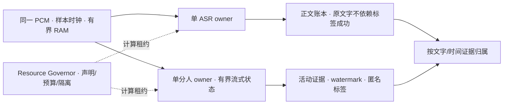

# 会议转录与分人：调研与设计

2026-10-18 用户批准方案并要求在同一 PR 持续实施。研究结论与历史证据保留各自时点；新增评分门和预登记规则用于后续实验，批准不代表模型、运行态或发布验收通过。进度见[实施记录](../../implementation/2026-10-18-meeting-diarization-handoff-audit.md)。

## 1. 推荐方案

推荐保留独立 ASR，先修复评测身份、评分与资源所有权，再对照 **Nemotron 3 Diarization 的 CoreML FP16 流式候选**。会议允许延后分人定稿，优先比较 `fast32` 与 `fast128`；只有独立开发、留出和安装态验收全部通过，才替换会议实验后端。资源解耦与声学改进分别验收，不用调度吞吐证明精度，也不通过降低门槛使候选合格。

这是基于 2026-10-18 一手资料和接手工作区的推荐，**不是已测出的模型排名**。本轮仅调研、读取既有开发集汇总和编写方案；没有执行模型、下载权重、读取留出音频或改变服务状态。

产品目标沿用 [Issue #370](https://github.com/hrygo/SpeechRail/issues/370)：会议正文准确优先，分人可延迟；支持主要讲话人及其他人的短插话，分人失败不丢正文，未经认证的人数不能宣称支持。第一阶段仍须独立证明 1–4 人；5–8 人是后续认证范围，不能由模型输出八个通道直接推出。

执行拆解见[实施计划](../plans/2026-10-18-meeting-asr-diarization-implementation-plan.md)。本方案修订此前解耦计划的证据解读和后续选型建议；不追溯改写历史运行结果，不自动把 ADR-0022 或新模型升级为生产验收通过。

## 2. 接手位置与证据范围

- OpenCode 会话：`ses_eb62ef783ffey0w5LgFSx9Vjd4`，标题「转录与分人优化」。
- 实际工作区：`feat/meeting-diarization-global-context`，接手 HEAD `0cd70930b921ed1a724458333aae48ff162291c2`，存在 19 个已改或新增文件；原始改动保留。
- 本地 `main` 已到 `66b2a1d6`；接手分支还落后其远端跟踪分支。实施前必须重新检查差异，不能直接覆盖、stash 后丢弃或盲目 rebase。
- 图谱 generation 为 `2026-10-17T22:35:42Z`，根是主 checkout。已对相关路径调用 `check_index_coverage`，但它不证明接手 worktree 的未提交内容最新；本方案的关键结论均另读该 worktree 源码。
- 既有 `development-eval-v2`、`development-eval-v2-sc`、`development-eval-v2-sc-postlane` 的 JSON 已只读复核：三者都是 `no-go`；后两份数值相同。未重新运行该评测，不把旧报告当作本轮实测。

> 🧠 **From Hindsight memory (Issue #370 Phase 1 开发集条件化修复与流式 slot 后处理)** — 历史页记录了 dev-v2 条件化、可选 slot 后处理和五点 activity threshold 筛选，四个人数层仍未通过。该页用于恢复工作背景；当前状态另以接手代码及仓库外开发集汇总复核。

> 🧠 **From Hindsight memory (会议准确性与实时字幕回溯修正落地)** — 会议优先准确性，沿用单 ASR worker 的有界窗口复核；动态人数须独立验收。该历史背景已对照会议/字幕运维文档与 Realtime 契约复核，不能将新的单遍分人约束扩展为禁止 ASR 窗口复核。

### 必须修正的结论

| 原结论或遗漏 | 本轮核实 | 设计影响 |
|---|---|---|
| 四个 fixture 的阈值网格穷尽了模型能力 | 只穷尽五个阈值在这四条派生样本上的组合；没有覆盖上下文、原始会议、参考标注风格和新模型 | 停止原四样本继续调参，但不能宣布普遍能力极限或单人必然分布外 |
| 2025 年基准证明旧版 Sortformer 目前最优 | 基准早于 Nemotron 3；基准的 SF v2-stream 与当前 v2.1、CoreML、参考和 collar 也不完全相同 | 旧报告只能说明当时、该口径的表现 |
| 解耦前后质量数字一致证明并发质量不变 | `probe_meeting_sortformer_1to4.py` 运行四槽 `CoreMLSortformerEngine`；ASR 从冻结 sidecar 读取。改 lane 的是 `meeting_dynamic`，其 Swift 实现为 `OfflineDiarizerManager` + session matcher | 这次复跑未执行被改的动态路径，也未运行并发 ASR，不能验收 AC-QUALITY-UNCHANGED 的联合运行语义 |
| 候选摘要不变说明候选不变 | `--slot-consolidate` 已改变输出，但未进入 `frozen_phase1_candidate_spec()`；带/不带后处理报告使用同一个摘要 | 修复身份链之前，所有此类结果仅用于诊断，不可解锁 holdout |
| `di_cp_*` 等同论文 DI-cpWER | 当前实现按参考时间最大重叠把假设句子重归属，无重叠时归给第一参考 speaker；官方算法使用文本组合优化 | 重命名为 temporal-oracle 诊断，独立接入正式指标；不能把历史 0.5–11.1pp 当成已验证的纯分人误差 |
| `skip_overlap=False` 覆盖所有产品门禁 | `diarization_quality.py` 的 DER/JER 包含 overlap，但 known 和逐人指标遇到多参考说话人直接跳过，返回 `known_denominator=nonoverlap_reference_seconds` | 保留可重现旧口径，并另行明确含 overlap 的产品门；不得用 DER 配置为其他指标背书 |
| T1–T7 均完成 | 现有 ADR 自己注明真实端到端 A/B 未执行；版本回滚、物理 footprint 声明也未完成 | 分开登记代码、机制测试、真实负载与运行验收 |
| RSS 是物理 footprint 下界，乘二即可声明 | RSS 和 footprint 记账口径不同，无通用固定倍数或大小关系 | 原 RSS 只保留观测，不将建议的 800 MiB 写入准入配置 |

关键源码入口：`examples/perf/probe_meeting_sortformer_1to4.py` 的 `frozen_phase1_candidate_spec`、`evaluate_locked_1to4_split`、`score_speaker_attributed_asr`；`examples/perf/diarization_quality.py`；`native/diarization/Sources/SpeechRailDiarizationWorker/{main,MeetingDiarizationWorker}.swift`。

## 3. 一手调研及选型依据

以下资料于 2026-10-18 核验。厂商/维护者结果均不是 SpeechRail 本机实测；不同参考、数据或 collar 的 DER 不做横向排名。

| 来源 | 可采纳事实及限制 |
|---|---|
| [NVIDIA Nemotron 3 模型卡](https://huggingface.co/nvidia/Nemotron-3-Diarization) | 发布于 2026-09-23，支持最多 8 位说话人、流式缓存和离线配置。同卡 AliMeeting near、30.4 秒配置下，旧 v2.1 为 DER 11.57，新模型为 6.40。它使新模型值得实测，不证明能通过本项目逐人门禁。 |
| [FluidAudio CoreML 制品卡](https://huggingface.co/FluidInference/nemotron-3-diarization-coreml) | 有 FP16 转换和本地加载方式。模型文件大小不能当内存峰值；转换方 AMI 结果不能替代中文会议验收。 |
| [FluidAudio Nemotron3 文档](https://github.com/FluidInference/FluidAudio/blob/v0.17.7/Documentation/Diarization/Nemotron3.md)及 [preset 源码](https://github.com/FluidInference/FluidAudio/blob/v0.17.7/Sources/FluidAudio/Diarizer/Nemotron3/Nemotron3Types.swift) | `fast32`、`fast128` 分别缓冲 2.88、10.56 秒；这是输入缓冲时间，另有计算和排队。使用匹配的静态形状；通过 `appendAudio/processBufferedAudio/finishStream` 流式处理，不能为了批量便利保存整场 PCM。 |
| [FluidAudio benchmark](https://huggingface.co/FluidInference/nemotron-3-diarization-coreml/blob/main/BENCHMARKS.md) | 维护者在 16 场 AMI、M5 Pro 上比较了 preset。结果支持预先选择长短上下文两候选；不能把其 RTFx 直接换算成本机 ASR 共存时延。 |
| [Benchmarking Diarization Models](https://arxiv.org/html/2509.26177v1) | 2025 年研究采用 collar=0.25、包含 overlap，报告了单人数据结果；不足以证明单人场景必然分布外，也不是唯一行业评分规则。 |
| [Can We Really Repurpose Multi-Speaker ASR Corpus for Speaker Diarization?](https://arxiv.org/html/2507.09226v2) | 句级 ASR 标注可能把停顿算成语音，边界风格会影响 DER。必须记录参考来源和标签规则；不能用候选 ASR 生成的对齐充当独立人工真值。 |
| [MeetEval](https://github.com/fgnt/meeteval)、[DI-cpWER 论文](https://arxiv.org/abs/2508.02112)、[官方实现](https://github.com/fgnt/meeteval/blob/main/meeteval/wer/wer/di_cp.py) | 区分 speaker-attributed、speaker-agnostic 与时间约束指标；明确精确/greedy 算法和 token 化。SpeechRail 当前 temporal oracle 不能使用同名标准指标作结论。 |
| [pyannote.metrics 4.1](https://pypi.org/project/pyannote-metrics/4.1/)、[MeetEval 0.4.3](https://pypi.org/project/meeteval/0.4.3/) | 均有正式发行制品；本方案锁定用于比对。版本元数据允许的 Python 范围不证明所有编译依赖能在 Python 3.14 运行，实施时须先验证实际安装、导入和最小评分。 |
| [Apple 内存诊断](https://developer.apple.com/videos/play/wwdc2021/10180/)、[Apple Silicon Metal 内存](https://developer.apple.com/videos/play/wwdc2022/10106/) | footprint 涉及 dirty/compressed 与图形资源记账，应测量实际 worker 的 footprint 和进程树；RSS 不可固定倍数替代。 |
| [AliMeeting 官方资料](https://www.openslr.org/119/) | 区分 near/far、原始通道、官方划分及许可；原轨混音、RMS 归一化和抽取窗口均属于派生条件，必须与原始会议分开报告。 |
| [Qwen3-ASR 官方仓库](https://github.com/QwenLM/Qwen3-ASR) | 官方提供 1.7B、0.6B、context 和独立 ForcedAligner；其 Python 工具的 streaming 文档限定 vLLM，且不直接返回时间戳。这不能证明本项目 MLX streaming/时间戳语义相同；ASR 优化先复核实际 adapter 和切块链。 |
| [Qwen-Audio-3.0-ASR 报告](https://arxiv.org/abs/2609.07549v2) | 2026 年 9 月报告了另一套 MoE ASR 与 streaming 系统。本轮没有核验其可用于本机的完整权重、许可和 MLX 适配，不能只凭更新论文把它列为可实施替换项。 |

### 可复核版本

- 现有 FluidAudio：`5c19d5e12320e22bbfb7a1877b089d2665a69add`，接手 `Package.resolved` 所载。
- 候选 SDK 起点：正式 tag `v0.17.7`，解析为 `503b4bd1bbf7220882de39fe8ae6716aae4132da`；本轮读取该 tag，确认上述 streaming 和 preset API 存在。仅候选原生评测包先固定此版本；不升级主服务依赖。
- CoreML 候选仓库：`FluidInference/nemotron-3-diarization-coreml`，metadata revision `25a90f97f254428d4b30374b76af9c74fdee8327`，当日 ungated。
- NVIDIA 原模型 metadata revision：`f667ed73aee57d40cc39428eb768b4fd87a0a29e`，当日 ungated。
- scorer 起点：`pyannote.metrics==4.1`、`meeteval==0.4.3`；后者 sdist SHA-256 为 `02d3a359f375d39c67dfb8fe1c061e7dac19d6fc1fb89ee72d793a5813dafeb2`。pyannote 4.2.0 已于 10 月 16 日发布，本方案不自动变更评分基线；若兼容性或已证实评分缺陷要求换版，须在候选输出前更新 policy/lock 并交叉验证。
- 本轮只读取元数据和源码，未下载权重，未核验本机制品完整性。下载时仍须检查 ModelScope 是否具备相同官方完整制品；不满足才使用锁定的官方/Hugging Face 来源。不能只锁 repo revision 而漏掉 bundle 内文件、辅助参数及许可证。

## 4. 方案比较

| 路线 | 收益 | 主要成本和限制 | 选择 |
|---|---|---|---|
| 仅完善独立 lane | 修复资源串行和故障串扰 | 不改变声学输出；不能关闭 #370 | 必要基础，独立交付 |
| 继续旧四样本 threshold/ghost 调参 | 改动少 | 泛化证据不足，短插话误删/误并风险，无法覆盖 5–8 人 | 停止扩展；旧结果保留为诊断 |
| 独立 ASR + Nemotron 3 CoreML FP16 | 沿用本机原生运行边界，原生八槽和跨块状态，切合会议延迟弹性 | 需新 worker adapter、认证、能力与契约更新 | 推荐主线，先独立开发对照 |
| 新接任意人数聚类/CAM++ | 可能覆盖更高人数 | 引入不同 embedding/聚类/身份匹配链；既有实验未过门，成本更高 | 本方案不扩展 |
| 联合 ASR/分离/分人训练 | 可能减少级联归属损失 | 改变现有中文 ASR、部署与训练体系；收益不能由论文直接迁移 | 研究备选，不进入本次实现 |

候选集合在任何新输出前冻结：C0＝旧四槽 FP16、`activity_threshold=0.25`、使用原 `>=` 判定、关闭 consolidation；C1＝Nemotron 3 `fast32` FP16；C2＝`fast128` FP16。旧 `meeting_dynamic` 报告是另一条历史基线，不能混为 C0。C1/C2 直接使用 10ms 帧概率，以 `score > 0.5` 判定活动，不做最短段删除、间隙桥接或 ghost 合并；帧尾裁到实际已接受样本。阈值及比较符均进入摘要，不搜索 threshold 或 VAD 开关。

锁定 SDK 的 [`segments()` 实现](https://github.com/FluidInference/FluidAudio/blob/503b4bd1bbf7220882de39fe8ae6716aae4132da/Sources/FluidAudio/Diarizer/Nemotron3/Nemotron3Diarizer.swift) 默认 `minDurationSeconds=0.2`，会丢弃更短片段。候选不得隐式继承该默认值；如复用该函数，显式设为 0，并验证跨 chunk 的连续活动与短插话均保留。它不是整场 PCM 或概率历史的收集入口。

C0 的认证比较仅限 1–4 人；5–8 人对它是能力范围外诊断，不能要求四槽模型输出八人，也不能把其越界失败当成新候选提升的有效对照。

会议场景先评 C1/C2，准确性优先；同等质量证据时选择定稿更快者。实时字幕约 1 秒延迟需求是独立场景，若以后验证 `low/fast`，另建候选与延迟门，不让会议长上下文变为字幕默认。

## 5. 系统边界

### 5.1 正文与标签

ASR 接收相同来源 PCM，不用分人结果裁掉 ASR 输入，也不按 speaker 重新生成正文。分人只提供活动/匿名身份，缺证据时保留正文并返回已有未知原因；未知不归给 S1。词时间证据不足时保留粗粒度归属，不插值伪造精度。

模型 session 内仅在有界 RAM 保持所需缓存、PCM 和到达序 slot；worker 会话结束即释放，不持久化 embedding、PCM 或跨会话身份。只运行一次流式分人推理，不在会议结束后依赖落盘录音做第二遍；此限制不取消 ASR 自身已定义的有界窗口复核。输入到达后不能切模型/preset，finish 尾帧严格裁到已接受样本；重复 finish/cancel 有界且幂等。

### 5.2 生命周期租约与计算租约

计算 lane 串行不等于权重仅有一个 owner。模型会在 chunk 间隙驻留，因此在启动 worker **之前**取得服务级分人会话所有权，持有到精确 child 回收确认。第二个会话在加载模型前返回现有 `backend_busy` 语义；失败不得启动第二份相同权重。

每次实际 load/infer/finalize 使用 `WorkClass.DIARIZATION` 计算预留，期间可按预算与 ASR/TTS 交叠。独占会话门须另有明确 owner；`WorkerLeaseLock` 的 active lease 计数用于防驱逐，不能误认为其 `lease()` 已限制为一个会话。

旧四槽和会议候选也共用这一个分人所有权门，切换前必须确认上一 worker 退出。这样当前 footprint 的 `max(streaming,dynamic)` 才可能成立；若未来允许两者共驻留，则必须改为求和，不能继续取 max。

### 5.3 故障、队列和预算

- 增加分人独立 quarantine。重叠获准且失联 worker 的资源仍有可信上界、持续计入预算时，ASR 清理失败不自动隔离分人，分人清理失败不自动隔离 ASR；未获准重叠或资源上界不再可信时，全体 fail-closed。
- `_close()` 与 infer 异常回收路径均使用分人 quarantine；唤醒已排队 waiter，使其立即收到隔离错误。未确认回收时保留 owner/引用及失联计算的预算占用，不因 Python 协程退出宣布已释放。隔离占用不作为仍在运行的正常任务无限占满通用队列，但也不能被计为空闲算力；明确回收后方可释放，未确认时由操作者恢复服务。
- 在同类 FIFO 中只允许越过**被其自身模型 lane 占用/隔离阻挡**的前项；同一模型 lane 不插队。测试防止第二个分人等待者挡住独立 batch ASR/TTS，并保留 realtime 预留和 aging。
- `lane_available()` 与实际准入使用同一组预算、隔离和活动 lane 规则；诊断不预留资源，但不能报告明确不可能立即准入的工作为可用。
- 先测真实 footprint，再按现有完整 `ComponentFootprint` 记入驻留、活动峰值、workspace 和余量，避免重计。内存预算只证明可容纳，不证明 ANE/Metal 并发有收益。
- `auto` 缺失声明时禁止重叠；还须检查 `_serial_budget_policy` 是否连单任务也拒绝。不能把“无声明”一概写成仍可串行运行。强制 `true` 不是生产认证，也不能绕过单任务预算拒绝。

### 5.4 生产接线与公共影响

候选实验用隔离的 native probe，保留主服务依赖/默认配置。选型后以新 ADR 修订 ADR-0012 的固定 bundle 和 SDK 决定，在默认关闭状态接入会议后端 `meeting_dynamic` 并构建生产候选；通过认证后才安装启用。保留现有后端键，不新增兼容 alias。旧策略文件不伪装为新模型认证文件，摘要不匹配时明确拒绝并保留原配置以便回滚。

`system_cap` 按实际模型变为 8；`max_speakers` 只来自对应人数、参考与策略的认证，未认证为 null。必须同步 `contracts/realtime-openai.md`、`contracts/realtime-events.schema.json`、`contracts/openapi.yaml` 的相关能力描述、Python 与 Swift 消费者和用户文档。八槽不变成 32 人认证。既有四槽 `sortformer` 的命名/行为不在候选评测阶段修改。

固定八槽输出不能可靠自动发现会话中出现了第九位不同说话人。已知参考/调用约束超过认证范围时，评测标为范围外；输入提供了超范围的显式请求约束时按契约拒绝。真实未知人数音频可能产生标签混淆，不能承诺自动返回 `speaker_capacity` 或准确识别溢出人数。只有实际证据支持时才输出未知原因，禁止借真值注入运行时。

### 5.5 会议标签延迟预算

建议产品预算为：实时速率输入下，**稳定标签延迟 P95≤15 秒、单次≤30 秒；输入结束后的剩余归属定稿 P95≤5 秒、单次≤15 秒**。这是本方案提出的体验边界，尚非既有承诺或本机实测值；批准后写入 scorer-policy，再开始 C1/C2 输出。它允许比较 10.56 秒输入缓冲的 fast128，也给计算与排队留下有限空间。预算不适用于字幕场景。

冻结前先核对实际 ASR 的窗口/封存周期能否满足该联合延迟预算；ASR 水位迟到与分人活动水位迟到分开记录。若现有 ASR 策略自身已使预算不可达，先明确所需 ASR 策略调整或提出可审阅的产品预算修订，再开始候选输出；不能事后把 ASR 等待全部归因于分人模型或放宽门槛。

标签延迟从待标注区间末样本的输入时钟，计到活动证据及 ASR 时间证据均越过该区间、标签可稳定发布的时刻；必须包含缓冲、排队、推理和归属处理。实时验收按 1× 供给 PCM，离线尽快重放只能测吞吐，不能当标签延迟。采样单位和权重在 policy 冻结，P95 至少逐会议报告，并检查最慢会议；未输出或超时区间计为失败，不能仅对成功发布部分计算 P95。临时标签可在现有更新机制中先展示，稳定 watermark 之前不能宣称定稿，之后不能无界回改。

ASR 正文不等待标签。超过单次时限时停止该分人会话、精确回收 worker，并将未完成归属保留为未知及明确原因；保留全部正文。若两候选都超预算，会议候选为 no-go，不把延迟上限事后放宽。最终 finish 仍不做第二遍整场推理。

## 6. 可信评测设计

### 6.1 候选与执行身份

候选摘要必须包含：backend 实现及 adapter 源码摘要、SDK revision、worker 摘要、模型 snapshot/文件摘要、精度、完整 preset 静态形状、compute units、activity/segment 参数、consolidation 开关及全部参数、归属算法和版本。另锁 manifest、参考标签规则、scorer 版本/参数、ASR sidecar 来源及 token 化。引用关系保持单向：candidate 不包含执行结果或收据摘要，manifest 不反向包含收据；收据绑定 candidate/policy、最终 development manifest、预定 holdout manifest 和运行模式各自的摘要，避免循环摘要或误要求开发集与留出集摘要相同。

旧收据不覆写。新 `schema_version=2` 收据绑定这些字段；旧 schema 和缺有效配置的收据不能解锁新实验。运行前比对实际 worker/model/preset；自报 CLI 参数不是执行证明。development 通过后仅同一个候选与评分策略可以进入锁定留出，一次性消费凭据防重复运行；attempt 必须原子认领并在任何留出推理前落盘，第二个执行者不能重复消费。运行失败和基础设施重试规则须在解锁前定义并保留尝试记录。

原生实验包用于选型；留出前须完成生产候选接线与构建，保持默认关闭，不安装或启停服务。若这改变 worker/adapter 摘要，须让冻结后的生产候选重新通过同一开发集及真实共存回归，重新签发对应收据。**独立留出、wheel 和安装态使用相同的生产 worker/adapter/model/decoder 字节与配置**；需签名时在制品冻结前完成对应获准步骤。留出后重新编译、重签或改变行为的修改不能沿用旧认证。

### 6.2 语料与统计单位

原四条 dev-v2 保留为诊断回归，不作为泛化认证集。主对照采用自然、未按模型输出筛选的完整会议/连续长片段；near/far 分开；RMS 重混音、单轨提取和短片段另列派生组。单人层补自然单人会议/讲话，不能仅由多人会议抽一轨代表单人产品场景。

划分按原始会议及可确认的全局人员分组，同一录音的不同通道、窗口、派生版本不跨集合。缺全局身份时，只能声称 meeting-disjoint，不能声称 speaker-disjoint。公开模型训练集被用于本项目 development 时须明确“不是模型未见数据”。Eval_Ali、AISHELL-4 test 中封存项和 R004 不参与开发或人工挑选。

建议首批 development 至少 24 个独立来源组覆盖 1/2/3/4 人各 6 组；后续 5/6/7/8 人每层至少 2 组作为可行性筛查。**这些是筛查规模建议，不是统计功效或生产充分性保证**；人数缺失、置信区间未支持门槛、或场景未覆盖时保持未认证。扩样和停止规则见 §6.5，不能因看见结果只加容易通过的样本。

固定 PCM/参考/token 化，逐会议配对；近远场、短插话、长静音、重叠、相似声线、离席返回分别报告。重复运行在会议内汇总，bootstrap 以来源会议组为单位，固定 seed=1717、10,000 次重采样、双侧 percentile 95% 区间（2.5%/97.5%）；配对差值使用相同重采样组，不能相减两份独立区间。同一会议多段不能增加独立样本数。原始开发集和认证集不能混合后只报一个均值。

### 6.3 评分与启用门

1. **ASR**：正文规范化 CER、英文 WER、插删替，以及人工指定的数字/金额/日期/否定词/专名。主 CER 的参考序列、标点/数字规范化和多说话人重叠处理在 policy 冻结；没有无歧义主参考时标记 `not_observed`，不能证明 10% 目标。重叠另报明确命名的 ORC char/word 指标；带标签另报 cpCER/cpWER、tcpCER/tcpWER，不用任意串接顺序制造得分。
2. **分人**：主 DER/JER collar=0、包含 overlap；分列 miss/false alarm/confusion。附 collar=0.25 且包含 overlap 的研究对照；既有 skip-overlap 结果单独保留，不能与前者混用。
3. **归属**：旧 known 三门作为冻结基线继续复算，明确 nonoverlap 分母。新增全区间 speaker-time recall/precision 与逐人 recall：先按整场一次映射，`C=∫|R∩H|dt`，`Dref=∫|R|dt`，`Dhyp=∫|H|dt`，recall=C/Dref、precision=C/Dhyp；额外/未映射 known 标签计入 Dhyp，unknown 不参与身份映射、不贡献正确项，参考发言仍留在 Dref。空分母为 null，不能视为 1。
4. **短插话**：0–0.32 秒、0.32–2 秒、≥2 秒分组，保留在总体分母。不能用 `min_turn` 直接删除前两组，也不能仅按短、低占比、不共现把另一位说话人并入主讲。
5. **独立 scorer**：以 `pyannote.metrics==4.1` 交叉校验时间指标；正式 DI-cpWER 使用 `meeteval==0.4.3` 的已锁定实现，标明 greedy。中文 char 指标明确声明 char-token 版本并用同一引擎，不沿用未证等价的 temporal oracle 名称。标准 cp/tcp/DI-cp 保留全部假设文字并遵循官方 stream/assignment 语义，不私自加入 unknown 惩罚仍冒用标准名称；另报 unknown 文本比例及产品归属门，标准得分不能为 unknown 归属背书。八人匹配不能把四人 factorial 枚举直接扩到 8! 并重复完整编辑距离；优先复用官方 assignment 实现。

现行 #370 数值门（90%/95%/95%/其他人80%）继续保留，不因公开 DER 更低而废弃。**含 overlap 的 recall/precision 与旧 known 不是同义指标**：本方案明确建议增加下节的必过门，数值代表新产品目标，不能据此重命名旧指标或沿用旧收据。批准方案后以 ADR 和新 policy 固定，未批准前只做诊断。

ASR 的相对 CER 改善 ≥10%、95% 配对区间支持收益仍是 #370 的独立关闭条件。分人新模型成功不等于 ASR 优化成功；ASR 在单变量分人对照中只要求正文保持，不自动声称达成 10% 目标。

### 6.4 建议冻结的产品评分策略

建议以下各项均为必过门；DER/JER、DI-cpWER 用于解释和合格候选排序，不能抵消产品门失败。

| 门 | 建议阈值和判定范围 |
|---|---|
| 既有 nonoverlap 产品门 | 继续按已冻结旧定义检查 90%/95%/95%/其他人 80%，不降低阈值 |
| 全区间 speaker-time recall | 每个人数层的 pooled 比率及会议组等权宏平均均 ≥90% |
| 全区间 speaker-time precision | 每个人数层的 pooled 比率及会议组等权宏平均均 ≥95% |
| 逐主讲 recall | 每场按参考发言总时长排名前四位（不足四位取全部）逐人 ≥95%；包含 overlap |
| 其他人 recall | 其余参考说话人总发言 ≥2 秒者，逐人 ≥80%；不足 2 秒者保留总体分母并单列，不按主讲人数过滤 |
| ≤4 人不退化 | 与同 PCM/scorer 的 C0 配对；主 DER、cpCER 的候选减基线点差均 ≤0，95% 配对区间上界亦 ≤0；没有证据排除退化时保持未通过，不事后增加容忍值 |
| 标签延迟 | 满足 §5.5 的 P95 和单次时限 |
| 完整性 | 无 PCM 丢弃、无缺场、无缺失声明人数层、无缺失必需参考；null 不视为通过 |

整场 speaker 映射只按时间交集做一次最优一一匹配，多余标签不映射为正确项。逐人门检查全部已观察个人，不能以平均掩盖某人失败。总体 recall/precision 的 pooled 与宏平均均给来源会议组 bootstrap 区间，**独立留出认证要求其 95% 下界也达到各自门槛**；逐人门使用完整观察集的逐人点值，不伪造单个说话人的独立样本置信区间。新旧门并行保留到一次性认证结束，任一失败均不能签发 go。

人数上限只认证连续已覆盖范围：如 1–4 人通过而 5 人缺失，仅可声明 4；不跳过 5 人声称已认证 6–8。near/far 仅对实际覆盖且过门的场景声明。以上是明确建议，批准前不得静默写入生产策略。

### 6.5 事前扩样与停止规则

1. 在 C1/C2 第一次输出前，登记合法 development 与独立留出来源池、场景分层、seed=1717 的固定组顺序和不可用样本的客观排除理由。无足够来源池时先补数据，不看输出后找有利样本。
2. development 每个人数层先取 6 个独立来源组。候选在该层任一必过点值失败即记 no-go，不复活；点值全部通过但总体下界未达门槛、或 C0 不退化的区间上界未达 0 时，定义为“证据不足”。该层任一在评候选需扩样时，所有未淘汰候选及 C0 对照都按相同固定前缀追加 6 组；只在 6/12/18/24 组处检查，最多 24 组/层。候选不能分别取不同样本数作配对排序，C0 即使未过绝对门仍作为对照运行。到上限仍不足则停止。development 多次查看只用于筛查，不用于对外显著性声明。
3. 合格候选的主排序量为人数层、场景等权的会议宏平均 DER（collar=0，含 overlap），以来源会议组配对 bootstrap。不能把差异区间跨 0 当作质量等价。建议仅在较快者相对 DER 点值最优者的退化差值 95% 上界≤1 个百分点时，允许按稳定标签 P95、更低峰值 footprint 依次择优；1 个百分点是待批准的选型非劣界，不放宽相对 C0 的不退化门。不满足则选 DER 点值更低者并标注排序不确定；DER 点值完全相同按 cpCER、标签 P95、footprint 顺序择优。不为排名追加数据或新增参数候选。
4. 唯一候选冻结后，独立留出每个人数层的组数固定为 `max(12, 2 × 该层最终 development 共同组数)`，最大 48；使用从未查看候选结果的组。同一次 attempt 内运行唯一候选及预先锁定的 C0（仅 1–4 人）/A0 对照，才能作配对不退化和 ASR 改善判定；C0 保留旧 SDK/制品，不能随新生产 worker 一起升级。该保守规模仍不保证统计功效。留出只作一次完整判定，不能边看边扩样；任一点值或总体下界未过、人数缺失均为 no-go/证据不足。
5. Phase 1 因而至少需要 24 个开发组和 48 个独立留出组，最多 96+192 组；标注和语料成本须独立估算。5–8 人每层 2 组只筛查可行性，正式认证仍走同一 6→24 开发和固定留出规则，不把 2 组当生产证据。
6. 留出失败后只允许新研究轮次：重新登记方案及新的未见留出池。预先列明的文件损坏/执行环境故障可按原候选重试；声学错误、预算超限、排队超时和质量失败均不属于免消费重试理由。

### 6.6 ASR 改善的独立工作线

现有 Phase 1 计划记录的 ASR 来源是 Qwen3-ASR-1.7B 8bit 及独立 ForcedAligner；这只能说明旧 sidecar 的来源，不能证明安装态仍使用相同参数。实施时先冻结实际 ASR 的模型/量化、adapter、切块、VAD、语言/context、decode 上限、时间戳和文本规范化，建立真实重放基线 A0。

先按错例把正文损失分成采集/切块漏音、截断或重复、声学替换、文本规范化与时间戳归属五类。用同一开发 PCM 对照生产流式 A0 与相同权重的有界长块诊断重放；后者只用于定位上下文/切块损失，不用参考边界或参考文本形成生产输入。ForcedAligner 修正只能改善时间证据，不能算正文 CER 改善。

在输出新候选前最多登记一项已定位的管线修复和一项同模型高精度对照；高精度仅在当前 MLX adapter、完整制品与预算均已核实后进入，不凭官方 CUDA/vLLM 示例假定本机支持。没有量化误差证据时不优先下载更大制品；没有系统误差证据时不先微调或引入联合 ASR/分离链。改变量逐项验证，context 不能含评测答案，LLM 改写不能替代原始转录评分。

主 CER 及其相对改善采用来源组等权口径：同一冻结 case 重复先平均错误数，同源片段再合并错误数与参考字符数，每个独立来源组只贡献一个 CER。配对区间对相同来源组 CER 差值重采样，和点值使用同一估计量；全体 pooled CER 另报，不用不同估计量的区间为主点值背书。定义进入 scorer 身份，并在真实 A0/候选输出前冻结。

ASR 唯一候选须达到相对 CER 点改善 ≥10%、95% 配对区间支持正收益，并单独人工核验关键事实。它和分人胜出候选组合后重新冻结联合身份，再进入一次性留出；分人开发用的固定 ASR sidecar 不证明这条工作线通过。ASR 无合格候选时允许独立交付资源修复或已认证分人，但 #370 继续保持未完成。

## 7. 分阶段准入与停止规则

| 阶段 | 放行条件 | 不满足时 |
|---|---|---|
| E0 证据修复 | 配置与候选摘要一致；标准指标与 oracle 分开；旧收据不解锁新实验 | 停止任何认证，保留探索结果 |
| E1 生命周期 | 单权重 owner、两个回收失败入口、隔离唤醒、队列、finish/cancel 确定性回归通过 | 不启用并发、不接真实会话 |
| E2 声学开发对照 | C0/C1/C2 在同一锁定开发集完成；所有声明层达到 §6.4/6.5 已批准规则 | 无 winner，保持 no-go；不扩大网格追门 |
| E3 共存 | 真实 ASR/分人各自单独运行，加同 PCM 双路 serial/overlap ABBA，测 queue/compute/尾音到定稿 P50/P95、质量和 footprint | 并发未过门则保留串行；选定运行策略仍须满足绝对质量/延迟门 |
| E4 认证 | 选定候选/运行策略后完成生产候选构建；字节变化时复验 E2/E3，再冻结唯一联合身份和 scorer，独立留出一次性验收 | 保留 no-go；留出一旦用于诊断不能继续作为未见认证集 |
| E5 发布 | 相同摘要进入 wheel，安装态 API、能力及回滚验证通过，联合长稳满足既有门 | 保留旧 managed release 和配置，不默认启用候选 |

E3 的 A=双路串行、B=双路重叠；另测 ASR-only、diarization-only，不能从 serial/overlap 两组推算不存在的单独基线。每个拟声明的冷/热条件至少 8 个 ABBA block，block 内固定模型、PCM、分包与负载；同来源重复先在组内汇总，不能充当独立会议。调度改造用相同模型比较，不能同时换模型再把收益归因于 lane。P95 建议要求 ASR 不劣于串行基线 5%、分人不劣于单独运行 10%，同时满足 §5.5 的绝对延迟门。并发收益的预定主量为尾音到双路均定稿的延迟，串行减并发的配对区间下界须 >0；排队延迟仅作解释，不能看结果后更换收益指标。相对容忍不能替代用户体验目标。质量不变须有当次真实 ASR 运行而非旧 sidecar；如低层数值非确定，按事前锁定误差带报告，不承诺逐位一致。

8 个 block 指每个冷/热条件的总量，预先均衡分配到至少 8 个独立开发来源组；不是每场再乘 8。若各次使用 5 分钟 1× 片段，两个冷/热条件共 64 次运行仅供给 PCM 就需约 5 小时 20 分钟，另加单路对照、加载、收尾和重复生产候选验证；预算须在执行前明确，不能计入“几分钟 smoke”。完整会议质量认证和长稳验收仍单列。

并发无净收益但串行能过绝对门时，以串行策略进入 E4，收据明确绑定该策略，不把 E3 写成“并发通过”。串行也不能满足门时停止认证。若 T8 改变最终 ASR 模型或策略，必须重跑 E3 并重新冻结联合身份，不能复用旧 ASR 的共存结果。

真实 footprint 至少覆盖冷启动、稳态、长静音后恢复、重叠与 finish/cancel；识别确切 PID/后代，不使用模糊进程匹配。既有 0.704→0.352 秒仅保留为 sleep 固定负载的机制证据。新模型共存要另测，不把内存足够等同于 ANE/Metal 不争用。

## 8. 工作量与回退

以下为工程估计，不是已发生工时：证据/生命周期修复约 2–3 人日；独立候选 probe 与开发集准备约 3–5 人日；通过后契约、主服务接线、安装验收约 2–4 人日。分人主线总计约 7–12 人日，另计人工标注、语料准备、真实模型运行和授权窗口。ASR 误差归因工具另估 1–2 人日，实际修复/新模型适配须以错例结果另估，不能包含在 7–12 人日中承诺。编译/转换不匹配、样本不足或质量失败会改变估计；不承诺修补若干阈值即可通过。

E0/E1 可独立交付，不需要先换模型。E2 失败不实施 E5；E3 无净收益则使用串行策略，保留声学候选评价。后续版本回退按 release skill 使用上一 managed wheel 和原私有配置；不回滚用户记录、不覆盖 SQLite、不删除模型/语料。默认配置不因安装模型而开启新能力。

本方案未授权下载、加载、启停、安装、外部发布或 UI 自动化。这些执行条件在实施任务中分别列出；研发文档不代替当前用户授权。

## 9. 方案审查记录

2026-10-18 由主代理独立审查并校对本设计及实施计划，未使用子代理。对照锁定 SDK 源码、当前公共契约、接手源码和 #370，修正了八槽模型的溢出检测假设、默认短段过滤、扩样对照不一致、区间跨 0 被当作等价、生产制品摘要闭环、隔离后的资源占用，以及单路/串行/并发基线与验收顺序。审查后用户批准上述非劣界和细化判据，作为后续实验的预登记策略；不代表既有实测或认证。
